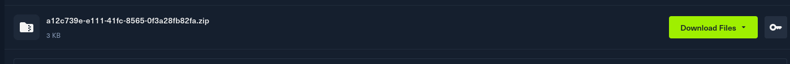
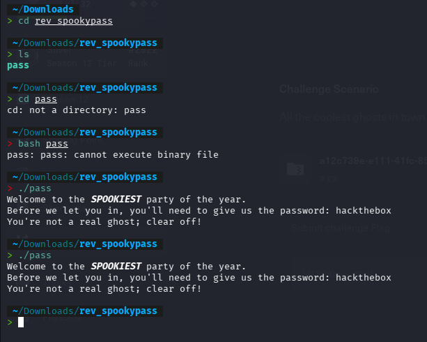
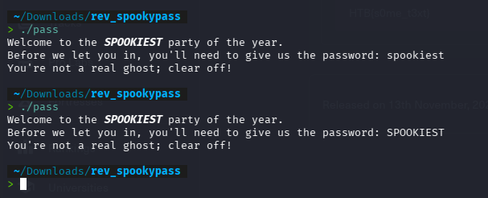
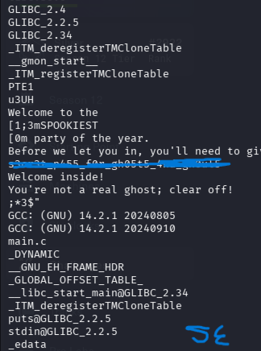
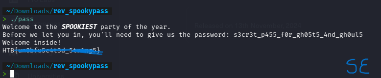

# HTB Challenge: SpookyPass

| | |
|---|---|
| **Platform** | Hack The Box |
| **Category** | Reversing |
| **Difficulty** | Very Easy |

## Scenario

> All the coolest ghosts in town are going to a Haunted Houseparty - can you prove you deserve to get in?

## Summary

SpookyPass is a small ELF binary that asks for a password. The expected password is stored in plaintext inside the binary, so running `strings` on it exposes the answer without any real reverse engineering.

## Tools Used

- `unzip`
- `ls`
- `strings`

## Walkthrough

### 1. Download and extract the challenge files

The challenge provides a downloadable archive. Its password is the key icon next to **Download Files** on the challenge page, which copies it to your clipboard.



After downloading, I opened a terminal in the download folder and extracted the archive with `unzip`, entering the password when prompted.

```bash
unzip <archive_name>.zip
```



This creates a new directory named `rev_spookypass`.

### 2. Look at what we were given

```bash
cd rev_spookypass
ls
```

The only file is `pass`, highlighted as an executable.

### 3. Run the program

Running it with `bash` throws an error, since it's a compiled binary and not a shell script. Executing it directly works:

```bash
./pass
```

The program prints a welcome message and asks for a password.

I first tried the password I used to unzip the archive. That didn't work. I also wondered whether the oddly formatted word "SPOOKIEST" in the welcome message was the answer, but it wasn't.



### 4. Check the binary with `strings`

This is a reversing challenge, and I don't know much about reversing yet. One basic technique I did know was running `strings` against the binary to print any readable text embedded in it.

```bash
strings pass
```



Right beneath the same "password" prompt text in the output was a string that looked like the password itself.

### 5. Enter the password

```bash
./pass
```

Entering the string from the `strings` output was accepted, and the program returned the flag.



**Flag:** `HTB{...}` (redacted per HTB rules)

## Takeaways

- Hardcoded plaintext secrets in a binary can be pulled out with `strings` alone, so it's always a worthwhile first step on easy reversing challenges.
- Trying the obvious things first (the unzip password, the highlighted word) cost little but ruled out dead ends quickly.
- A quick read of the binary with a disassembler or decompiler would be the next step for harder challenges where the password isn't sitting in plain text.
