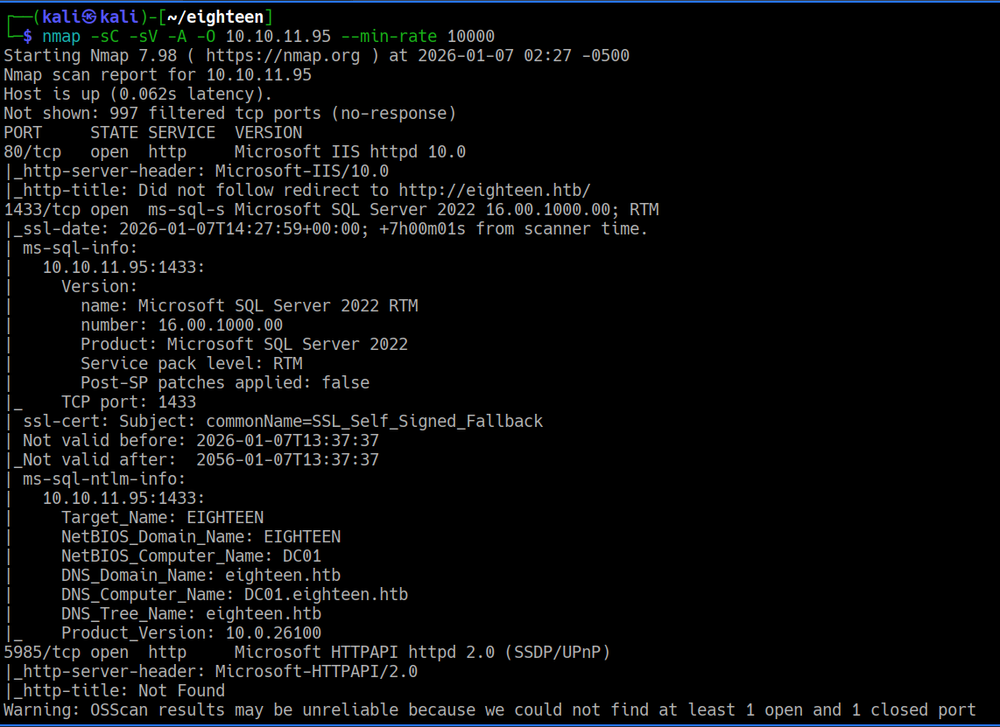

# Eighteen

Eighteen is a Easy difficulty Windows machine.

Machine information: As is common in real life Windows penetration tests, you will start the Eighteen box with credentials for the following account: kevin / iNa2we6haRj2gaw!

Starting off with nmap scan:

In the results, we see:

Port 80/tcp, which is http, and Microsoft IIS httpd 10.0. This redirects to “eighteen.htb”

Port 1433/tcp. Which is ‘ms-sql-s’ and Microsoft SQL Server 2022. Showing the domain is ‘eighteen.htb’ and the Host is ‘DC01.eighteen.htb’

Port 5985/tcp. http. Microsoft HTTPAPI httpd 2.0 ( SSDP/UPnP )

Adding to my /etc/hosts

Using ‘mssqlclient’ to connect to MSSQL with the credentials that were given to us.

From here, we use SQL commands to enumerate the admin’s hash.

We first ‘enum_impersonate’, which reveals ‘appdev’.

From here, we ‘USE financial planner’, and get the ‘password_hash’

So, we now know the admin hash is:

pbkdf2:sha256:600000$AMtzteQIG7yAbZIa$0673ad90a0b4afb19d662336f0fce3a9edd0b7b19193717be28ce4d66c887133

Using a python script to crack the hash, we get the plaintext of the hash.

Next, we enumerate the users found on the Domain, using “RID Brute Force”.

Here, we see more users:

We can make a text file, and put all the users inside the file, and then run a “password spray attack” against the file of usernames, using the password we got from cracking the hash.

What this means, is that we will attempt to use that specific password, against all the usernames in the file.

We then run the attack. and get a match with adam.scott

We can now remotely login as [adam.scot](http://adam.scot) using evil-winrm. 

Now, we are logged into a Windows machine, as adam.scott, and are in the Documents directory.

We check what’s inside the Documents directory:

We go up on directory, into essentially the home directory:

We go to the Desktop directory, and find the user flag.

We now enumerate internally:

