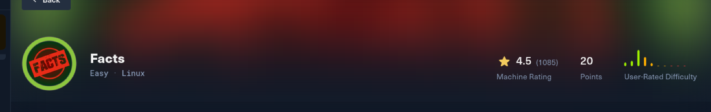

# Facts

Easy, Linux.

First, ping to make sure the VPN connection is up. ping 10.xxx.xxx.xx

**ENUMERATION**

Now, nmap scan, with defailt scripts and services flags. sudo nmap -sC -sV -A -T4 10.129.244.xx

Here, I can see that port 22 and 80 are up. This is SSH and HTTP. SSH is ‘secure shell’, and can be used to login to the server from the terminal.

HTTP is HyperText Transfer Protocol, and is used on port 80 for web apps/web sites.

In the nmap results, you see that port 80 is running nginx 1.26.3.

Port 80 is hosting a web app named facts.

**ASSIGNING HOST AND DOMAIN**

Because the nmap showed ‘facts.htb’, when scanning the IP address, i’m going to add that domain to my /etc/hosts file. Doing this, will allow me to now use ‘facts.htb’ when using tools, and inside the web browser.

Adding facts.htb to /etc/hosts, with the target IP.

echo "10.129.244.96 facts.htb" | sudo tee -a /etc/hosts

This lets my kali vm resolve that domain name directly to the IP address. This is normal i’ve noticed, doing HTB Labs. Sometimes, you won’t be able to get to the page, in the web browser, sometimes things are configured to only respond to ‘facts.htb’ specifically.

WEB / PORT 80 / WEB APP ENUMERATION

Now, I want to enumerate [http://facts.htb](http://facts.htb) more. This normally can be ffuf commands, fuzzing, or gobuster, things like this for subdomain enumeration, trying to find out if there’s more pages. Like ‘login.facts.htb’, something like that. Also, directory enumeration, sometimes there’s ‘facts.htb/assets or facts.htb/robots.txt’.

Here, I use dirbuster, gobuster, or ferox. I like to use ferox because when you install it, it has seclists as a dependency. So instead of having to manually install seclists, I just install ferox. xD

feroxbuster -u '[http://facts.htb/](http://facts.htb/)' -w /usr/share/wordlists/dirbuster/directory-list-2.3-medium.txt
This is the command. Also, I want to point out that using ‘-u [http://facts.htb’](http://facts.htb’) would not be possible, if I hadn’t added facts.htb to my /etc/hosts file. Hopefully this helps anyone understand that better.

The feroxbuster shows several endpoints. The code 200 means OK, and that it works. Several had code 200, one being sitemap. When you go to it, I see things like “cute_animals” and “dark_chocolate”. Which points toward the web app being something like a blog.

Showing the ‘sitemap’ directory, showing ‘cute-animals’ and ‘dark-chocolate’, causing me to think it’s a blog.

Also, I ran a seperate scan, this time using gobuster, to enumerate directories of ‘http://facts’.

gobuster dir -u [http://facts.htb](http://facts.htb/) -w /usr/share/wordlists/seclists/Discovery/Web-Content/raft-medium-directories.txt 

Gobuster scanning facts.htb with ‘dir’ flag using wordlist raft-medium-directories.txt

This scan, instantly returned ‘http://facts.htb/admin/login’. While, feroxbuster, has been running for like 10 minutes now, hasn’t found that yet.

Great example of why it’s a good thing to try different tools and approaches!

WEB APP ENUMERATION

Now, i’m going to go to endpoint ‘facts.htb/admin/login’ and continue to do enumeration.

firefox http://facts.htb/admin/login

firefox command to go to that endpoint

the admin/login endpoint. Showing Create an account and Forgot your password?

So, we know the target has an admin login interface here. Seems very juicy, in a HTB Lab.

Going to ‘Create an account’ takes you to http://facts.htb/admin/register

facts.htb/admin/register

Creating an account and logging in takes you to the admin dashboard.

Logged in as fyodor uchiha, showing a dashboard.

Seeing this, i’m more confident that this should be the path to the flag. The fact that it’s admin, more than likely means i’ll be able to move forward.

And, at the bottom of this page, you see “**Copyright © 2015 - 2026 [Camaleon CMS.](https://camaleon.website/)” and the version number.**

Hopefully, we can find a CVE for this specific CMS. Similar to finding WordPress exploit, and maybe we will use a Camaleon exploit, combined with our admin credentials.

Showing ‘Camaleion CMS Version 2.9.0”

When you research this specific version of Camaleon CMS Version 2.9.0, you do find Github exploit PoC’s for it.

Showing the Github page of the CVE PoC that I will use.

“This vulnerability allows an **authenticated** user to download arbitrary files from the server by manipulating the `file` parameter.”

I’ll git clone the repo into my facts directory, and have the python script.

showing the ‘git clone’ command to get the exploit on my attacker machine.

showing the README file in the exploit directory.

The exploit uses arbitrary file reading (LFI/Path Traversal). This means that you can retrieve and read sensitive files. You have to be an authenticated user, which we already are, because we created the account earlier.

Now, i’ll run the exploit, and specifically go after /etc/passwd file.

python [CVE-2024-46987.py](http://cve-2024-46987.py/) -u [http://facts.htb](http://facts.htb/) --user hacker -p hacking /etc/passwd | tail

showing that the exploit does indeed work, dumping the /etc/passwd file.

This, did dump the /etc/passwd file, and shows the users ‘trivia’ and ‘william’.

I tried to see if the user flag was in william’s directory, and it is!

me getting lucky by seeing if the user flag was in william

From here, there is a different PoC I found, for Camaleon.

I will git clone the repo and put it on my kali pwd.

sudo git clone [https://github.com/Alien0ne/CVE-2025-2304.git](https://github.com/Alien0ne/CVE-2025-2304.git)

Now, I will run the exploit.

Now, it needs to be said that this only works with an AUTHENTICATED user, as shown in the screenshot above.

showing the exploit working, dumping S3 credentials.

With these credentials, we will test and see if we can use them to retrieve more sensitive information.

I start with ‘aws configure’, but that needs a tool to be installed.

When you run ‘aws configure’, you have to manually enter the access key and secret key, that we got from the alien0ne exploit.

Now, we keep enumerating deeper.

This, is showing more of the contents.

Now, we look inside ‘ssh’.

aws --endpoint-url [http://facts.htb:54321](http://facts.htb:54321/) s3 ls s3://internal/.ssh/

showing contents of ssh

We download id_ed25519 and authorized_keys from the internal/.ssh dir.

I change the permissions on the id file, and cat it to see it.

chmod 600 gives permissions to that file, so we can work with it.

I attempt to use the id_ed file and ssh directly with it, but still ended up needing a password.

CRACKING A HASH

First, we need to convert the id_ed file into something john the ripper recognizes and can work with.

To do this, I run:

ssh2john id_ed25519 >> trivia.hash

This, will convert the id file, into a hash i named ‘trivia.hash’.

showing ssh2john converting the id file into a hash, that i can crack.

Now, I have a hash to crack!

At first the command doesn’t work, saying rockyou.txt doesn’t exist.

But going to the directory, I see that it’s a zip file, and I unzip it.

gunzip rockyou.txt.gz

Then, try again:

john trivia.hash --wordlist=/usr/share/wordlists/rockyou.txt

Running the john command to crack the hash.

john cracked the hash! The pass is ‘dragonballz’, which is super cool to me because i really like dragonballz! xD

showing that john cracked the hash, dragonballz

Now, with this, I will ssh into the server as ‘trivia’. (I just randomly picked trivia instead of william, i didn’t have a real reason for it.).

ssh -i id_ed25519 trivia@facts.htb

showing ssh in as trivia

This is showing that the user flag is in william, but, we’re apart of the cool kids club and already have found the user flag or own way! =P

So, what’s my standard do-every-time process, is I run sudo -l, to see what trivia can do with elevated privileges.

sudo -l

showing results of sudo -l

This shows that ‘User trivia may run the following commands on facts: /usr/bin/facter’.

Trying to understand what facter is, i run ‘file’ command, and it shows to be a Ruby script.

file /usr/bin/facter

results of ‘file’ command

cat /usr/bin/facter

reading the actual file facter

When I did some research on Facter: “Facter supports loading custom facts from user-specified directories, which raised the possibility of injecting malicious Ruby code that would execute with elevated privileges.”

So my understanding of this is, Facters will load something from something to user specifies. So if i put a rev shell code or something in a directory, maybe i can for Facter to load it.

To test this out, this creates a directory to host the custom facter.

I then create a custom fact. The script was designed to execute a privileged command that sets the SUID bit on `/bin/bash`, running with root.

writing the custom fact, and making sure it works.

Now, when we run facter, it ran that custom fact we just made, which changes /bin/bash, allowing us to run it with root privileges.

We then launch the shell command, bash, and we see we are root when we do ‘whoami’, and then, go to the root dir and get the flag.

So pretty much, trivia wasn’t root or admin, but, trivia had the ability to run something called ‘facter’, LIKE he/she was root or admin, without actually having to be.

So, we created something that Facter uses, and inside that something, was the script to change how /bin/bash works, which is the way to create a shell.

Once all this was done, and we ran ‘bash -p’, we got a bash shell, as root.
