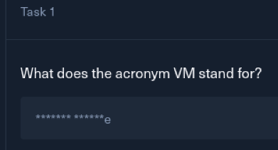

# Meow

Meow is a ‘Very Easy’ machine in Starting Point of HTB Labs.

Task 1:

Obviously, it’s “Virtual Machine”.

Task 2:

A tool used to interact with the operating system, via command line, known as console or shell?

Terminal.

What service is used for the VPN connection into HTB Labs?

I’m going to go with ‘openvpn’.

This, is ‘ping’.

This is nmap.

Okay, the next question is to identify the service running on port 23/tcp.

I will run an nmap scan, and use the flag ‘-sV’, because this argument used in nmap is specifically for services.

Shown here, is the nmap scan results. The service is ‘telnet’.

What username can log into the target with telnet with a blank password?

A Telnet connection to the target revealed a login prompt, where the `root` username was accepted without a password.

This is the end of the machine.

To summarize, the first several tasks were knowledge-based, and just answering questions.

There were 2 technical questions.

The first asked to identify what service was running on port 23. With a nmap scan, using -sV, I was able to see it was Telnet.

The next, asked what username could successfully authenticate in a telnet connection, without a password. Kind of like doing ‘anonymous’ with FTP, I just ran telnet with the IP of the target, and when prompted, entered root, and it was authenticated.

Once logged in as root, running command ‘ls’ listed the contents of the directory, which held ‘flag.txt’.
