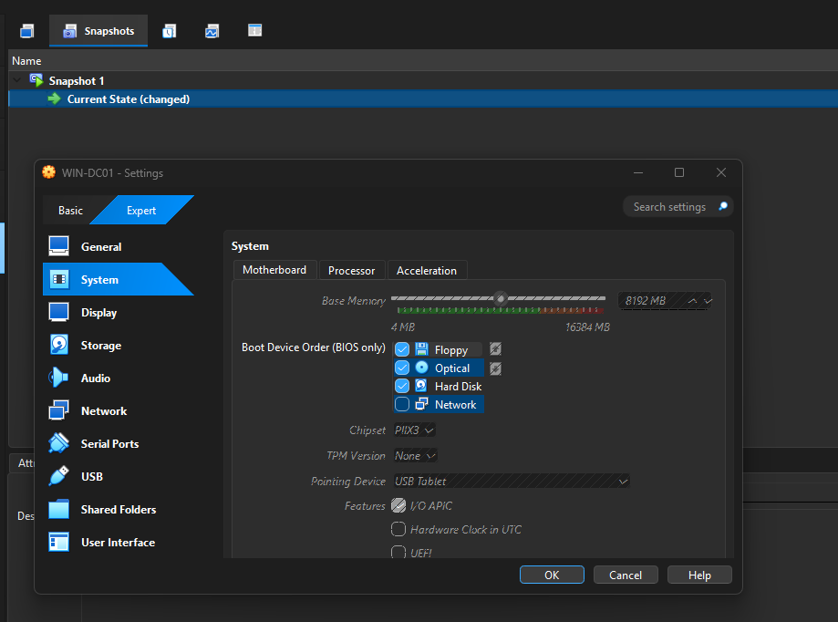

# Setting Up an Active Directory Home Lab

Penetration tests against enterprise environments almost always end up dealing with Windows and Active Directory in some form - whether it's the primary target or just the thing standing between you and the goal. I wanted a dedicated environment to practice against: real Kerberos behavior, real AD misconfigurations, real attack paths, instead of just reading about them.

This write-up covers building the "victim" side of that lab: standing up a domain controller from scratch and populating it with users and misconfigurations worth attacking. A follow-up write-up will cover the Kali (attacker) side - actually exploiting what's built here.

## Environment Specs

- **Hypervisor:** VirtualBox
- **OS:** Windows Server 2025 (ISO from Microsoft)
- **VM name:** `WIN-DC01`
- **Resources:** 8 GB RAM, 60 GB VHD, 2 CPU cores
- **Network:** Host-only network named `SOCNET`, alongside an existing Attacker (Kali) VM and a SIEM VM




## Initial Setup

After walking through the Windows Server installation, I had a working Administrator account. Right after install finished, I took a VirtualBox **snapshot** - essentially a save state of the VM at that point in time, so I can roll back to a clean install later without redoing the OS setup from scratch.


One quirk worth noting: when the lock screen says "Press Ctrl+Alt+Delete," you can't just do that on your host keyboard - VirtualBox intercepts it. You send it through the VM window instead: **Input -> Keyboard -> Insert Ctrl+Alt+Delete**.

## Networking

The plan was to put `WIN-DC01` on the same `SOCNET` network as the other lab VMs, with a static IP so the domain controller's address never shifts. Eventually this box needs to:

- Serve as the Domain Controller
- Sit on `SOCNET` with the other lab machines
- Host users with SPNs, so I can practice Kerberoasting later

**Adapter configuration:**


Adapter 1 is NAT (gives the VM internet access, needed to pull down Sysmon later); Adapter 2 is `SOCNET`.


To confirm which adapter was which, I checked the assigned IPs - VirtualBox's NAT range is normally `10.0.x.x`, which made it easy to tell NAT (Ethernet) apart from SOCNET (Ethernet 2):


Static IP was set via **Network Connections -> Adapter Settings -> IPv4**:


After a reboot, the IP held steady at `192.168.100.15`:


## Installing the AD DS Role

Before promotion, the server needs the **Active Directory Domain Services** role installed - this is what actually puts the AD software on the machine. Without it, the box is just a regular Windows Server.


## Promoting to a Domain Controller

With the role installed, the next step is promoting the server to stand up a new forest:

```powershell
Install-ADDSForest `
  -DomainName "aizen.lab" `
  -DomainNetbiosName "AIZEN" `
  -InstallDNS `
  -SafeModeAdministratorPassword (ConvertTo-SecureString "YourDSRMPassword!" -AsPlainText -Force)
```

**What each piece does:**

| Parameter | Purpose |
|---|---|
| `Install-ADDSForest` | Creates a brand-new AD forest. The first domain created becomes the forest root - everything else (additional domains, trusts, etc.) builds on top of it. Under the hood this installs the AD database (NTDS), configures the SYSVOL share, sets up Kerberos, and configures the box as a DNS server for the domain. |
| `-DomainName "aizen.lab"` | The fully qualified domain name (FQDN) for the new domain. |
| `-DomainNetbiosName "AIZEN"` | The legacy, pre-DNS short name (max 15 characters) still used for backward compatibility - e.g. `AIZEN\Administrator` login formats and older tooling that doesn't understand FQDNs. |
| `-InstallDNS` | Installs and configures the DNS Server role alongside AD. AD relies heavily on DNS (SRV records) to locate domain controllers and services, and since this is a fresh network with no other DNS infrastructure, the DC needs to be authoritative for `aizen.lab`. |
| `-SafeModeAdministratorPassword` | Sets the DSRM (Directory Services Restore Mode) password - used for recovery scenarios. Replaced the placeholder with an actual password before running. |


The command works through several warnings as it completes, then the VM restarts automatically.

### Verification

After reboot, `whoami` confirms the domain identity:

```
aizen\administrator
```


`nslookup aizen.lab` confirms DNS is resolving correctly and the static IP is still intact - the machine is functioning as a domain:


From the Kali VM, an `nmap -sV` scan against `192.168.100.15` confirms the AD-related services and the `aizen.lab` domain are visible externally:


## Populating the Domain

A domain controller with no users isn't much of a lab - there's nothing to attack. The goal here was to build out realistic attack surface: a mix of regular users with varying password strength, plus at least one deliberately misconfigured service account to serve as a Kerberoasting target.

### Creating OUs

Before adding users, I set up two Organizational Units (OUs) to keep the domain organized: `Employees` and `ServiceAccounts`. This mirrors how real environments are structured, and lets me apply different policies or delegation to each group later on.

An OU is a container object in AD used to organize users, computers, and groups. AD addresses everything using Distinguished Name (DN) syntax - my domain `aizen.lab` breaks into two "Domain Component" parts, `DC=aizen` and `DC=lab`, chained together to form the path.

```powershell
New-ADOrganizationalUnit -Name "Employees" -Path "DC=aizen,DC=lab"
New-ADOrganizationalUnit -Name "ServiceAccounts" -Path "DC=aizen,DC=lab"
```


Both `New-ADOrganizationalUnit` calls return silently on success - no output means no error. I confirmed they landed correctly with:

```powershell
Get-ADOrganizationalUnit -Filter * | Select Name, DistinguishedName
```

Which listed `Employees` and `ServiceAccounts` alongside the built-in `Domain Controllers` OU - confirming both were created in the right place.

### Creating User Accounts

With the OUs in place, next I populated the `Employees` OU with a mix of regular user accounts - some with weak, easily-crackable passwords and some with stronger ones. This gives me realistic targets to practice password attacks against later.

```powershell
New-ADUser -Name "John Smith" -SamAccountName "jsmith" -UserPrincipalName "jsmith@aizen.lab" -Path "OU=Employees,DC=aizen,DC=lab" -AccountPassword (ConvertTo-SecureString "Summer2024!" -AsPlainText -Force) -Enabled $true

New-ADUser -Name "Sarah Johnson" -SamAccountName "sjohnson" -UserPrincipalName "sjohnson@aizen.lab" -Path "OU=Employees,DC=aizen,DC=lab" -AccountPassword (ConvertTo-SecureString "P@ssw0rd123" -AsPlainText -Force) -Enabled $true

New-ADUser -Name "Mike Davis" -SamAccountName "mdavis" -UserPrincipalName "mdavis@aizen.lab" -Path "OU=Employees,DC=aizen,DC=lab" -AccountPassword (ConvertTo-SecureString "Tr0ub4dor&3xQz!91" -AsPlainText -Force) -Enabled $true
```

- **jsmith** - deliberately weak/guessable password (dictionary + year pattern), good for password-spraying practice
- **sjohnson** - moderately complex but still a common pattern seen in real breach dumps
- **mdavis** - strong/random password, meant to resist cracking even if the hash gets dumped


> Worth keeping in the write-up honestly: the `sjohnson` command initially failed with a `CommandNotFoundException` from a typo - `ConvertTo-SaecureString` instead of `ConvertTo-SecureString`. PowerShell's error output made the typo obvious immediately, and re-running the corrected command fixed it. Small errors like this are normal and are a good reminder to actually read command output rather than assuming success.

### Creating a User with a Randomized Password

For this account, I generated the password entirely within PowerShell instead of typing it myself - closer to a real-world attacker's starting position, since I genuinely don't know this account's credential.

```powershell
Add-Type -AssemblyName System.Web
$randomPassword = [System.Web.Security.Membership]::GeneratePassword(16, 4)

New-ADUser -Name "Jane Doe" -SamAccountName "jdoe" -UserPrincipalName "jdoe@aizen.lab" -Path "OU=Employees,DC=aizen,DC=lab" -AccountPassword (ConvertTo-SecureString $randomPassword -AsPlainText -Force) -Enabled $true
```

- `Add-Type -AssemblyName System.Web` loads the .NET assembly containing the password generator class - not loaded into PowerShell by default.
- `GeneratePassword(16, 4)` creates a 16-character random password with at least 4 non-alphanumeric characters, satisfying AD's default complexity policy.
- The password is generated and passed straight into account creation without ever being displayed or typed.

Verified the account with `Get-ADUser -Identity jdoe -Properties *` - confirmed `Enabled : True` and the correct `DistinguishedName` under the `Employees` OU:


### Creating an SPN-Enabled Service Account

This is the account that actually matters for Kerberoasting practice. Any domain user with a Service Principal Name (SPN) registered to it can have its Kerberos service ticket requested by *any* authenticated domain user - no admin rights needed - then cracked offline. Real environments often have SPNs assigned to service accounts (running IIS, MSSQL, etc.) with weak, rarely-rotated passwords. I'm recreating that misconfiguration on purpose.

```powershell
New-ADUser -Name "SQL Service" -SamAccountName "svc-sql" -UserPrincipalName "svc-sql@aizen.lab" -Path "OU=ServiceAccounts,DC=aizen,DC=lab" -AccountPassword (ConvertTo-SecureString "Winter2023!" -AsPlainText -Force) -Enabled $true

setspn -A MSSQLSvc/win-dc01.aizen.lab:1433 AIZEN\svc-sql
```

- `New-ADUser` creates `svc-sql` in the `ServiceAccounts` OU with a deliberately weak password.
- `setspn -A` registers the SPN - `MSSQLSvc/win-dc01.aizen.lab:1433` mimics a realistic SQL Server service SPN, tied to `svc-sql`.


Unlike `New-ADUser`, `setspn -A` gives verbose feedback - it checked the domain, registered the SPN under `CN=SQL Service,OU=ServiceAccounts,DC=aizen,DC=lab`, and confirmed with `Updated object`. I double-checked it was actually queryable (the same recon step an attacker would take) with:

```powershell
setspn -L svc-sql
```

Which listed `MSSQLSvc/win-dc01.aizen.lab:1433` back - confirming the SPN is registered and discoverable.

### Domain Population - Summary

At this point the domain has enough structure and misconfiguration built in to move into the attack phase. Recap of what's in `aizen.lab`:

**OUs:**
- `Employees`
- `ServiceAccounts`

**Regular user accounts (`Employees` OU):**
- `jsmith` - weak/dictionary password, for password-spraying practice
- `sjohnson` - moderately complex, common real-world pattern
- `mdavis` - strong/random password, resistant to cracking
- `jdoe` - password generated and set entirely within PowerShell, never typed or displayed

**Service account (`ServiceAccounts` OU):**
- `svc-sql` - weak password, SPN registered (`MSSQLSvc/win-dc01.aizen.lab:1433`) - the first Kerberoastable target in the domain

## Wrap-Up

This closes out the environment build-out. In a real engagement - white, black, or grey box - I might start with nothing more than an IP address. From there, scanning and enumeration lead into the techniques that almost always end up touching a domain or Active Directory in some way, which is exactly why I wanted a dedicated environment to practice against.

With `aizen.lab` populated and `svc-sql` sitting there Kerberoastable, the next step is hopping onto the Kali VM (the attacker) and going after initial access - starting with pulling and cracking that first ticket.
