# Wazuh Agent Deployment — WIN-DC01

## Objective

Before running any attacks against `WIN-DC01` from Kali, I needed the Wazuh manager to actually see what happens on it. `WIN-DC01` is the domain controller for `aizen.lab` on the SOCNET lab network, but nothing on the box was shipping logs anywhere — Wazuh wouldn't detect a single Kerberoast or AS-REP roast attempt until it was enrolled as an agent. This write-up covers installing the Wazuh Windows agent on the DC and getting it talking to the manager, including the install and connectivity problems I ran into along the way.

## Environment

| Host | Role | IP |
|---|---|---|
| WIN-DC01 | Domain Controller (Windows Server 2025), `aizen.lab` | `192.168.100.15` |
| wazuh-server22 | Wazuh Manager (Ubuntu) | `192.168.100.10` |
| Kali | Attacker box | `192.168.100.11` |

All hosts sit on the host-only SOCNET network (`192.168.100.0/24`). Manager IP was confirmed with `ip a` on the Ubuntu Wazuh VM.

## Step 1 — Download the Wazuh Windows Agent

On `WIN-DC01`:

```powershell
Invoke-WebRequest -Uri "https://packages.wazuh.com/4.x/windows/wazuh-agent-4.14.4-1.msi" -OutFile "$env:TEMP\wazuh-agent.msi"
```

`WIN-DC01` has internet access through its NAT adapter, so it pulled the installer directly from Wazuh's package servers.

**First snag:** my first attempt at this command had the URL wrapped in angle brackets (copy-pasted from a markdown link), which PowerShell parses as the redirection operator:

```
The '<' operator is reserved for future use.
+ FullyQualifiedErrorId : RedirectionNotSupported
```

I also mixed `$env:tmp` and `$env:TEMP` between commands, which pointed the install at two different paths and made `Test-Path` return `False` even though the file had technically downloaded. Re-running the `Invoke-WebRequest` with the URL properly quoted and consistently using `$env:TEMP` fixed it — `Test-Path "$env:TEMP\wazuh-agent.msi"` came back `True`.

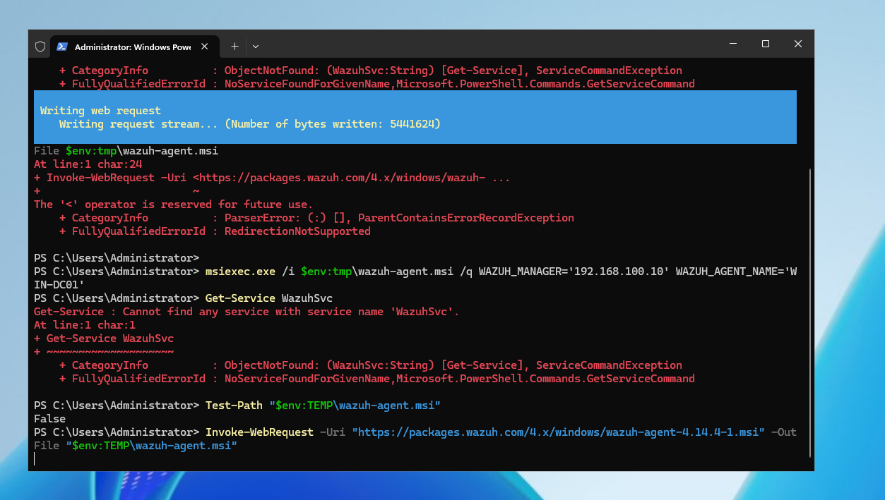
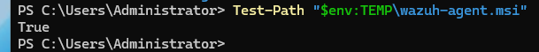

## Step 2 — Install and Enroll the Agent

```powershell
msiexec.exe /i "$env:TEMP\wazuh-agent.msi" /qn WAZUH_MANAGER='192.168.100.10' WAZUH_AGENT_NAME='WIN-DC01'
```

- `/qn` — fully silent install, no GUI
- `WAZUH_MANAGER` — points the agent at the manager's IP
- `WAZUH_AGENT_NAME` — labels the agent `WIN-DC01` in the dashboard

**Second snag:** running `msiexec.exe /i` without a quiet flag launched the interactive installer GUI in the background instead of completing on the command line, so `Get-Service WazuhSvc` came back `Cannot find any service with service name 'WazuhSvc'` — the install hadn't actually finished. Once I explicitly used `/qn`, the install completed unattended and `Get-Service WazuhSvc` showed the service present, in a `Stopped` state.

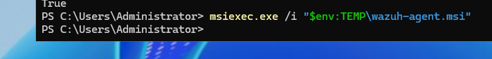
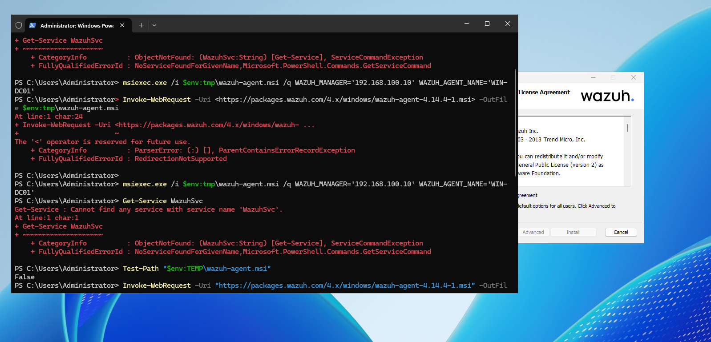
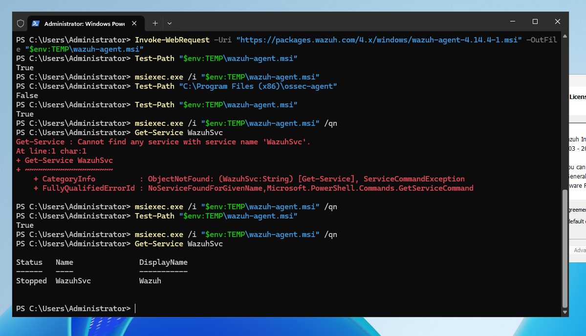

## Step 3 — Start the Agent Service

```powershell
NET START WazuhSvc
```

The config was edited directly to point at the manager before restarting:

```powershell
notepad "C:\Program Files (x86)\ossec-agent\ossec.conf"
Restart-Service WazuhSvc
Get-Service WazuhSvc
```

That brought the service to `Running`.


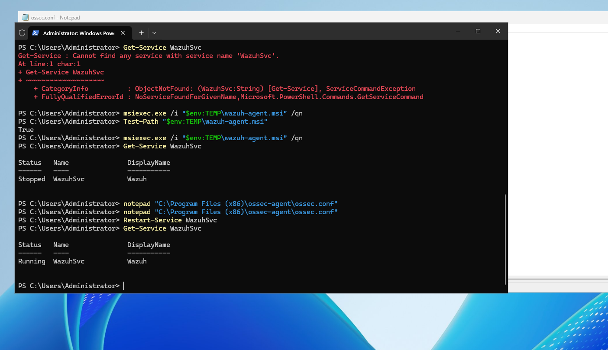

## Step 4 — Diagnosing the Connectivity Failure

With the service running, the agent still wasn't showing up on the manager. Checked both ports Wazuh depends on:

```powershell
Test-NetConnection 192.168.100.10 -Port 1514   # agent <-> manager event traffic
Test-NetConnection 192.168.100.10 -Port 1515   # enrollment service
```

Port 1515 came back `TcpTestSucceeded : False`.

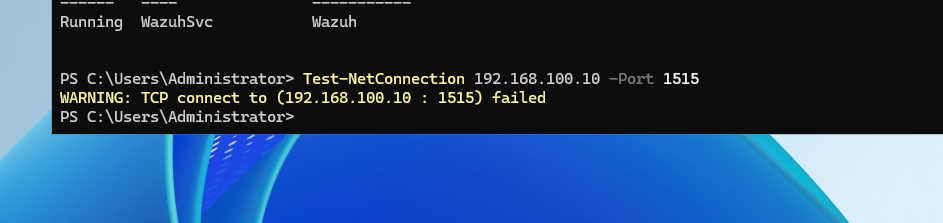

On the Ubuntu manager side, the usual checks:

```bash
sudo ss -lntup | grep -E '1514|1515'
sudo systemctl status wazuh-manager
sudo ufw status
sudo ufw allow 1514/tcp
sudo ufw allow 1515/tcp
sudo ufw reload
```

Opening the Wazuh agent's own management GUI on `WIN-DC01` explained the actual state clearly:

- **Manager IP:** `192.168.100.10` ✅
- **Authentication key:** `<insert_auth_key_here>` ❌
- **Status:** `Require import of authentication key - Not Running`

So the install and service were fine — the agent just hadn't been registered with the manager yet, which is what port 1515 (auto-enrollment) would normally handle. Since that port wasn't reachable, the fix was to register and extract the key manually instead of relying on auto-enrollment.

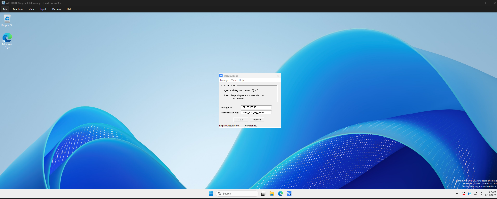

## Step 5 — Manually Register the Agent on the Manager

On the Ubuntu Wazuh manager:

```bash
sudo /var/ossec/bin/manage_agents
```

```
****************************************
* Wazuh v4.14.4 Agent manager.         *
* The following options are available: *
****************************************
  (A)dd an agent (A).
  (E)xtract key for an agent (E).
  (L)ist already added agents (L).
  (R)emove an agent (R).
  (Q)uit.
Choose your action: A,E,L,R or Q:
```

Chose **A** to add an agent:

- **Name:** `WIN-DC01`
- **IP Address:** `192.168.100.15`
- **ID:** accepted the default (`002` — agent `001` was already in use by the earlier `win_victim` build)

```
Agent information:
   ID:002
   Name:WIN-DC01
   IP Address:192.168.100.15
Confirm adding it?(y/n): y
Agent added with ID 002.
```

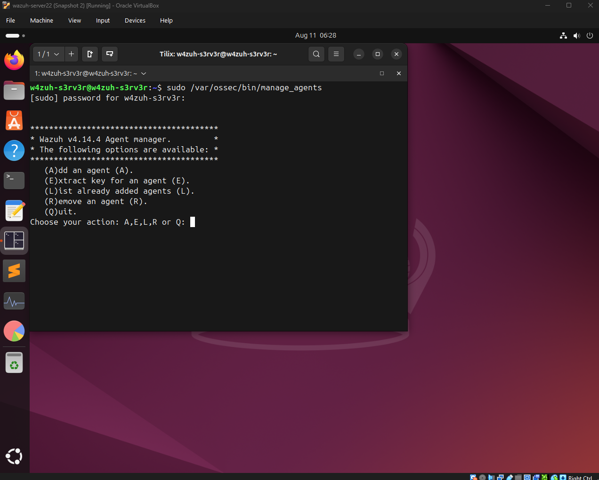

Then chose **E** (Extract key for an agent), selected agent `002`, and copied the generated authentication key (redacted here — the extracted key is the agent's credential):

```
Available agents:
   ID: 001, Name: win_victim, IP: any
   ID: 002, Name: WIN-DC01, IP: 192.168.100.15
Provide the ID of the agent to extract the key (or '\q' to quit): 002

Agent key information for '002' is:
[REDACTED]
```

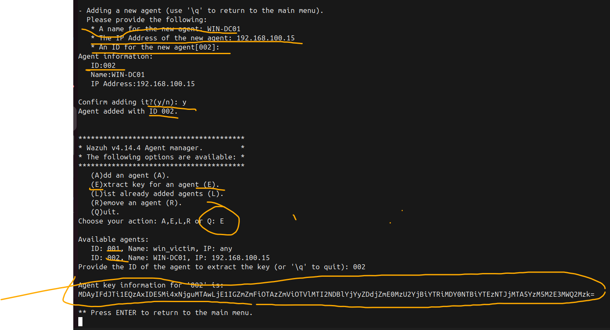

## Step 6 — Import the Key on WIN-DC01

Back in the Wazuh Agent GUI on `WIN-DC01`:

1. Left **Manager IP** as `192.168.100.10`
2. Pasted the extracted key into **Authentication key**, replacing `<insert_auth_key_here>`
3. Clicked **Save**, then **Refresh**

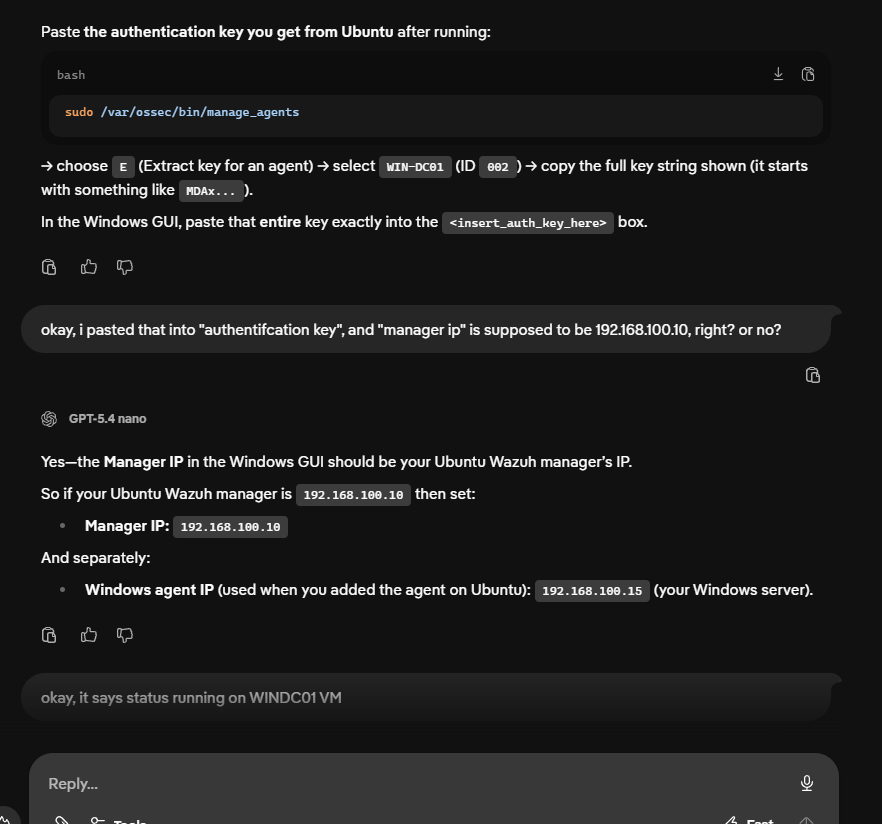

Status flipped from `Require import of authentication key - Not Running` to:

```
Agent: WIN-DC01 (002) - 192.168.100.15
Status: Running
```

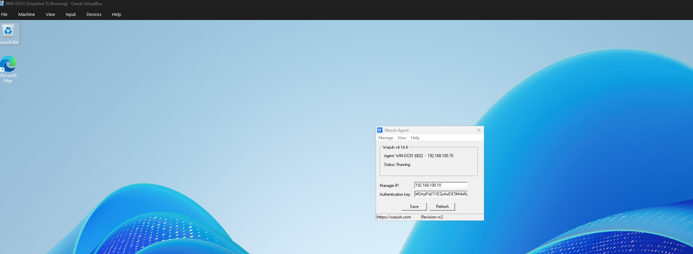

## Root Causes / Lessons Learned

- **Copy-pasted URLs with markdown formatting break PowerShell.** The `<...>` around the download URL triggered `RedirectionNotSupported` — always strip markdown link syntax before pasting into a terminal.
- **`$env:tmp` and `$env:TEMP` aren't guaranteed to resolve the same way across commands in practice** — mixing them made `Test-Path` lie about whether the installer was actually there. Pick one and stay consistent.
- **`msiexec /i` without `/q` or `/qn` opens the interactive wizard**, which silently "hangs" from a scripting perspective — the service won't exist until someone clicks through the GUI or the flag is corrected.
- **Setting `WAZUH_MANAGER` at install time isn't the same as enrollment.** If port 1515 (the enrollment service) isn't reachable, the agent installs and runs but sits in `Require import of authentication key`, since it never receives a key automatically.
- When auto-enrollment is blocked, `manage_agents` on the manager (Add → Extract key) plus a manual key paste into the agent GUI is a reliable fallback — and confirms the *actual* data channel (port 1514) is what matters day-to-day, not 1515.

## Result

`WIN-DC01` is enrolled as Wazuh agent `002`, actively reporting to the manager at `192.168.100.10`. Next step is running Kerberoasting / AS-REP roasting attempts from Kali against `aizen.lab` and confirming the manager actually generates alerts for them.
