# Creating Wazuh Server

Rebuilding the SOCNET Wazuh manager (indexer + server + dashboard, all-in-one single-node install) from a fresh Ubuntu Desktop VM. This replaces the previous Wazuh server ahead of re-enrolling `WIN-DC01` and `ubuntu01` and resuming the AD attack-chain write-ups (Kerberoasting, Golden Ticket).

## Environment

| | |
|---|---|
| **VM name** | `wazuh_server` |
| **OS** | Ubuntu Desktop |
| **RAM** | 6.6 GiB allocated (upgraded from initial 5.5 GB during build — see Issue #1) |
| **vCPUs** | 2 (upgraded from 1 — see Issue #1) |
| **Disk** | 60 GB (dynamically allocated VDI, ~8.7 GB actual on disk post-install) |
| **Network** | NAT (`enp0s3`, internet access) + Internal Network "SOCNET" (`enp0s8`, `192.168.100.0/24`) |
| **Static IP** | `192.168.100.10/24` |
| **Wazuh version** | 4.14.7 (all-in-one install: indexer + manager + dashboard) |

## Build Steps

### 1. Fresh install and baseline snapshot

Installed Ubuntu Desktop on a new VM and took a VirtualBox snapshot ("Fresh Install") immediately after first boot, before any configuration — a clean rollback point in case the Wazuh install script needed a redo.

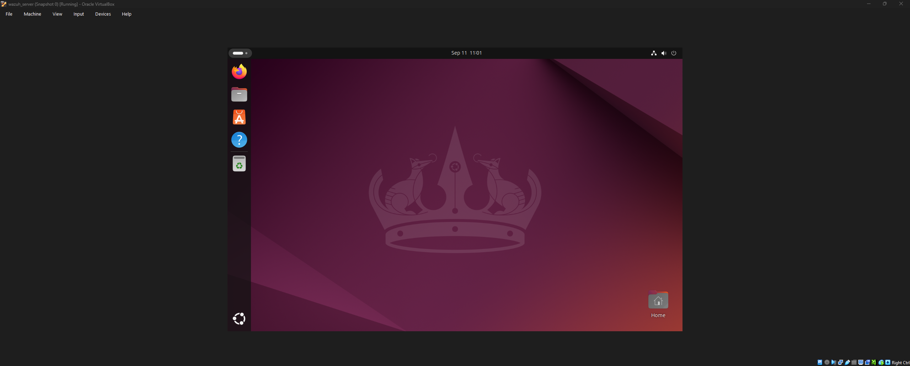

### 2. Identify network interfaces

Two adapters are attached: NAT (internet-facing) and an Internal Network named "SOCNET" in VirtualBox — but VirtualBox adapter labels don't determine the Linux-side connection names, so `nmcli` was used to enumerate them.

```
nmcli con show
```

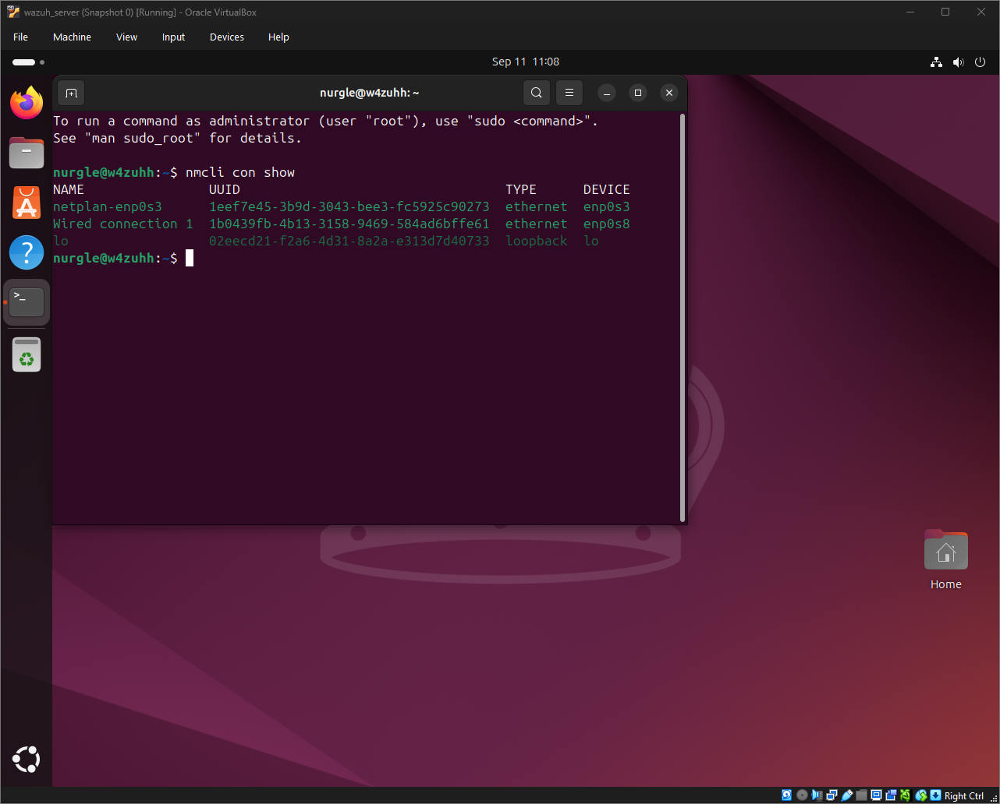

```
ip a
```

confirmed which device belonged to which network by checking assigned addresses:
- `enp0s3` → `10.0.2.15/24` → **NAT**
- `enp0s8` → `192.168.100.21/24` (DHCP-assigned) → **SOCNET**

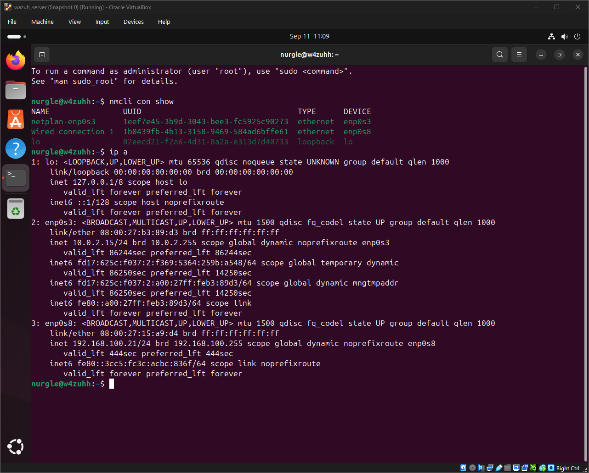

### 3. Set the static IP

Since Ubuntu Desktop uses NetworkManager (not netplan YAML) as the network renderer, the static IP was set with `nmcli` rather than editing config files directly:

```
sudo nmcli con mod "Wired connection 1" ipv4.addresses 192.168.100.10/24 ipv4.gateway 192.168.100.1 ipv4.dns 8.8.8.8 ipv4.method manual
sudo nmcli con up "Wired connection 1"
```

Verified with `ip a` — `enp0s8` now shows `192.168.100.10/24` with no `dynamic` flag.

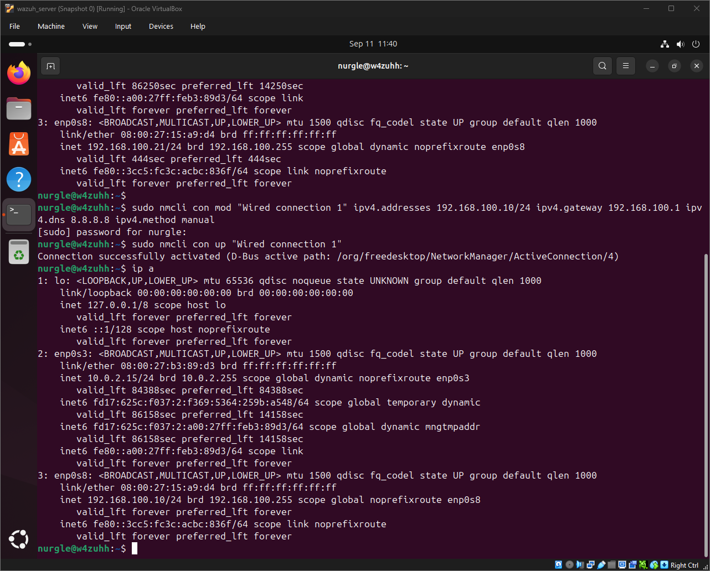

### 4. Install curl and download the Wazuh installer

`curl` isn't installed by default on a fresh Ubuntu Desktop image, so `apt update` was run first, then `curl` was installed before pulling the installer script:

```
sudo apt update
sudo apt install curl
curl -sO https://packages.wazuh.com/4.14/wazuh-install.sh
```

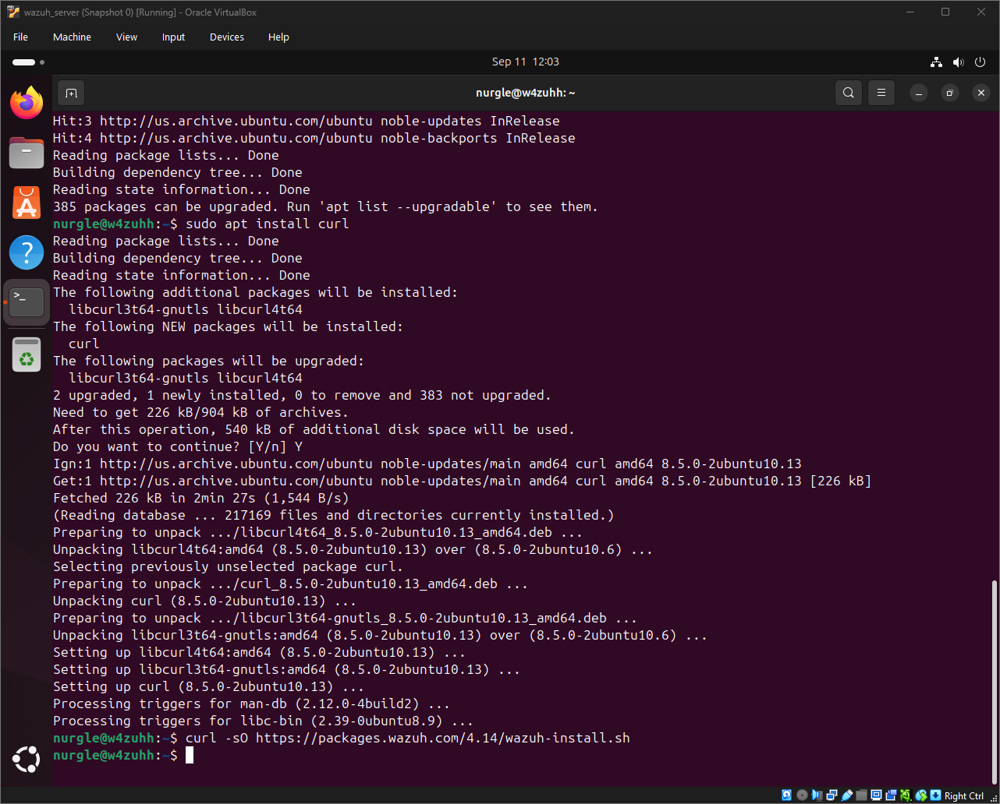

**Note:** the initial `curl` download of the 226 KB install script crawled at ~1.5 KB/s (2.5 minutes for a tiny file), flagging a slow connection that ended up affecting later steps too (see Issue #3).

### 5. First install attempt

```
sudo bash wazuh-install.sh -a
```

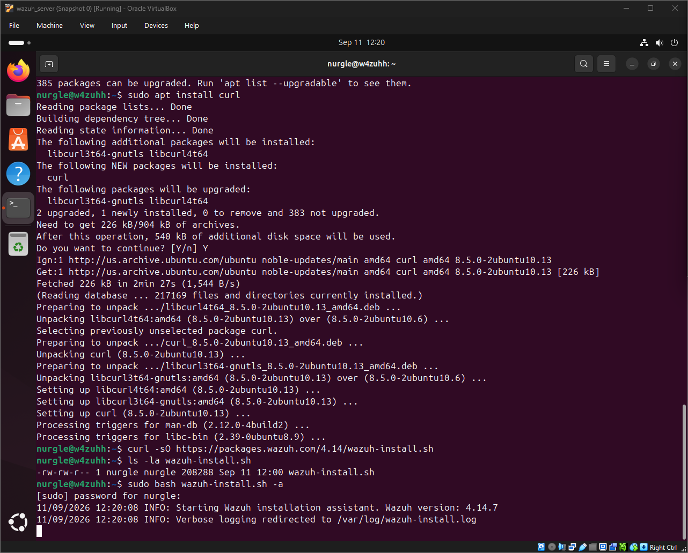

## Issues Encountered & Resolutions

### Issue #1 — Hardware requirements not met (1 vCPU)

The installer's pre-flight check failed:

```
ERROR: Your system does not meet the recommended minimum hardware requirements of 4Gb of RAM and 2 CPU cores.
```

`free -h` confirmed RAM was fine (~4.3 GiB available), but `nproc` returned **1** — only a single vCPU had been assigned to the VM.

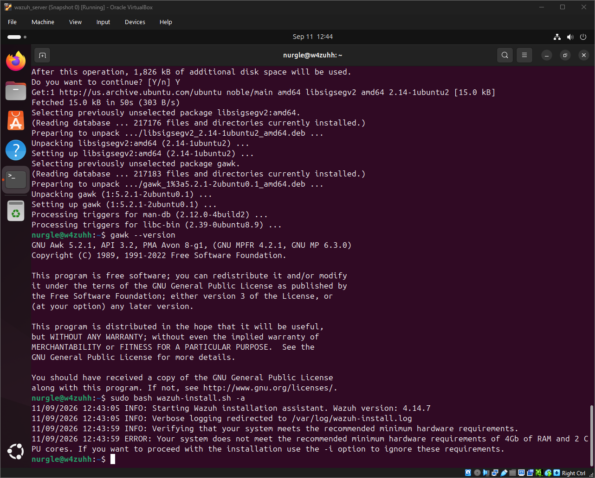
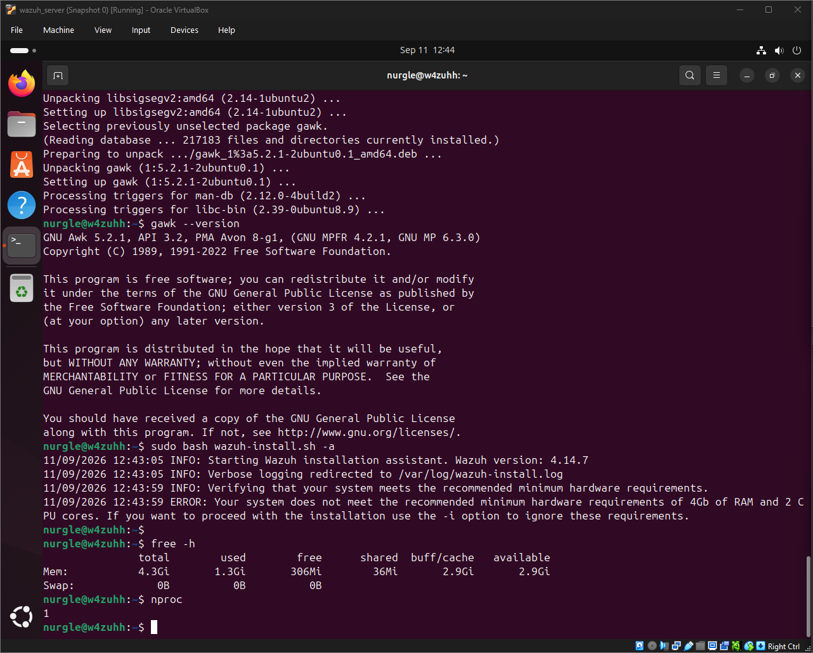

**Resolution:** rather than bypassing the check with `-i`, the VM was shut down and reconfigured with 2 vCPUs in VirtualBox (System > Processor), since the indexer (OpenSearch) is CPU-intensive and running it on a single core would risk an unstable install. After rebooting, `nproc` confirmed 2 cores available.

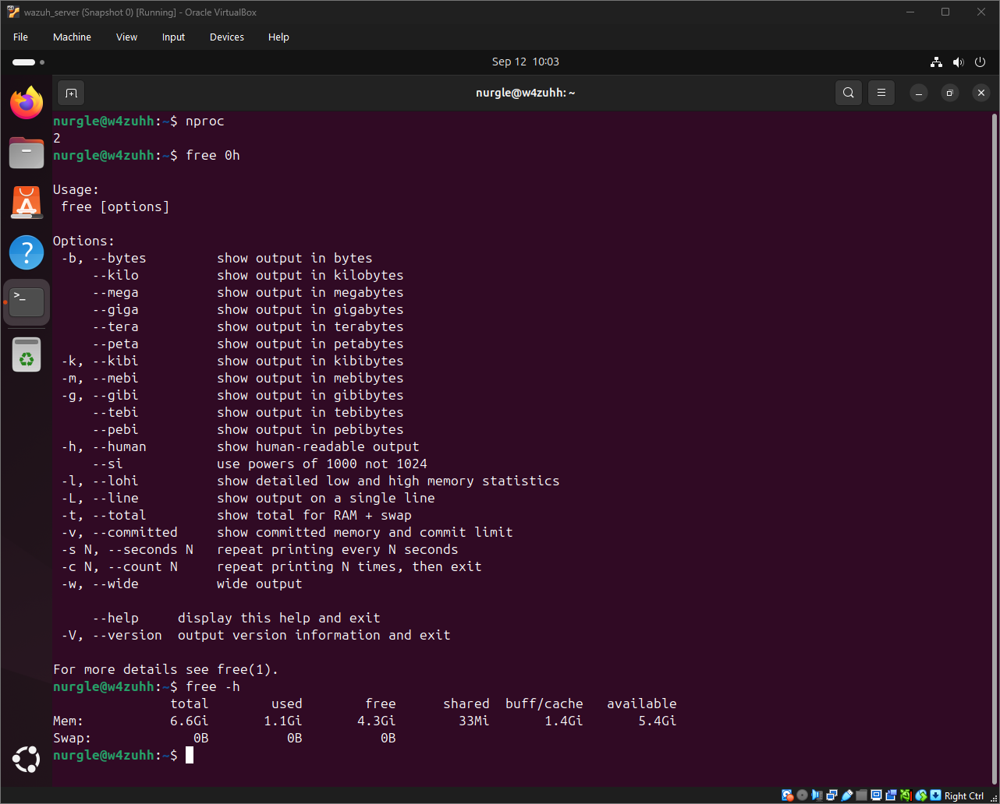

### Issue #2 — `gawk` dependency install failure

A separate hiccup during dependency installation: the installer couldn't install `gawk`, tracing back to Ubuntu's package mirror (`archive.ubuntu.com`) failing specifically over HTTP (port 80), despite basic internet connectivity (ping to `8.8.8.8` and DNS resolution both working fine).

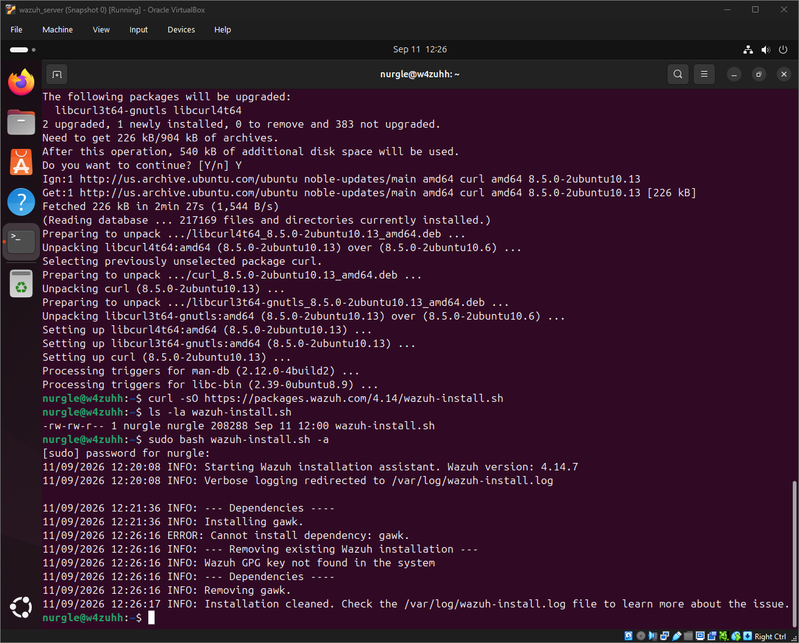

**Resolution:** confirmed HTTPS to the same mirror worked correctly (`curl -I https://archive.ubuntu.com/ubuntu/` returned `200 OK`), pointing to a transient HTTP connection issue with that specific mirror IP rather than a broken VirtualBox network config. Retried `sudo apt install gawk`, which succeeded once the transient issue cleared.

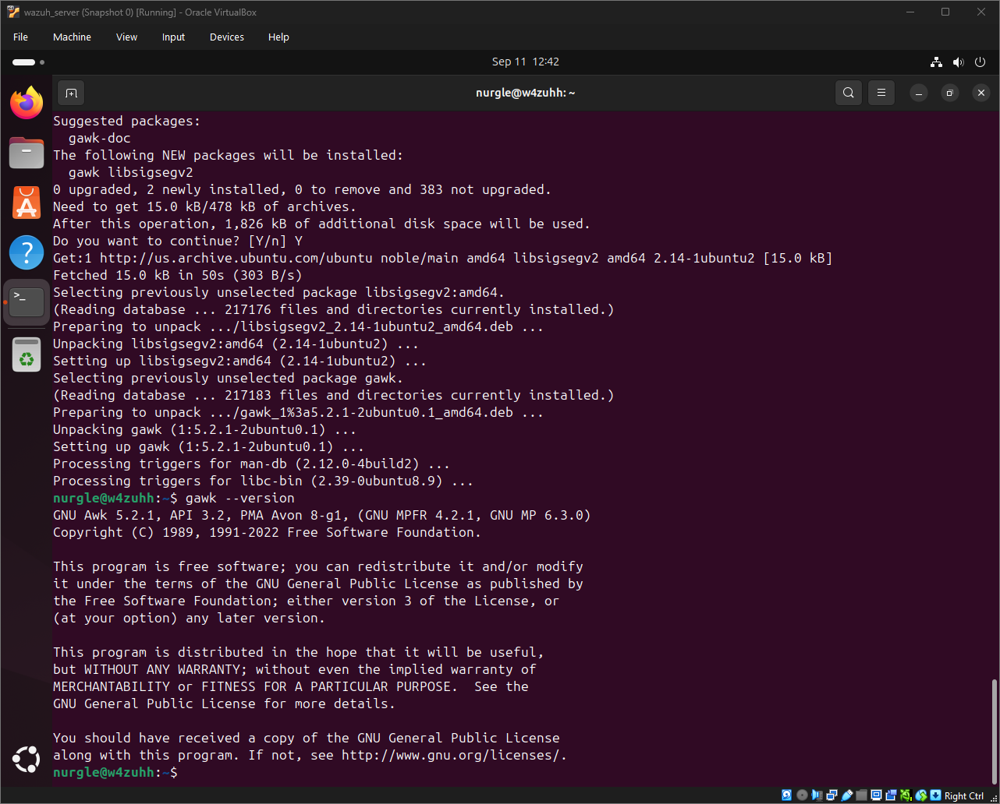

### Issue #3 — `unattended-upgrades` blocking the dpkg lock

On the installer re-run (now with 2 vCPUs), the indexer installed and started cleanly, but the manager install step failed outright:

```
E: Could not get lock /var/lib/dpkg/lock-frontend. It is held by process 6981 (unattended-upgr)
```

Ubuntu's background `unattended-upgrades` service — which runs automatically shortly after a fresh install — grabbed the dpkg lock at the exact moment the Wazuh installer tried to `apt install` the manager package. The installer's own cleanup routine then also failed to fully remove the partially-installed indexer package, since it hit the same lock.

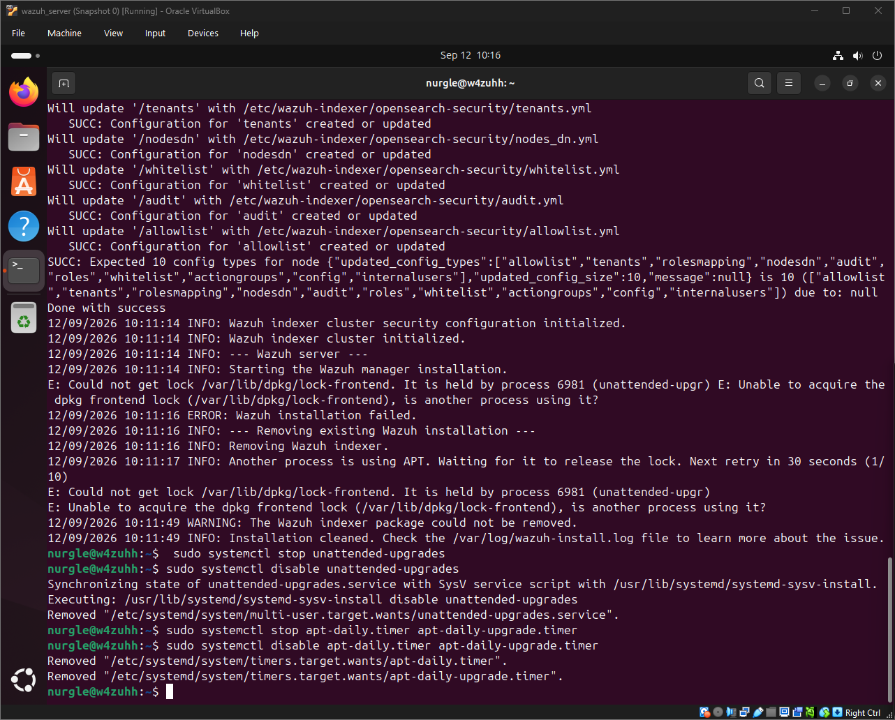

**Resolution:**
```
sudo systemctl stop unattended-upgrades
sudo systemctl disable unattended-upgrades
sudo systemctl stop apt-daily.timer apt-daily-upgrade.timer
sudo systemctl disable apt-daily.timer apt-daily-upgrade.timer
```

Since the previous partial install left the indexer package in a half-removed state, the installer was re-run with the overwrite flag to force a clean setup:

```
sudo bash wazuh-install.sh -a -o
```

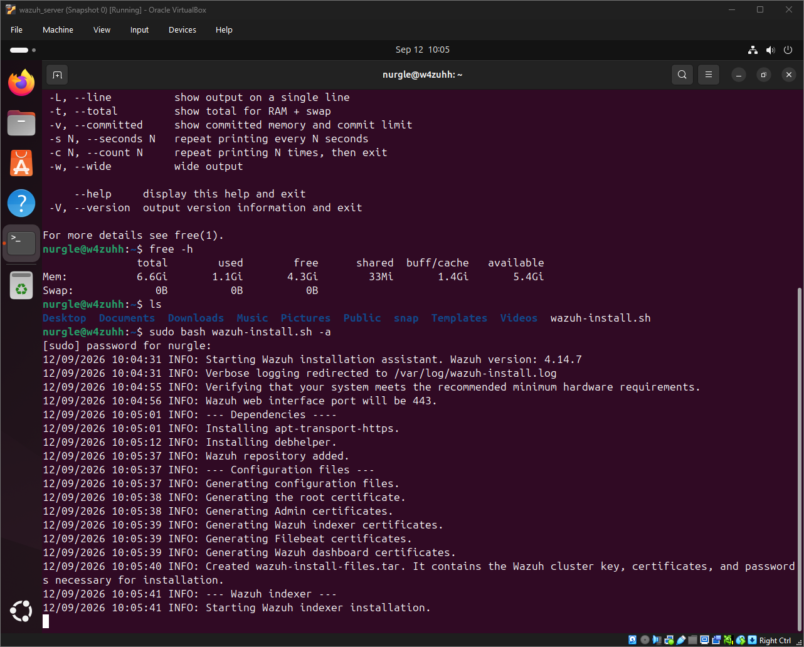

### Issue #4 — Dashboard install appeared to hang

The dashboard installation step sat on "Starting Wazuh dashboard installation" for a long stretch with no visible progress. Rather than interrupting it, a second terminal was opened to check `tail -f /var/log/wazuh-install.log` and `ps aux | grep apt` for active process activity — both confirmed the install was still working, just slow, consistent with the earlier observed low bandwidth.

**Resolution:** none needed — patience. The dashboard step alone took ~36 minutes; total install time was roughly an hour, driven almost entirely by slow package downloads rather than any actual fault.

## Successful Install

The install completed end-to-end, generating the admin credentials for dashboard access:

```
You can access the web interface https://<wazuh-dashboard-ip>:443
    User: admin
    Password: [REDACTED]
```

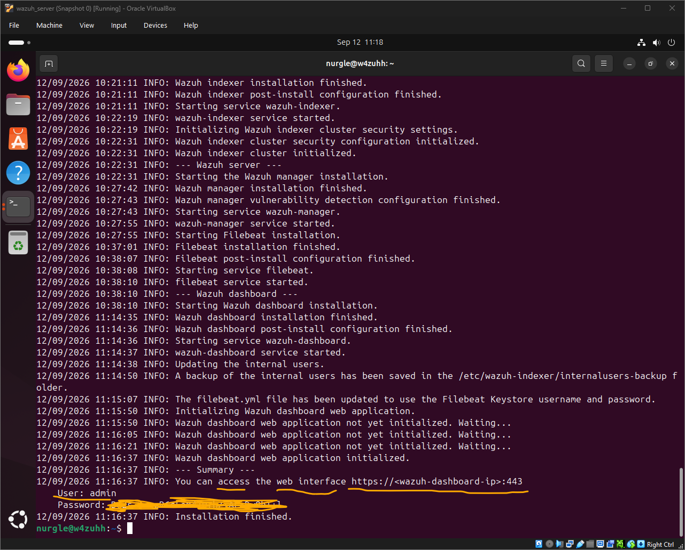

## Verifying Dashboard Access

Since SOCNET is an isolated Internal Network in VirtualBox, the dashboard was accessed from a VM on the same segment rather than the host machine directly.

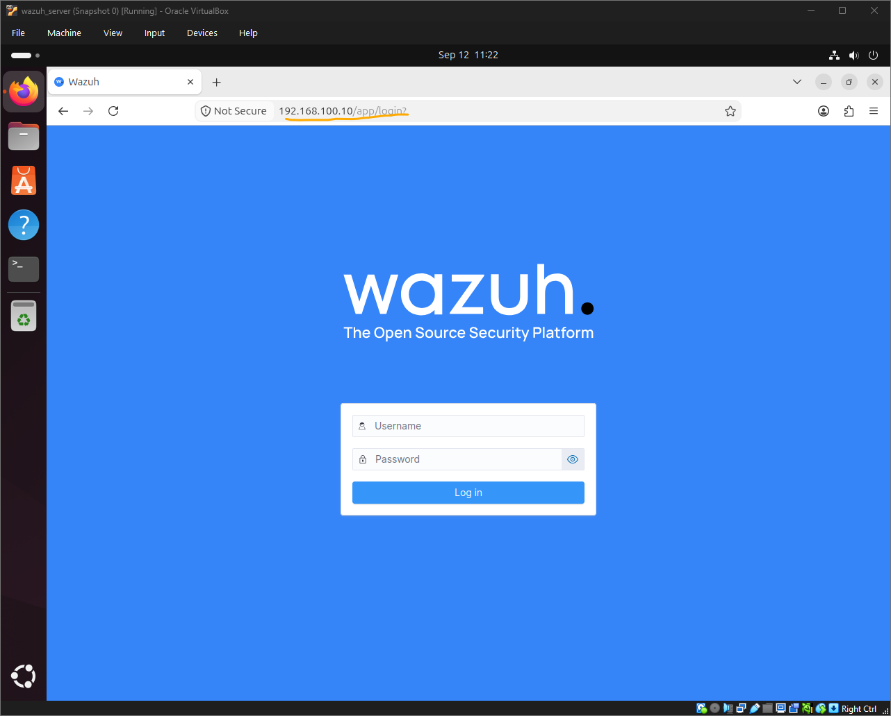

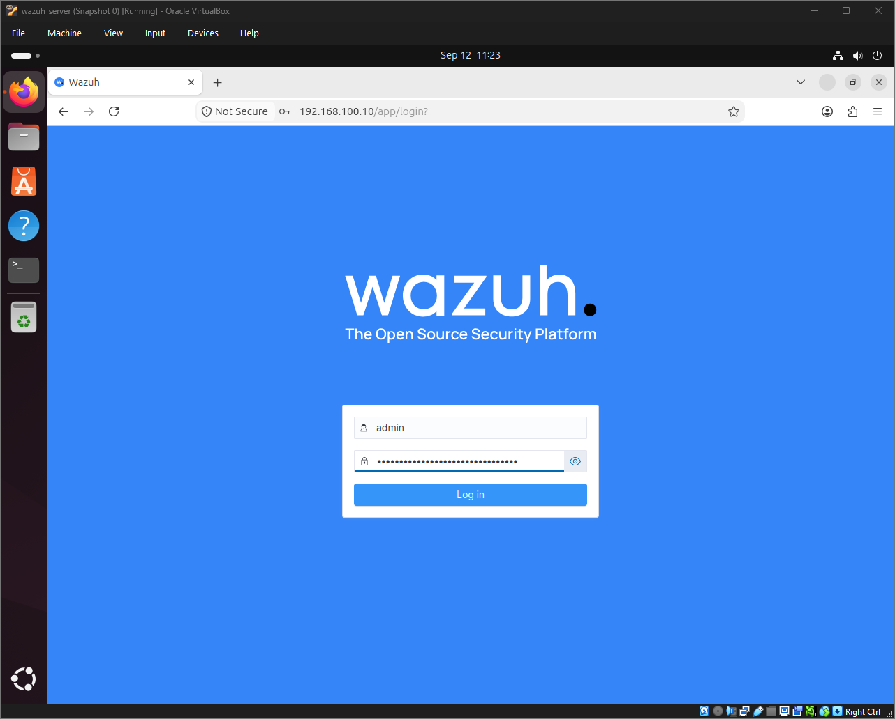

Logged in successfully and confirmed the manager API connection is online and up to date:

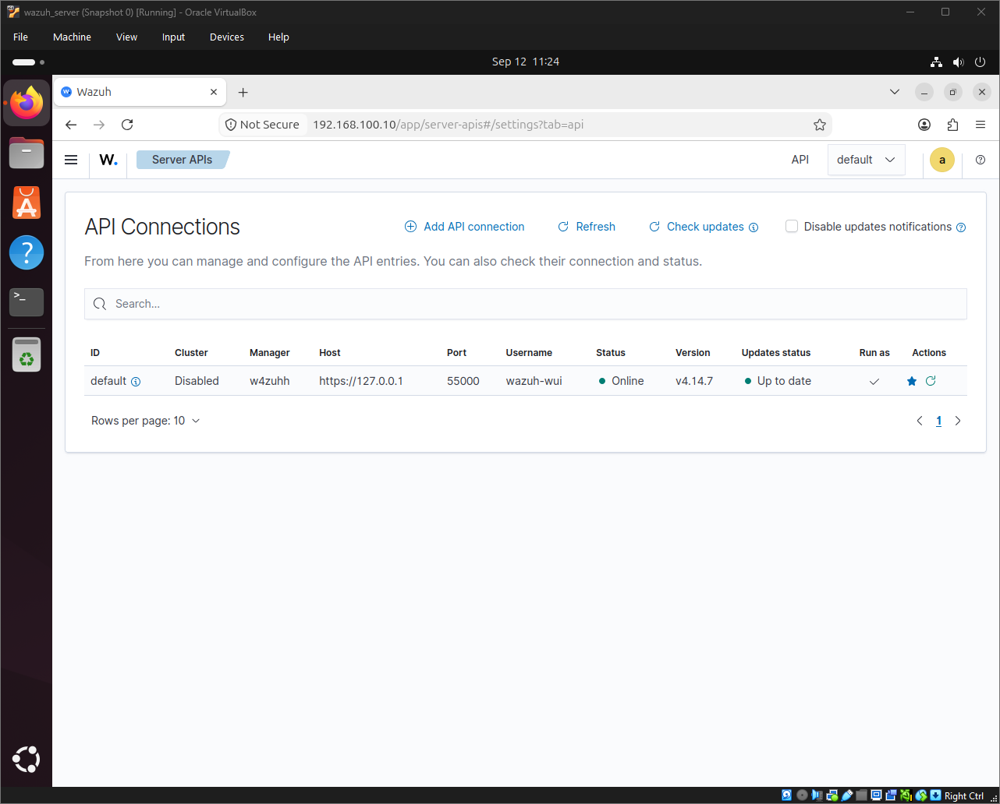

| Field | Value |
|---|---|
| Manager | `w4zuhh` |
| Host | `https://127.0.0.1` |
| Port | `55000` |
| Status | Online |
| Version | v4.14.7 |
| Updates | Up to date |

## VM Configuration Reference

Supplementary screenshots of the final VirtualBox VM settings for this build:

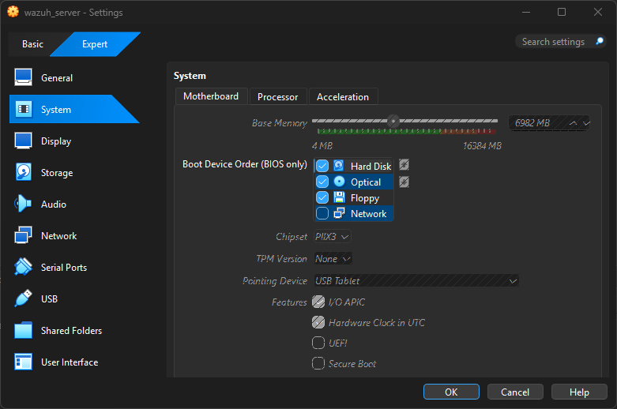
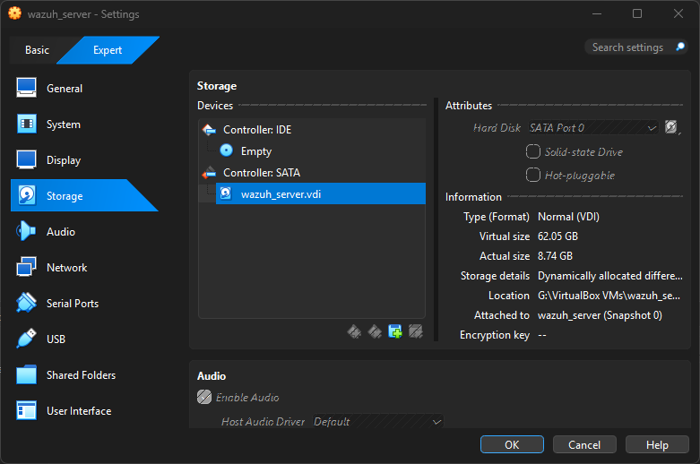

## Key Takeaways

- **Check CPU count, not just RAM, against a tool's minimum requirements.** It's easy to size a VM by RAM/disk alone and overlook vCPU count — Wazuh's indexer specifically needs 2+ cores to install and run reliably.
- **`unattended-upgrades` is a real risk to long-running installers on fresh Ubuntu VMs.** It's worth disabling background APT timers before kicking off any install that takes more than a few minutes, to avoid a dpkg lock collision mid-install.
- **Transient mirror issues can look like broader network problems.** Testing HTTP vs. HTTPS to the same host helped isolate a mirror-specific hiccup from a genuine VirtualBox networking misconfiguration.
- **Slow bandwidth can look like a hang.** Before assuming an installer is stuck, check for active process activity (`ps aux`, live log tailing) rather than interrupting a step that may just be slow.

## Next Steps

- Re-enroll `WIN-DC01` and `ubuntu01` as Wazuh agents against the new manager (`192.168.100.10`)
- Verify log ingestion from both agents before resuming the AD attack-chain (Kerberoasting → Golden Ticket) red/blue write-ups
