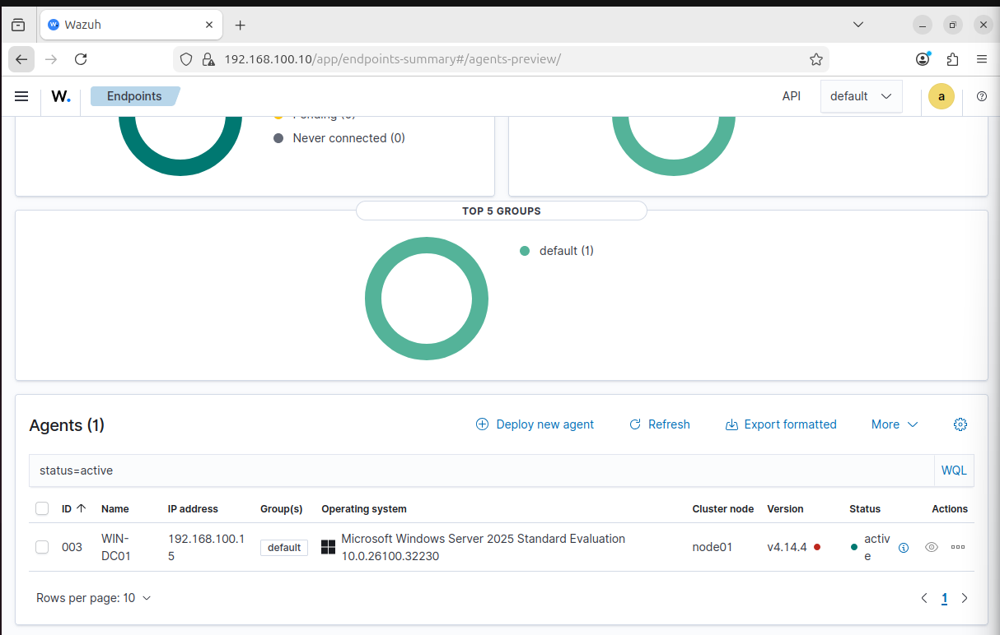
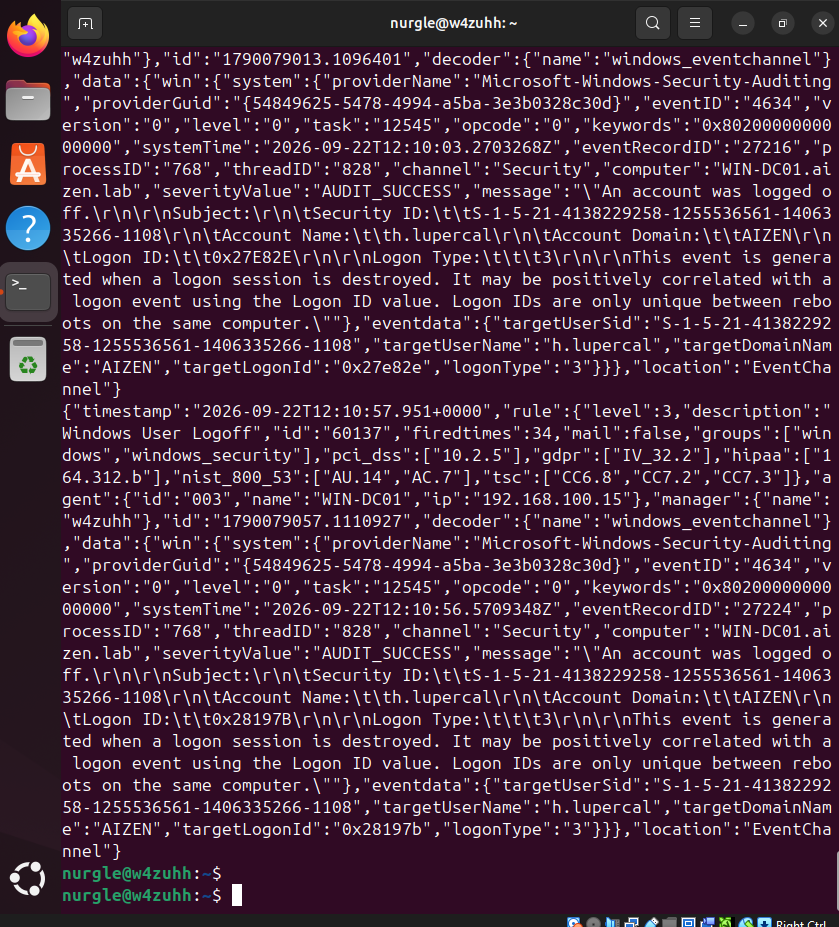

# Kerberoasting — Blue Team Write-Up (Detection & Investigation)

> **Status: DRAFT / IN PROGRESS.** Telemetry has been validated and the relevant evidence has been located and analyzed. Custom Wazuh detection logic has been designed but not yet implemented or tested. See §8 "Next Steps" before treating this as final.

**Environment:** AIZEN.LAB Active Directory Home Lab
**Date investigated:** 2026-09-22
**Author:** Steven (0x5t3v3n)
**Related:** Companion red-team write-up — *Kerberoasting Red Team Write-Up*
**MITRE ATT&CK:** T1558.003 — Steal or Forge Kerberos Tickets: Kerberoasting

---

## 1. Objective

Investigate, from a defender's perspective, the Kerberoasting activity carried out against `WIN-DC01` in the red-team exercise: confirm what telemetry was generated, locate the specific evidence of the attack, determine whether the existing Wazuh deployment would have detected it, and identify what detection logic would be needed to close any gap.

## 2. Environment

| Host | Role | OS | IP |
|---|---|---|---|
| `wazuh_server` (`w4zuhh`) | Wazuh manager/indexer/dashboard | Ubuntu | `192.168.100.10` |
| `WIN-DC01` | Domain Controller (victim/monitored host) | Windows Server 2025 Standard Evaluation, Build 26100 | `192.168.100.15` |
| Kali | Attacker | Kali Linux | `192.168.100.20` |

`WIN-DC01` is registered with the Wazuh manager as **agent ID 003**, actively reporting, using Wazuh agent `v4.14.4`.



## 3. Scope

This investigation covers the two TGS requests generated during the red-team Kerberoasting exercise:

- `svc-sql` — AES256 TGS-REP (etype 18)
- `svc-nurgle` — RC4-HMAC TGS-REP (etype 23) — the account deliberately created with a weak, RockYou-crackable password, and the primary subject of this investigation since its ticket used the classic, lower-security RC4 encryption type.

The relevant Windows telemetry for this technique is **Event ID 4769 — "A Kerberos service ticket was requested"**, generated by the Domain Controller on every TGS issuance.

## 4. Telemetry Pipeline Verification

Before investigating the specific attack, the logging pipeline itself was confirmed end-to-end:

- `WIN-DC01` → Wazuh agent → Wazuh manager (`192.168.100.10`) is active and reporting (confirmed via `agent_control -l` and the Wazuh dashboard).
- Windows Security auditing for Kerberos service-ticket operations (success auditing) was enabled prior to the attack so that Event ID 4769 would fire.
- Wazuh is ingesting Windows Security events via the `windows_eventchannel` decoder, confirmed by the presence of numerous `"eventID":"4769"` entries in `/var/ossec/logs/alerts/alerts.json`.

**Conclusion:** the collection pipeline itself works — Windows is generating the events and Wazuh is receiving them. The open question was whether the *specific* Kerberoasting-relevant events were present and how they were being classified.

## 5. Investigation

### 5.1 Searching Wazuh's alert store

The first approach was to search Wazuh's alert output directly for identifiers tied to the attack:

```bash
sudo grep -i "svc-nurgle" /var/ossec/logs/alerts/alerts.json | tail -20
sudo grep -i "h.lupercal" /var/ossec/logs/alerts/alerts.json | tail -20
```

- The `svc-nurgle` search returned **nothing**.
- The `h.lupercal` search returned only **Event ID 4634 ("An account was logged off")** entries, classified under Wazuh rule `60137` ("Windows User Logoff") — ordinary session-teardown events, not anything related to a Kerberos service-ticket request.



Broader searches for `"eventID":"4769"` in `alerts.json` did return results, but they were dominated by routine, expected Kerberos activity — machine-account (`WIN-DC01$`) and `krbtgt` ticket requests generated by normal domain operation — all classified under the generic Wazuh rule `60106` ("Windows Logon Success").

**Interim finding:** Wazuh is not surfacing anything that stands out as "a Kerberoasting-style request" — every 4769 event, regardless of which account requested it, which service was targeted, or which encryption type was used, is classified identically as a routine successful logon.

### 5.2 Checking for raw archived events

Wazuh's raw event archive was checked next, since not every ingested event necessarily becomes an "alert":

```bash
sudo grep '"eventID":"4769"' /var/ossec/logs/archives/archives.log | grep -E 'h\.lupercal|svc-nurgle|15555'
```

This returned nothing because **archive logging was not enabled/populated** on this Wazuh deployment (`archives.log` was present but empty). This is a configuration gap worth noting separately — with archiving enabled, all raw events (not just those matching an alert rule) would be retained and searchable, which is valuable for exactly this kind of retrospective investigation.

### 5.3 Going to the authoritative source

Since Wazuh's alert output didn't surface the specific event, the Windows Security event log on `WIN-DC01` was queried directly:

```powershell
Get-WinEvent -FilterHashtable @{LogName='Security'; Id=4769} -MaxEvents 50 |
    Where-Object { $_.Message -match 'svc-nurgle|15555|h\.lupercal' } |
    Format-List TimeCreated, Message
```

This located the exact event generated by the attack.

## 6. Evidence Located

**Event ID 4769 — Kerberos service ticket requested**

| Field | Value | Significance |
|---|---|---|
| Time Created | 9/22/2026 5:10:56 AM (local) | Matches the red-team attack window |
| Account Name | `h.lupercal@AIZEN.LAB` | The low-privileged account performing the request |
| Service Name | `svc-nurgle` | The Kerberoasted service account |
| Client Address | `::ffff:192.168.100.20` | The Kali attacker VM |
| Client Port | `53228` | |
| Advertized Etypes | RC4-HMAC-NT, 3DES, DES-CBC-MD5, AES256-CTS-HMAC-SHA1-96 | The full list of encryption types offered by the client (Impacket) |
| Ticket Encryption Type | `0x17` (23 — RC4-HMAC) | Confirms the KDC issued the weaker RC4 ticket, matching the `$krb5tgs$23$` hash captured in the red-team exercise |
| Failure Code | `0x0` | Request succeeded — this is a completely normal, successful Kerberos operation from the KDC's point of view |

This single event is the definitive, ground-truth artifact of the attack: it places `h.lupercal`, `svc-nurgle`, and the Kali VM's IP address in the same record, at the same moment the red-team exercise captured the corresponding TGS hash.

## 7. Key Findings

1. **The attack is fully observable on the wire.** Windows Security auditing captured the exact account, target service, source IP, and ticket encryption type involved in the Kerberoasting request. Nothing about the attack itself is inherently invisible to logging.
2. **Wazuh's default Windows ruleset does not distinguish this from routine activity.** Every 4769 event observed during this exercise — the attacker's request included — was classified under the same generic "Windows Logon Success" rule (`60106`) used for ordinary, expected Kerberos operations (machine accounts, `krbtgt`, etc.). There is currently no rule that treats a 4769 event any differently based on which account is targeted, what encryption type was negotiated, or how many distinct SPNs a single account has requested tickets for.
3. **This is consistent with why Kerberoasting is considered "quiet."** Because the TGS-REQ/TGS-REP exchange is a legitimate, successful Kerberos operation, there is no authentication-failure signal to alert on. Detection has to be built around *anomalous patterns* in otherwise-normal-looking traffic — not failure conditions.
4. **Archive logging is currently disabled**, which limits retrospective/hunting capability. Only events that already match an existing alert rule are retained in a way that's easy to search after the fact.

## 8. Next Steps (Not Yet Completed)

The following still needs to be done to turn this investigation into a working detection capability. This section will be updated once each item is complete.

- [ ] **Enable Wazuh archive logging** (`logall`/`logall_json` in `ossec.conf`) so raw 4769 events are retained regardless of whether they match an existing rule, and reindex/restart the manager to confirm archiving is active.
- [ ] **Draft and implement a custom Wazuh rule** targeting Kerberoasting-relevant 4769 patterns rather than relying on the generic logon-success classification. Candidate detection logic to test:
  - Alert when `eventdata.ticketEncryptionType` is `0x17` (RC4) or `0x1` (DES) **and** the `serviceName` is not a machine account (`*$`) or `krbtgt` — RC4/DES tickets for ordinary user/service accounts are unusual on a modern, AES-capable domain and worth flagging on their own.
  - Alert (or aggregate) when a single `targetUserName` requests TGS tickets for an unusually high number of **distinct** SPNs within a short time window — a signature of automated enumeration tools like Impacket's `GetUserSPNs` rather than normal user/application behavior.
- [ ] **Re-run the red-team attack** (or a variant of it) with the new rule active and confirm it fires correctly, with an acceptable false-positive rate against normal domain activity.
- [ ] **Document the final, validated Wazuh rule** (rule ID, XML/YAML definition, and a screenshot of the resulting alert) in this write-up.
- [ ] **Decide on retention/monitoring for `svc-sql`'s AES ticket as well** — determine whether encryption-type alone is a sufficient detection surface, or whether the SPN-request-volume rule above is needed to also catch AES-only Kerberoasting attempts (which are just as real an attack, only harder to crack offline).

## 9. MITRE ATT&CK Mapping

| Tactic | Technique | Notes |
|---|---|---|
| Credential Access | **T1558.003** — Steal or Forge Kerberos Tickets: Kerberoasting | Primary technique under investigation |
| Data Source | Windows Event Logs — Event ID 4769 | Confirmed present and correctly generated |
| Detection Gap | No dedicated analytic currently in place | Addressed in §8 |

---

## Appendix: Evidence Index

| # | File | Description |
|---|---|---|
| 1 | `screenshots/01-wazuh-agent-status.png` | Wazuh dashboard confirming `WIN-DC01` (agent 003) is active and reporting |
| 2 | `screenshots/02-alerts-search-hlupercal.png` | `alerts.json` search for `h.lupercal` — only generic logon/logoff events found, confirming the detection gap |
