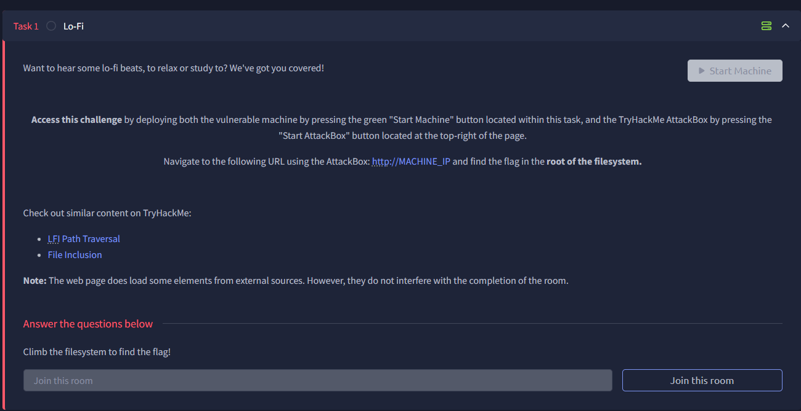

# Lo-Fi

in the descriptoin, we can see that it’s based on LFI, local file inclusion.

what this specific tecnique is

- LFI (Local File Inclusion) is a class of web vulnerability and an attack technique/exploitation vector that abuses unsanitized file-include functionality in a web application.
- What it does: it lets an attacker cause the server-side application to read and/or include files from the local filesystem (and sometimes special streams), leading to information disclosure and — in many cases — remote code execution through secondary techniques.

More detail (how it works)

- Typical vulnerable pattern (PHP example): the application does something like include($_GET['page']); and then an attacker controls the page parameter.
- Common exploitation methods:
    - Path traversal: send values like ../../../../etc/passwd to climb directories and read sensitive files (configuration files, passwords, SSH keys, application source).
    - Use of special wrappers/streams (in PHP: php://filter, php://input, data://) to read encoded content or feed data to the interpreter.
    - Log / upload poisoning: if you can inject PHP into a log or upload a file that the application later includes (e.g., including Apache access.log), you can get the server to execute attacker-supplied code.
    - Session or socket files: include session files or other writable files to steal sessions or escalate access.

nmap scan

ssh on port 22

http on port 80

web browser:

web browser 1

testing LFI by just using “../../../../etc/passwd”

and it works

using the same technique looing for the flag

