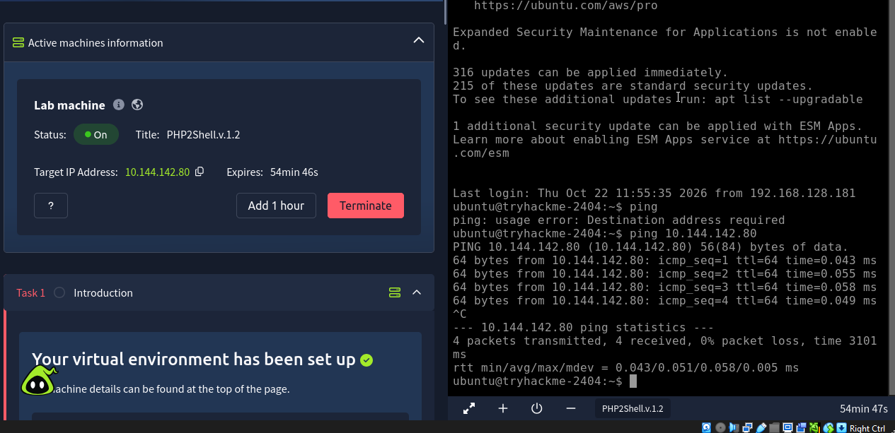

# PHP2Shell

10/23/2026

i’ve been seeing a lot about ‘php2shell’ lately, and just found out that THM actually has a room for it. i’ve been telling myself that i need to get up to speed on current events, instead of only focusing on techniques/methods/types of vulns, etc., so this can fall into that as well. i’d like this to be the beginning of a new norm, where i’m made aware, learn from, and study current events, and create demos/write ups for them, to put in my resume.

“This room takes you through the vulnerability from the ground up. You will see the harmless PHP feature it abuses, understand the single mistake in the engine that turns that feature into a weapon, and then run a working exploit against a vulnerable server in the lab to read a flag as the web server user. The focus throughout is on why the bug exists and why patching the application does nothing to stop it.”

“

## Learning Objectives

- Explain what `session.upload_progress` does and why it runs before any application code.
- Understand how a PHP memory bailout leaves a dangling pointer that survives into the next request.
- Distinguish the two CVEs: a memory-disclosure path and a remote-code-execution path.
- Run the public exploit chain to leak memory, defeat ASLR and execute a command.
- Detect the attack and apply the mitigations that actually work.

“



im able to ping the target IP.


“

When a browser uploads a large file, the server has no simple way to tell the page how far the upload has got.  solves this with a feature called

```
session.upload_progress
```

.”

so, i guess whenever your in a web browser, and you’re uploading a big file, the browser actually has to way to tell the page the progress of the upload. and PHP fixes that with ‘session.upload_progress’

10/24/2026

okay so maybe the above is true, maybe not. maybe what i’m about to say is like, the mechanism under the hood of how the above works, but this is now my understanding.

“explain what this means: PHP memory bailout leaves a dangling pointer that survives into the next request”

- **“Memory bailout”** — PHP has an internal error-recovery mechanism (in the engine, this is literally called a “bailout” — `zend_bailout()`). When something fatal happens mid-request — like PHP running out of memory — instead of letting execution continue normally and cleaning up step by step, PHP does an abrupt jump (technically a `longjmp`) back to a safe recovery point. Think of it like an emergency eject rather than a controlled landing: it skips the normal, orderly shutdown sequence.
- **Why that matters** — because it’s abrupt, some cleanup that *would* normally happen (freeing specific allocated memory, resetting references) can get skipped or done out of order. If some internal data structure still holds a reference to memory that the bailout freed (or didn’t finish initializing), that reference is now a **dangling pointer** — a pointer that still points to a memory address, but the data that used to live there is gone/invalid. Reading or writing through a dangling pointer is undefined behavior — that’s the classic root of a huge class of memory-corruption bugs (use-after-free is the close cousin of this).
- **“Survives into the next request”** — this is the part that turns a crash into an RCE. PHP-FPM or mod_php workers don’t get thrown away after every single request — a worker process handles many requests over its lifetime for performance reasons. If that dangling pointer lives in a *global* or *persistent* structure (not something scoped and destroyed per-request), it doesn’t get cleaned up when request #1 ends. So when the **next** HTTP request comes in and gets handled by that same worker, PHP’s internals may touch that same bad pointer again — except now the memory it points to might have been reallocated for something else entirely (maybe attacker-controlled request data). That’s the mechanism: request 1 corrupts/orphans a pointer via the bailout path, request 2 (potentially from the attacker) exploits the fact that the pointer is now stale and pointing at memory they can influence.

so, whenever php is running, and an error happens, instead of php finishing out the http request, it aborts, and jumps back to a safe spot, earlier in the process. because its abrupt and fast, sometimes, when the abort happens, php will still think that a certain space of memory has certain data inside of it, but in reality, it doesn’t, it’s empty.

and this is the dangling pointer. and the attacker, could manipulate/force the php error process to create the pointer, and then manipulate php to actually use that pointer, but instead of it pointing to ‘empty’ memory, the attacker could inject malicious code into it, therefore, getting php to run your own code, malicious code. so it’s a remote code execution. and as we now know, that’s pretty much GG. because essentially, if i can get something to run ‘any command’ that i want it to, i can pop a rev shell, or give myself higher privileges, or download a script or literally just whatever i need to do from tha point on to move forward in the ctf.

these are the credentials for the machine.


created a tryhackme dir, then a dir for php2shell, then i moved the openvpn config file to the dir, using ‘mv’ and moving it to ‘here’ with ‘.’.


‘every vuln abuses something that was created to be useful’. 

so we’re going to look at the feature that the bug is actually on.


so, when browser uploads file, php doesn’t have a function telling the page the progress of the upload.

php has a thing for this, named session.upload_progress.

while the file is being uploaded, and while php is still reading the incoming data of the POST request(the file being uploaded), it actively writes a static description of it as it comes in.

and this is being written to ‘$_SESSION’. 

then, the second part reads $_SESSION and That’s what tells the browser the progress of the upload.

and so, during the process, is what we’re focusing on here.

the key is exactly <u>when</u> this happens. 

and because this is one of the first things PHP does, and because of this, it doesn’t require a login or anything, because the execution hasn’t even reached the app or website layer of it, that even knows it needs to login to something. it hasn’t even reached that point yet. 

“This pre-execution window is the foothold. The whole of PHP2Shell happens inside it, driven entirely by what the attacker puts in an ordinary multipart upload, while the application that owns the server is still fast asleep.”

now, for this question/answer of this section.


so, essentially, php is writing a description of data it’s receiving into $_SESSION, as it comes in. it’s a default function. and it happens so early in the chain, that it’s even before the actual app’s layer, so it doesn’t require a login.


so, php has a function that happens during a file upload process. the vuln isn’t actually that specifically, it’s actually like, the specific timing of what happens during that function’s process.

the vuln as a concept is known as a ‘out-of-memory’ condition.

and this specific flaw is ‘
 If the out-of-memory condition strikes *after* the engine has freed a block of memory but *before*
 it has cleared the pointer that still refers to that block, the bailout
 leaves the pointer behind, pointing at memory that is no longer valid’


so, when the process happens, a block gets emptied, but the pointer remains. and, when the attacker can control what that pointer is pointing to, the attacker can trick the system to ‘point at it’, or essentially, just run whatever the attacker put there. which could be rev shell code or wget or literally whatever, that’s the juicy bit right there.

the system is no matter what going to execute one thing at a time, and essentially, the attacker just makes it to where the system executes malicious code.

and that’s why the PHP2Shell has 2 CVE numbers. one for the memery disclosure bit, and one for the Remote Code Execution.


both are just up above.


everything in this THM room runs on the machine itself. the vulnerable server is on lo:8088

the server is a container. so we list the containers and see the version of PHP it ships

command: docker ps `--format '{{.Names}}  {{.Image}}  {{.Status}}'`


this confirms the server is vulnerable, because the fix was at 8.4.27


command: docker exec php2shell-target php -v

this shows more info.

next i run curl on the specific page i’m targeting.

command: curl -s http://127.0.0.1:8088/index.php


The entire application is one line that prints `OK`. There is
 no login form, no file upload, no database, and certainly no bug in 
this code to exploit. That is the point worth pausing on: if the attack 
works against this page, it works against the runtime, not the 
application, and a real target such as a WordPress or Laravel site is no
 better protected simply because its own code is sound.

so, the server has the normal mod_php setup with session.upload_progress enabled as default. but it’s tweaked a little bit to set the memory_limit low, so we hit the condition reliably.

the PoC i’m going to use is already on the room’s machine.


both in notes already.


first, it shows the chunk base.

and then, the libphp. these are what was needed to defeast ASLR. 

ASLR is made for this reason. if the attacker knows where exactly in memory to point at, the attacker could manipulate things into tricking the system to running something the attacker injected.


it’s the header that gives PHPSESSID


This explains that “and instead calls sytstem() with attacker-controlled bytes as its argument”.

this is the malicious bit. so, the engine ends up running malicious bytes/codes, given by the attacker.


this shows the differenvce between the two.

the first, i run the exploit already on the machine. i run it against loopback 8088, and we get the leaks of the memory locations.

the second, does the same, and then also gives us the flag.


both are above.


the answer is above.


answer in text above.


this is the end of the room.


so, this room shows that not all vulnerabilities happen on the application layer and up. 

php2shell couldn’t be fixed by ‘updated WordPress’. or ‘update the app’ or ‘go fix the security of the software our stuff is on’.

that literally wouldn’t work or help, because the vulnerability is UNDER all that.

the malicious bit, and full exploit has already happened before the data even hits the app. the vuln was literally in the underlying systems itself. almost like the ‘OS’ of the website.

and essentially, what happened was, let’s say you have a website. wordpress. and, on wordpress, you upload a image.

by default php has a function, that is informing the website on the progress of the upload in real time. and, with the way this function works, it’s writing info to a certain variable, which is in php’s memory. and php had a vulnerability in the engine, to where you could trick php into messing up that process, and accidentally have the engine pointing at a certain block of memory. then, because you can force php to point at a certain block of memory, the attacker would inject malicious code into that block of memory, thereofre, you are forcing php to run whatever the attacker wants, which is always GG. something i’ve noticed as i learn more and more about pentesting, that always seems to be the critical moment. as soon as you can trick or hack or manipulate the app/system/user into running something ro doing something specific that the attacker wants (usually something like a backdoor or rev shell code), then it’s GG, and we popped shell.