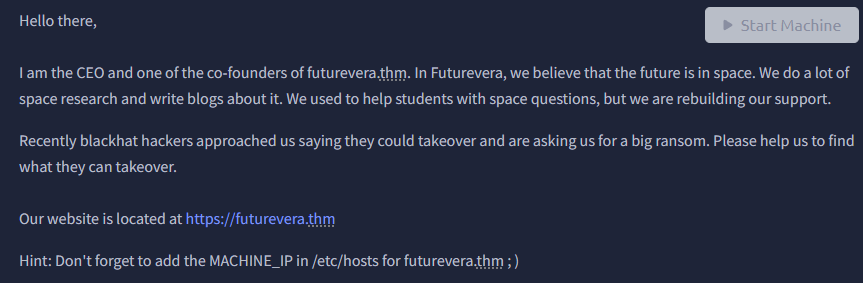

# TakeOver

This explains the lab. We are being asked to respond to a claim from hackers saying they could takeover and then ransom it back to the owners. We are to figure out what they could takeover and how.

We’re giving the URL of the website, and are given a hint to add the IP to the ‘/etc/hosts/’ file.

I start by ping’ing the IP address to make sure it’s up.

Running an nmap scan, we see that port 22/tcp is up which is SSH. There’s port 80 up, http, with a redirect to ‘https://futurevera.thm/’

I’ll add that to the /etc/hosts

In the room info, we’re told they’re rebuilding their support, so we add support.futurevera.thm to /etc/hosts

i’ll use firefox to go to that domain

now, adding support to the URL

you get this:

clicking on advanced, and then view certificate, we see another subdomain

adding it to /etc/hosts

when going to that URL, we get the flag.

tips for future:

